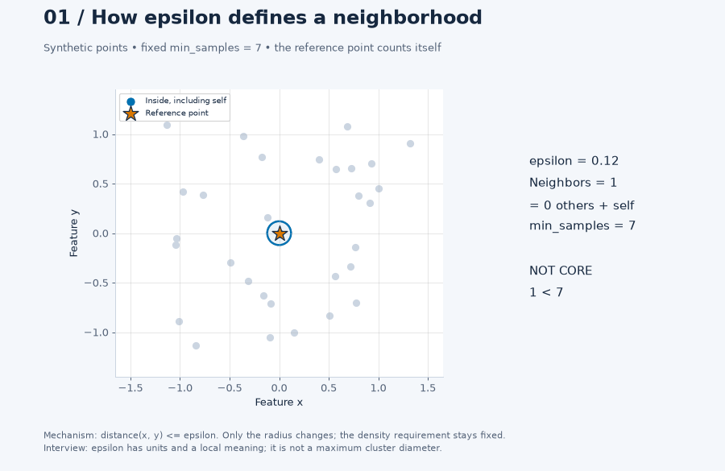
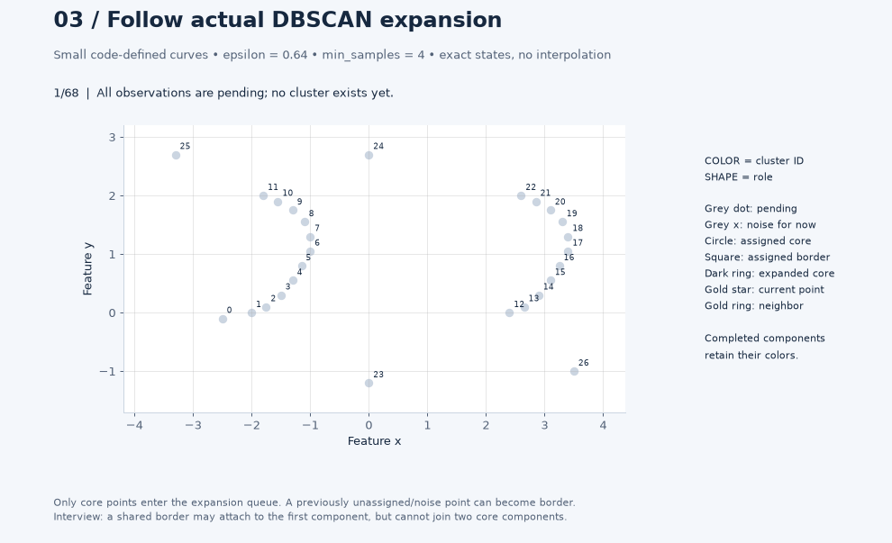
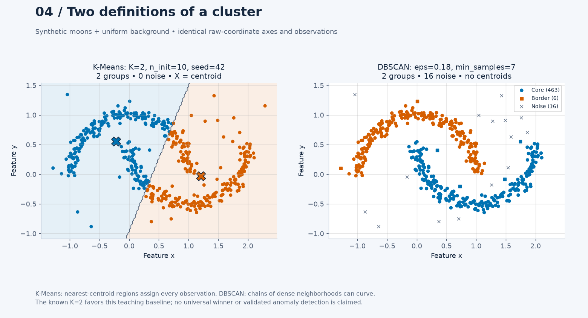

# Day 37 — DBSCAN and Density-Based Clustering

When should a cluster follow a curved dense region instead of a centroid?
DBSCAN answers with local neighborhood counts and connectivity. It discovers
a cluster count and can leave points unassigned, but its density thresholds
still require a meaningful representation and validation.

This study follows [K-Means](../36-k-means-clustering/) with an unweighted,
Euclidean DBSCAN implementation and a small scikit-learn comparison. All data
are synthetic; no external dataset or production outcome is claimed.

## What to inspect

- `eps` defines a neighborhood radius, not a maximum cluster diameter.
- `min_samples` includes the point itself. Core points meet that count;
  border points neighbor a core point without meeting it themselves.
- Clusters expand through core points. A chain of border points cannot merge
  two dense components. A shared border point can attach to either component
  depending on input order.
- Noise (`-1`) means unassigned under this density definition. It does not
  establish fraud, a data error or a business anomaly.

These distinctions matter in spatial hotspot discovery and exploratory
segmentation, where forced centroid assignments can hide sparse observations.
The [notes](notes.md) discuss geospatial units, density assumptions, evaluation,
memory costs and assignment of future observations.

## Files and execution

| File | Purpose |
|---|---|
| [example.py](example.py) | Two moons plus background; epsilon/density sweeps, K-Means comparison, self-inclusive k-distance quantiles and NumPy agreement checks |
| [from_scratch.py](from_scratch.py) | Educational queue-based expansion with explicit input errors and a small runnable example |
| [tests/test_dbscan.py](tests/test_dbscan.py) | Exact neighborhood semantics, border ambiguity, non-propagation, duplicates, degenerate cases and library agreement |
| [generate_visualizations.py](generate_visualizations.py) | Independent Matplotlib/Pillow and standalone offline Plotly exports |
| [dbscan_visual_core.py](dbscan_visual_core.py) | Deterministic teaching datasets, sensitivity grid, count density and geometric controls |
| [VISUAL_LAB.md](VISUAL_LAB.md) | Guided questions, artifact inventory, parameters, observations and limitations |
| [tests/test_visual_dbscan.py](tests/test_visual_dbscan.py) | Exact trace invariants, actual three-feature geometry, density counts, frames and export/CLI checks |
| [notes.md](notes.md) | Theory, engineering trade-offs, dated experiment evidence and interview questions |
| [references.md](references.md) | Original paper and official documentation |

From the repository root, using an activated stable Python 3.11+ environment:

```bash
python -m pip install -e ".[dev]"
python 02-unsupervised-recommender-systems/37-dbscan-density-based-clustering/example.py
python 02-unsupervised-recommender-systems/37-dbscan-density-based-clustering/from_scratch.py
python -m pytest -q 02-unsupervised-recommender-systems/37-dbscan-density-based-clustering/tests/test_dbscan.py
```

Dependency ranges remain in [pyproject.toml](../../pyproject.toml). The two study
scripts above print to the terminal and write no files. Visual generation is a
separate command:

```bash
python 02-unsupervised-recommender-systems/37-dbscan-density-based-clustering/generate_visualizations.py --all
python 02-unsupervised-recommender-systems/37-dbscan-density-based-clustering/generate_visualizations.py --visualization 3
```

Open the generated `outputs/index.html` beside the generator. The lab contains
ten core scenes and a supplementary high-dimensional distance control;
the [visual guide](VISUAL_LAB.md) explains each. Three GIFs, nine PNGs and three
standalone interactive HTMLs were generated. The three inspected previews below
are deliberately unignored **candidates**, pending author interpretation review.
Other exports, gallery, reports and browser inspection files remain ignored.

## Three preview candidates

**Count the reference observation itself.** The radius changes while the
required count stays fixed; watch the core threshold switch.



**Trace the actual queue expansion.** Point 0 starts as noise and later becomes
border. Only core points propagate connectivity; frames are exact engine states.



**Compare grouping rules on shared coordinates.** K-Means divides centroid
regions and assigns all points; DBSCAN follows local density and can abstain.



## Evidence and boundaries

The [dated experiment record](notes.md#executed-experiment--2026-10-29) specifies
the synthetic generator, parameters, versions, observed counts and interpretation
candidates. **Author review required** for those candidates. Tests validate
software behavior; they do not approve conclusions on the author's behalf.

The K-Means baseline assigns every point and uses the known generator count
of two. DBSCAN can abstain. Moon-only ARI includes unassigned moon points as a
single `-1` label and excludes the 35 background points; noise counts are
reported separately on both populations. This is an illustrative comparison
of assumptions, not a benchmark or a procedure for selecting optimal parameters.

The NumPy implementation stores quadratic distances and neighborhoods. It is
for small educational inputs, not a replacement for library implementations.
Global density thresholds can miss sparse groups or merge groups through
dense bridges. DBSCAN also provides no native scikit-learn `predict` method.

The main lesson is to validate the neighborhood definition, coverage and core
connectivity together. Discovering a cluster count does not remove model choice.
