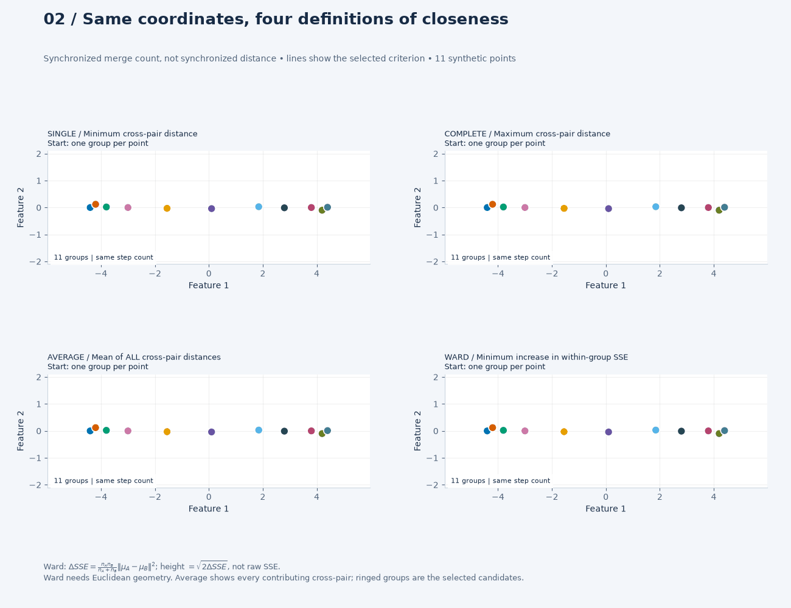
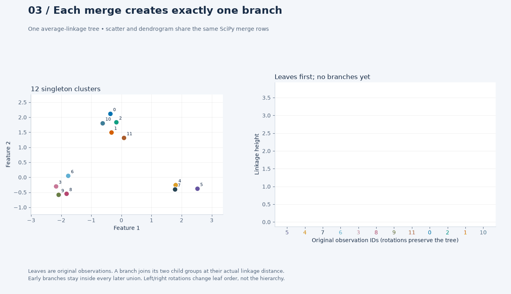
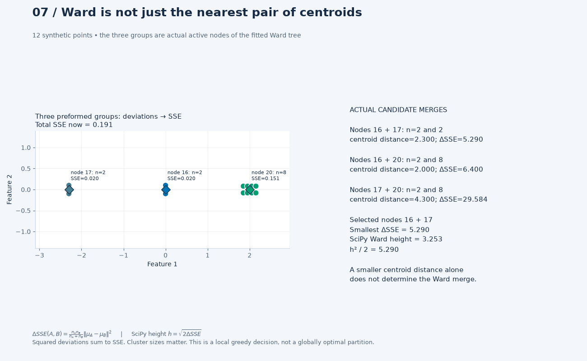

# Day 38 — Hierarchical Clustering

What changes when a clustering result must preserve nested groups? Agglomerative
clustering starts with singleton observations and repeatedly merges two groups.
Its linkage criterion defines which merge is closest; a full hierarchy supports
several levels of granularity without refitting.

This study follows [K-Means](../36-k-means-clustering/) and
[DBSCAN](../37-dbscan-density-based-clustering/) with single, complete, average
and Ward linkage. It is useful for exploratory segmentation, document taxonomy
discovery and inspecting related observations at several resolutions. All data
here are synthetic; no semantic taxonomy or production outcome is validated.

## What the hierarchy means

| Linkage | Merge criterion | Main caution |
|---|---|---|
| Single | Minimum cross-cluster point distance | Bridges can chain large groups together |
| Complete | Maximum cross-cluster point distance | Extreme observations influence the criterion |
| Average | Mean of all cross-cluster point distances | Depends on representation and the chosen dissimilarity |
| Ward | Smallest increase in within-cluster SSE | Requires Euclidean geometry; merges are irreversible |

A dendrogram represents the same merge tree: leaves are observations, internal
nodes are merges and height is linkage-dependent dissimilarity. Ward's displayed
height is $\sqrt{2\Delta SSE}$ under the SciPy/scikit-learn convention used here.
Leaf ordering is not an extra similarity measurement, and heights are not
probabilities. A large gap can motivate a cut for investigation; it does not
establish the correct number of clusters.

The scripts inspect merge IDs, heights, counts and cuts in the terminal.
Equal merge heights can prevent a horizontal threshold from producing exactly
K groups, even when a merge-order cut does. The separate
[visual lab](VISUAL_LAB.md) adds exact-state animations and offline explorers;
the two original study scripts still print only terminal results.

## Files and execution

| File | Purpose |
|---|---|
| [example.py](example.py) | Four-linkage comparison, Ward cuts at K=2–5, full-tree conversion and a tied-height check |
| [from_scratch.py](from_scratch.py) | Educational NumPy average linkage with deterministic tie handling and SciPy-format output |
| [tests/test_hierarchical.py](tests/test_hierarchical.py) | Hand-calculated merges, unequal cluster sizes, library agreement, Ward height units, nested cuts and input errors |
| [notes.md](notes.md) | Formulas, dendrogram interpretation, scaling, trade-offs, dated measurements and interview questions |
| [references.md](references.md) | Official APIs and algorithm reference |
| [visualize_hierarchical.py](visualize_hierarchical.py) | Ten independent scenes: merge GIFs, incremental dendrograms, interactive cuts/3D/embedding distances and pairwise storage |
| [VISUAL_LAB.md](VISUAL_LAB.md) | Scene-to-concept guide, commands, visual-phase evidence and limitations |
| [tests/test_visual_hierarchical.py](tests/test_visual_hierarchical.py) | Actual merge states, SciPy dendrogram geometry, controlled chaining/Ward/scaling, offline controls and temporary exports |

From the repository root with an activated stable Python 3.11+ environment:

```bash
python -m pip install -e ".[dev]"
python 02-unsupervised-recommender-systems/38-hierarchical-clustering/example.py
python 02-unsupervised-recommender-systems/38-hierarchical-clustering/from_scratch.py
python -m pytest -q 02-unsupervised-recommender-systems/38-hierarchical-clustering/tests/test_hierarchical.py
```

Dependencies remain centralized in [pyproject.toml](../../pyproject.toml).
Both scripts print results and write no files. No new dependencies are required.

Generate all visual scenes, or select one independently:

```bash
python 02-unsupervised-recommender-systems/38-hierarchical-clustering/visualize_hierarchical.py --all
python 02-unsupervised-recommender-systems/38-hierarchical-clustering/visualize_hierarchical.py --scene 3
python 02-unsupervised-recommender-systems/38-hierarchical-clustering/visualize_hierarchical.py --scene 1 --fast --output-dir 02-unsupervised-recommender-systems/38-hierarchical-clustering/outputs/fast
```

Open `outputs/index.html` beside the generator. The HTML explorers are standalone
and work without a server or internet. Existing complete scenes are skipped;
use `--force` to explicitly regenerate them. `--fast` reduces resolution and
speeds playback while preserving every mathematical state. See the guide before
using the visual controls as interview evidence.

## Selected visual previews

The inspected GIFs below are deliberately unignored preview candidates. Their
interpretations still require author review. Other GIFs, the PNG, standalone
HTMLs, gallery, run records and inspection files regenerate locally and remain
ignored; see the [visual guide](VISUAL_LAB.md).

**Follow the criterion:** identical coordinates, four linkage definitions.



**Match the operation to the branch:** scatter and dendrogram share one tree.



**Separate centroid distance from Ward cost:** cluster sizes can change the choice.



## Evidence and takeaways

The [2026-10-29 experiment record](notes.md#executed-experiment--2026-10-29)
documents configuration, versions, measured results and limitations.
**Author review required** for interpretation candidates; passing software tests
does not approve scientific conclusions on the author's behalf.

On these deliberately separated blobs, all four methods produce the same
K=3 partition. This illustrates a limit of the dataset, rather than a general
ranking of linkage methods. The Ward K sweep explores one fixed hierarchy;
it is not independent evidence that three clusters are correct in other data.

The key decisions are the representation, dissimilarity, linkage and useful
granularity. Ward shares an SSE objective with K-Means but follows a different
greedy path. Standard agglomerative clustering assigns every fitted observation
and offers no native scikit-learn `predict` rule for new observations.

The NumPy implementation is deliberately slow and intended for small inputs.
Unstructured library implementations also face quadratic pairwise memory costs.
Use domain review, perturbation/stability checks and downstream validation before
treating a hierarchy as an operational taxonomy or segmentation policy.
