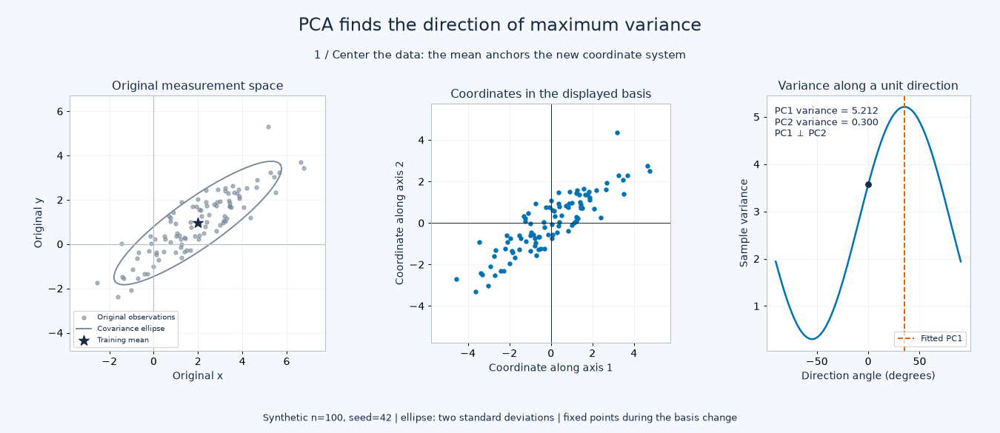
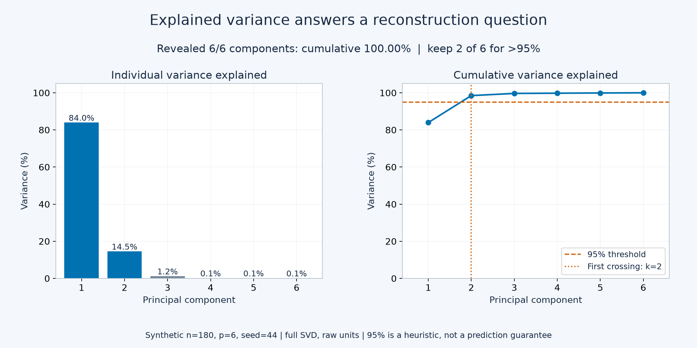
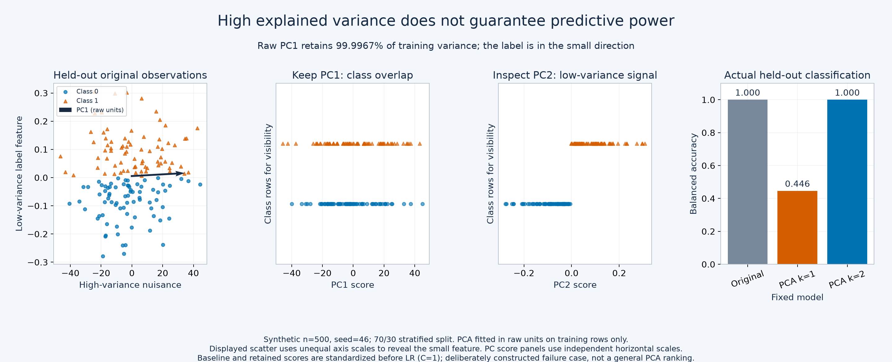

# Day 39 — PCA in Practice

How much can a linear projection discard while retaining useful information?
Principal Component Analysis creates orthogonal directions ordered by training
variance. Keeping only the leading directions compresses the representation;
it optimizes squared reconstruction error, with no knowledge of a target label.

This study extends the [Day 4 linear algebra foundations](../../00-foundations/04-eigenvalues-eigenvectors-pca-svd/)
into applied decisions: scaling, selecting dimensions, inspecting direction
weights, projecting new observations and measuring what reconstruction loses.
PCA can help with correlated sensors, compact numerical representations and
exploratory analysis. Its usefulness for prediction requires separate evidence.

## What is compared

- **Wine classification:** standardized logistic regression with no PCA, two
  PCs or a 95%-variance rule. Identical stratified folds compare fixed candidates
  within the training partition. Only the CV-selected candidate receives a
  final test-label score. Scaling and PCA are fitted inside every fold.
- **Representation diagnostics:** raw versus standardized PC1 variance, leading
  direction weights and train/held-out reconstruction at different dimensions.
  Reconstruction MSE is measured in standardized feature units.
- **Synthetic counterexample:** a large-variance nuisance feature and a
  small-variance label signal. Deliberately unscaled one-component PCA tests
  whether high explained variance can coexist with poor classification.
- **Numerical internals:** a small NumPy covariance eigendecomposition exposes
  centering, projection and inverse transformation. Tests compare subspaces
  against full-SVD scikit-learn PCA, allowing arbitrary axis signs.

Wine is **real public data**, loaded locally with scikit-learn: 178 chemical
analyses, 13 numerical features and three cultivar classes. It is the UCI Wine
dataset, distinct from Wine Quality. Source: Aeberhard and Forina (1992),
[UCI Wine, DOI 10.24432/C5PC7J](https://archive.ics.uci.edu/dataset/109/wine),
licensed CC BY 4.0. No dataset is downloaded or copied into this repository.
The counterexample and NumPy demo are explicitly synthetic.

## Files and execution

| File | Purpose |
|---|---|
| [example.py](example.py) | Fold-local Wine comparison, reconstruction diagnostics and synthetic failure case |
| [from_scratch.py](from_scratch.py) | Educational dense covariance PCA, frozen transforms and synthetic reconstruction demo |
| [tests/test_pca.py](tests/test_pca.py) | Hand calculations, variance identities, SVD agreement, rank/tie cases, input errors and fold-local fitting |
| [notes.md](notes.md) | Geometry, scaling conventions, interpretation, interview questions and dated experiment evidence |
| [references.md](references.md) | Dataset attribution and primary documentation |
| [visualize_pca.py](visualize_pca.py) | CLI for eight independent animated, static and interactive demonstrations |
| [pca_visual_core.py](pca_visual_core.py) | Deterministic generators, fitted transforms and exact reconstruction states |
| [pca_visualizations.py](pca_visualizations.py) | Matplotlib renderers and the standalone Plotly 3D explorer |
| [VISUAL_LAB.md](VISUAL_LAB.md) | Execution guide, interpretation boundaries and separate dated visual-phase evidence |
| [tests/test_pca_visuals.py](tests/test_pca_visuals.py) | Projection geometry, inverse scaling, training boundaries and temporary offline exports |

From the repository root, with an activated stable Python 3.11+ environment:

```bash
python -m pip install -e ".[dev]"
python 02-unsupervised-recommender-systems/39-pca-in-practice/example.py
python 02-unsupervised-recommender-systems/39-pca-in-practice/from_scratch.py
python -m pytest -q 02-unsupervised-recommender-systems/39-pca-in-practice/tests/test_pca.py
```

Dependencies remain in [pyproject.toml](../../pyproject.toml); no new extra is
needed. The two original study scripts print results and write no files.
The separate visual CLI exports to `outputs/` beside the script.

## Visual laboratory

```powershell
python 02-unsupervised-recommender-systems/39-pca-in-practice/visualize_pca.py --list
python 02-unsupervised-recommender-systems/39-pca-in-practice/visualize_pca.py --all
python 02-unsupervised-recommender-systems/39-pca-in-practice/visualize_pca.py --demo 3d
```

Open `outputs/index.html` locally after generation. The 3D HTML embeds Plotly
and works offline: drag to rotate, scroll to zoom, hover to inspect rows and
select k=1/2/3 for exact reconstruction, retained variance and MSE. It works
independently of the GIFs. The [visual guide](VISUAL_LAB.md) explains every demo,
`--fast`, `--show`, `--output-dir`, and explicit `--force` regeneration.

Three inspected preview candidates are deliberately unignored; other exports,
the HTML and run/inspection records regenerate locally and remain ignored.
**Author review required** for the visual interpretation candidates.

**Change the basis, then discard a coordinate:** the original points stay fixed
during the basis phase; projection is a separate step.



**Choose a variance threshold:** ratios come from the fitted synthetic model.



**Check the task:** a deliberately small-variance label signal can be lost.



## What a Senior ML Engineer Should Understand

PCA preserves variance and optimizes linear reconstruction, with no guarantee
of predictive or semantic relevance. Scale and outliers change its directions;
components and scores have arbitrary signs. Any proposed storage or computation
benefit needs measurement against task quality. At inference, keep feature order,
fitted scaling/centering and the component version consistent.

## How to read the evidence

The [dated experiment record](notes.md#executed-experiments--2026-10-29) separates
configuration, measurements, interpretation candidates and limitations.
**Author review required:** passing tests verifies specified software behavior;
it does not approve the interpretations on the author's behalf.

Explained variance is a property of a fitted representation. It is neither a
classification score nor the percentage of semantic information preserved.
Direction weights describe combinations of features, not causal effects.
The 95% rule is fitted on training features, and can choose different dimensions
across CV folds. Fold-score standard deviation is descriptive, not a confidence
interval or evidence of a statistically significant model difference.

The Wine comparison uses one small split and fixed `C=1`; it is not an exhaustive
hyperparameter search or a production benchmark. The synthetic counterexample
deliberately favors a particular failure mode. The NumPy implementation stores
a dense covariance matrix, does not scale or whiten, and rejects zero total
variance. Use tested library solvers for practical workloads.
