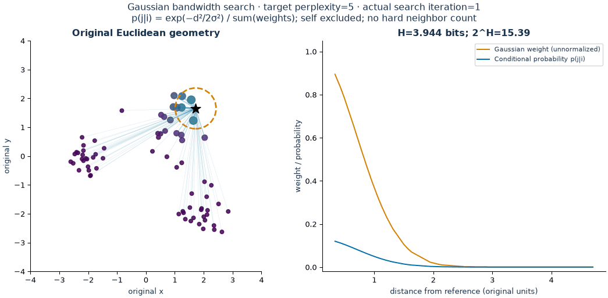
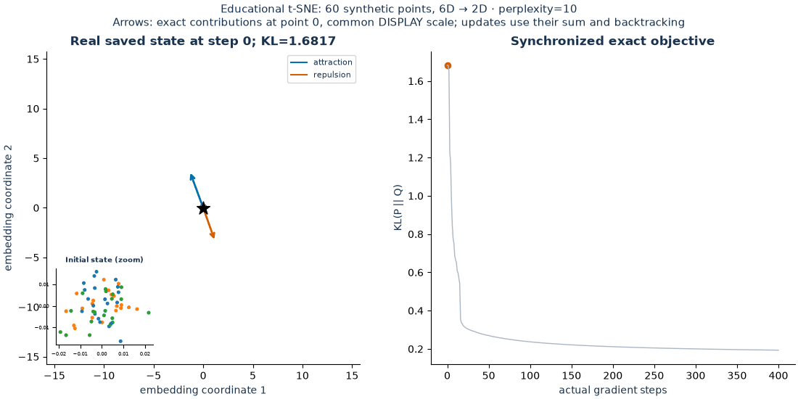
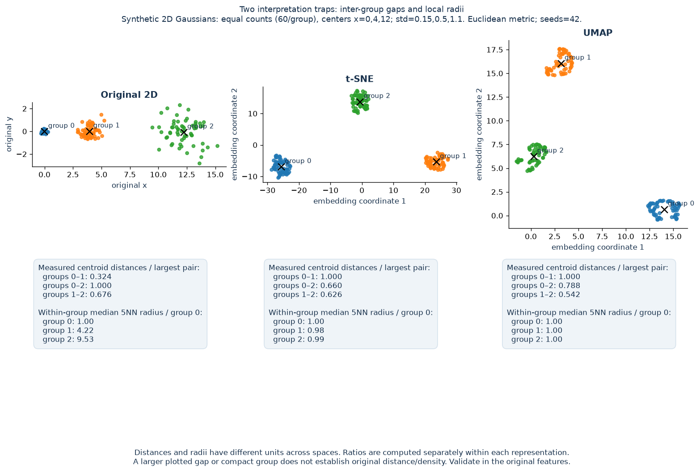

# Day 40 — t-SNE and UMAP

Which high-dimensional neighbors survive a two-dimensional embedding, and what
would be a mistake to infer from its layout? t-SNE fits similarity probabilities;
UMAP fits a fuzzy neighborhood graph. Both are useful for exploring image,
document and other learned representations. Neither makes a 2D gap, compact
group or isolated point sufficient evidence of a real cluster or anomaly.

This study follows [PCA in practice](../39-pca-in-practice/). PCA supplies a
linear baseline; nonlinear methods add neighborhood-focused objectives and
additional sensitivity to initialization and configuration. There is no
universal winning representation for visualization, clustering and retrieval.

## Executable questions

- On identical **public handwritten digits**, how do PCA, t-SNE and UMAP compare
  in trustworthiness and original-neighbor recall at k=10 and k=30?
- Holding the sample fixed, what changes when t-SNE perplexity goes from 30 to
  50 or UMAP `min_dist` goes from 0.1 to 0.8? How much do neighbors agree across
  seeds 42 and 21 with the baseline settings?
- Does the analytical gradient of a small, fixed-bandwidth t-SNE objective
  agree with finite differences? Does a specified synthetic descent run reduce
  that objective?

The original study scripts print numerical diagnostics. The separate
[offline visual laboratory](VISUAL_GUIDE.md) adds ten demonstrations, five
interactive Plotly explorers, three GIFs and eight explanatory figures.

The real dataset is scikit-learn's bundled `load_digits`: 1,797 images encoded
as 64 pixel-block counts in [0,16], from the UCI Optical Recognition of
Handwritten Digits dataset. It is distinct from MNIST. The example samples 800
rows without replacement and divides counts by 16. Digit labels are never
passed to fitting or used to select settings. See [dataset attribution and
primary references](references.md). The from-scratch demo uses **synthetic** data.

## Files and execution

| File | Role |
|---|---|
| [example.py](example.py) | Seven fixed PCA/t-SNE/UMAP fits, neighborhood diagnostics, seed agreement and environment/configuration metadata |
| [from_scratch.py](from_scratch.py) | Dense fixed-bandwidth affinities, exact KL gradient and a small synthetic descent demo |
| [tests/test_tsne_umap.py](tests/test_tsne_umap.py) | Probability invariants, finite-difference gradients, geometric invariance, neighbor ties/input errors and three-library integration smoke |
| [notes.md](notes.md) | Theory, interpretation mistakes, interview questions, dated measurements and proposed follow-ups |
| [references.md](references.md) | Dataset provenance, papers and official APIs |
| [visualize.py](visualize.py) | CPU-only visual CLI, bounded quick/standard profiles and dated run records |
| [manifold_visual_core.py](manifold_visual_core.py) | Perplexity search, recorded gradient steps, real fitted graphs/embeddings, caching and measurements |
| [manifold_visualizations.py](manifold_visualizations.py) | Explanatory offline HTML, Matplotlib figures and Pillow animations |
| [VISUAL_GUIDE.md](VISUAL_GUIDE.md) | Learning path, commands, mathematical caveats and separate visual-phase evidence |
| [tests/test_visual_lab.py](tests/test_visual_lab.py) | Probability/gradient/graph invariants, genuine 3D fits, fit-cache identity and temporary exports |

From the repository root, in an activated **stable Python 3.11+** environment:

```bash
python -m pip install -e ".[dev,manifold]"
python 02-unsupervised-recommender-systems/40-t-sne-umap/example.py
python 02-unsupervised-recommender-systems/40-t-sne-umap/from_scratch.py
python -m pytest -q 02-unsupervised-recommender-systems/40-t-sne-umap/tests/test_tsne_umap.py
```

Dependency bounds live in [pyproject.toml](../../pyproject.toml). UMAP's Numba
compilation can make the first run slower. `example.py --samples 200` reduces
the sample for a quick check; valid sizes are 61–1,797 because evaluation at
k=30 requires more than 60 observations. Changing `--sample-seed` changes the
sample; embedding seeds remain fixed for controlled comparisons.

Both scripts write JSON to stdout and create no output files. If saving results,
use an ignored `outputs/` directory and a new dated filename for each run.
Do not overwrite the historical measurements in the notes.

## Offline visual laboratory

```powershell
python 02-unsupervised-recommender-systems/40-t-sne-umap/visualize.py --quick --output-dir .local/portfolio-review/day40-quick
python 02-unsupervised-recommender-systems/40-t-sne-umap/visualize.py --all
```

Open `outputs/index.html` beside the generator. It provides a learning path from
Swiss Roll geometry and genuine 3D digits embeddings through probability search,
actual t-SNE optimization, UMAP graph construction, parameter comparisons and
four interpretation traps. The HTML files use a shared local Plotly bundle;
no web server or network connection is required.

Use `--interactive`, `--animations`, `--experiments`, or `--demo NAME` for subsets.
Existing complete modules are skipped when source/profile match; use a separate
`--output-dir` for another profile or explicit `--force` to regenerate visuals.
Fit caches retain original measured fit times. The [guide](VISUAL_GUIDE.md)
explains exact commands, profiles, limitations and all generated assets.

The visual phase uses 400 public digits and 500 synthetic Swiss Roll points by
default, while the earlier numerical study uses 800 digits. Its t-SNE seed
experiment deliberately randomizes initialization. These are separate runs with
separate configurations; historical measurements remain intact.

Three inspected previews are deliberately unignored; HTML, other figures/GIFs,
caches and dated run records remain regenerable and ignored. **Author review
required** for the interpretation candidates.

**Match entropy rather than count hard neighbors:** the circle shows sigma,
and the frames are real bandwidth-search states.



**Watch actual KL updates:** the main limits stay fixed, the inset exposes the
initial random coordinates, and arrows use a declared common display scale.



**Check geometry in the original space:** equal population counts coexist with
changed centroid-distance and local-radius ratios after nonlinear mapping.



## Reading the evidence

[Executed experiments — 2026-10-30](notes.md#executed-experiments--2026-10-30)
record hypotheses, exact settings, versions, results and limitations.
**Author review required:** interpretation candidates remain pending; software
tests do not establish personal review or downstream model quality.

Trustworthiness penalizes false neighbors according to their original ranks.
Neighbor recall measures the fraction of original kNNs retained. Neither
measures global geometry, original density, semantic relevance or retrieval
quality. All digits diagnostics are in-sample exploratory measurements; there
is no predictive train/test experiment or speed benchmark here.

The original `from_scratch.py` optimizer uses one shared Gaussian bandwidth. It deliberately
omits perplexity matching, early exaggeration, momentum, adaptive optimization
and scalable approximations. It requires quadratic pair storage and is suitable
only for small inputs; it is not a library replacement or a full t-SNE implementation.
The visual optimizer separately matches per-row perplexities and records real
backtracked updates; it also omits production t-SNE acceleration and exaggeration.
Its saved trajectories are distinct from parameter sweeps, which switch whole
models. UMAP scenes show construction stages and genuine final fits, without an
invented optimization path.

## Key takeaways

- The original representation and distance metric define what a neighbor means.
  Common pixel scaling preserves Euclidean neighbor ranks; per-feature
  standardization would change the question.
- Perplexity is an entropy-derived effective neighborhood size. It is neither
  UMAP's graph neighbor count nor the evaluation k.
- UMAP `min_dist` influences packing; tighter groups do not establish stronger
  original-space separation. Independent fits have no shared coordinate system.
- Check original-space neighbors and stability before interpreting a layout.
  Validate clustering and retrieval on the task they are meant to serve.
- For predictive use, fit learned preprocessing on training data. UMAP provides
  an approximate held-out transform; scikit-learn t-SNE has no `transform()`.
