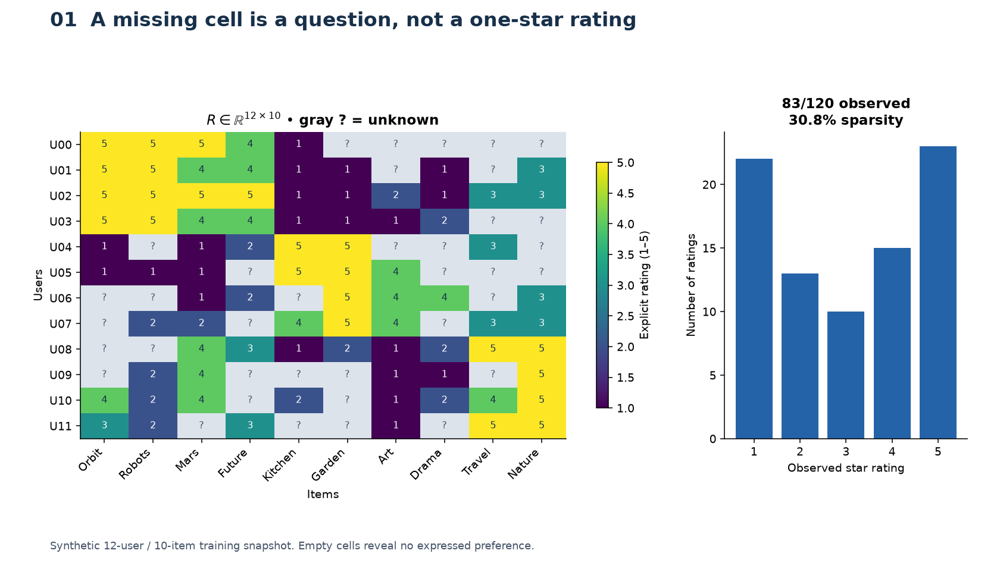
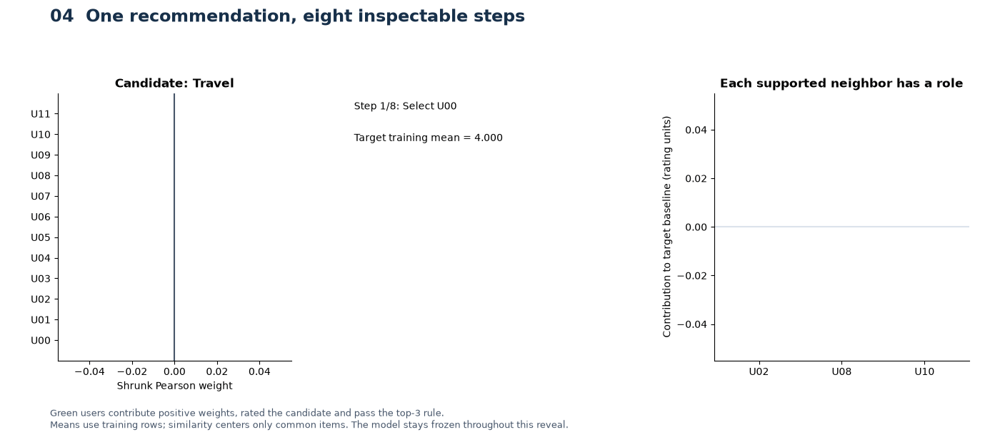
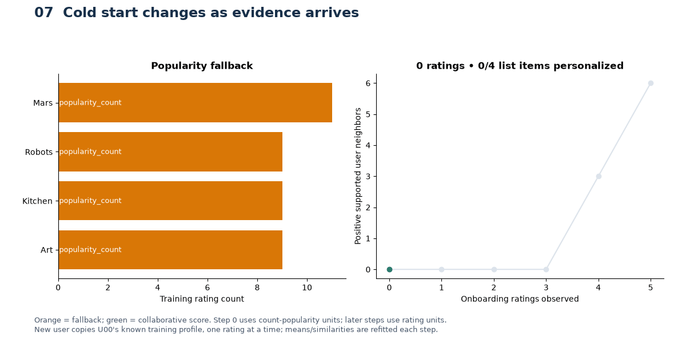

# Day 42 — Offline Recommendation Learning Lab

[Topic study](README.md) · [Generator](visualize_day42.py) · [Numerical tests](tests/test_visual_lab.py)

The lab makes the evidence behind a recommendation inspectable: observation
masks, shared-item support, normalized neighbor contributions, learned dot
products, cold-start policies and evaluation boundaries. All ten scenes run on
CPU with synthetic data. No downloads, APIs, services or browser windows are
started by the generator.

## Install and explore

Use the repository's stable Python 3.11+ environment and canonical dependencies
(the lab introduces no extra package or separate requirements file):

```bash
python -m pip install -e ".[dev]"
```

From this topic directory:

```bash
python visualize_day42.py --list
python visualize_day42.py --all
python visualize_day42.py --scene 5
python visualize_day42.py --fast
python visualize_day42.py --all --animate-matrix
python -m pytest -q tests/test_visual_lab.py
```

From the repository root, prefix the script path with
`02-unsupervised-recommender-systems/42-recommender-systems-i/`.
`--scene N` independently generates any scene from 1 through 10. Without a
selection, the default is all ten scenes; `--fast` also generates all ten.
The modes `--all`, `--scene` and `--list` are mutually exclusive.

Open `outputs/day42/index.html` in a browser for the gallery, then open
`outputs/day42/05_factorization_3d.html` for the 3D explorer. Its Plotly JavaScript
is embedded: user selection, saved-epoch slider, rotation, zoom and hover work
without an internet connection. Candidate vectors are orange rays from the
origin; the green ray is the selected user. The table gives the actual global
mean, biases, dot product, total score and Euclidean distance for every unseen
candidate. Larger item markers identify these candidates; smaller ones are
training-observed items. The axes have no assigned preference labels.

`--fast` saves fewer optimizer checkpoints/animation frames and runs four rather
than twelve repeated sparsity perturbations. It uses the **same training data,
loss, dimensions, epochs and final factor predictions**. Its output is separated
under `outputs/day42/fast/`. The eight arithmetic steps and six onboarding states
are retained because each is meaningful. `--output-dir PATH` provides a separate
destination for inspection or experiments. Different profiles cannot share a
catalog. A changed source fingerprint starts a fresh gallery catalog; dated run
records are preserved. Stable artifact filenames are refreshed on regeneration.

Recommended order: 1 → 2 → 3 → 4 → 5 → 6 → 7 → 8 → 9 → 10. For a shorter
session, focus on 1, 3, 4, 5, 7 and 8. Read the captions before comparing curves.

## Ten visual questions

Each row explains what to look at, the calculation, what to notice, how it
connects to an application and the main simplification.

| Scene | What am I looking at? | Calculation and what to notice | Real-system connection | Main limitation |
|---|---|---|---|---|
| 1 — Matrix | Annotated 12×10 ratings and their distribution; optional interaction reveal | $R\in\mathbb{R}^{12\times10}$; gray question marks differ from low observed ratings; title reports measured sparsity | Sparse histories define where evidence exists | Teaching groups and observation mask are synthetic; reveal order is row order, not event time |
| 2 — Feedback | Separate rating and click matrices, event counts and confidence curves | $p_{ui}=\mathbb{1}[n_{ui}>0]$, $c_{ui}=1+\alpha n_{ui}$ for **click counts**; increasing alpha increases weight, not binary preference | Choose interaction semantics and log exposure before fitting | Fictional nested impressions/views/clicks/purchases; confidence is not calibrated certainty |
| 3 — Similarity | Four similarity heatmaps, supported-user graph, paired ratings and deviations | Raw cosine, full-row centered cosine, overlap Pearson and $n/(n+\beta)$ shrinkage differ; pair annotation gives numerator and denominator | Minimum support, centering and neighbor selection affect recommendations | Graph positions are a circular layout; support curves hold correlation fixed; neither gives uncertainty intervals |
| 4 — Arithmetic | Eight-stage GIF, weight bars, identifiable contributions and final candidate ranking | Each contribution is $w_{uv}(r_{vi}-\bar r_v)/\sum_v w_{uv}$; add target mean and clip to 1–5 | A prediction can expose its supporting neighbors and fallback source | Animation reveals one frozen model; no online update or causal explanation |
| 5 — Factors | Training curves, dot-product/distance comparison, optimizer GIF and interactive 3D factors | Masked gradient descent learns $\mu+b_u+b_i+p_u^\top q_i$; table and vectors update with user and epoch | Learned retrieval representations combine behavior across the interaction graph | Axes are not interpretable categories; training loss is not held-out quality; scores are unbounded estimates |
| 6 — Reconstruction | Training observations, full predictions, training residuals and mask; dimension comparison | Errors are displayed only where training labels exist; extra dimensions change capacity and optimization | Separate reconstruction of known entries from generalization | Same finite optimizer budget, one seed and L2; no monotonic fit or test-quality guarantee |
| 7 — Cold start | New-user GIF, support trajectory, thinning sweep and new-item/content comparison | Refit after each observed onboarding rating; orange fallback becomes green only with usable evidence | Route new users/items to explicit fallback, content or exploration policies | Onboarding copies a known synthetic training profile; content example is a separate hand-declared category rule |
| 8 — Evaluation | Held-out MAE bars, two hand-checkable lists and a learned candidate ranking | Same top-3 relevant count can yield different NDCG because discount depends on rank | Measure rating error separately from candidate retrieval and order | Synthetic full-information ranking labels differ from the held-out-rating population; no online-effectiveness claim |
| 9 — Exposure | Shown/clicked counts and concentration trajectories, animated over rounds | Count-weighted selection gives some items more chances to click even with equal propensity | A recommendation policy shapes future training evidence | One seeded trajectory; no user heterogeneity, position effects or fatigue; impressions alone do not debias observations |
| 10 — Pipeline | Events → matrix → training → retrieval → ranking → recommendations → new interactions | Follow the feedback arrow; identify cold-start branch, offline evaluation and online monitoring | Connect model internals to a permission-aware recommendation system | Architectural diagram only; no deployed infrastructure |

## Numerical definitions and assumptions

`recommender_visual_core.py` constructs three preference templates, perturbs and
clips ratings to 1–5, and fixes disjoint training and held-out masks with seed 42.
The resulting training matrix has 83 observations out of 120; 23 other entries
are held out for rating evaluation, and 14 have neither training nor rating-test
labels. The generator additionally knows the full **synthetic** preference matrix;
it is not a claim that real unobserved user preferences are available.

Only the masked training matrix enters either model. The visual dataset is a
fixed synthetic holdout, with no temporal claim. The earlier eight-pair study's
artificial-time experiment remains a separate historical record in `notes.md`.
Future study suggestions there are not implicitly executed by this lab.

The neighborhood model reuses [from_scratch.py](from_scratch.py): overlap-local
Pearson, at least three common ratings, shrinkage five, at most three positive
neighbors who rated the target item, and full training-user means for prediction.
Fallback is training item mean → user mean → global mean. List generation excludes
seen items and unsupported catalog columns. Scene 7's **first** state deliberately
uses count-popularity instead, with a separately labeled axis; counts are never
compared numerically with later rating scores.

The educational factorization minimizes

$$
\mathcal{L}=\frac{1}{|\Omega|}\sum_{(u,i)\in\Omega}
 (\mu+b_u+b_i+p_u^\top q_i-r_{ui})^2
+\lambda\left(\|P\|_F^2+\|Q\|_F^2+\|b_u\|_2^2+\|b_i\|_2^2\right).
$$

It uses simultaneous full-batch gradient updates, a fixed training global mean,
three dimensions, 240 epochs, learning rate 0.08 and L2 coefficient 0.02. Missing
entries supply **no residual**, unlike zero-filled SVD. Empty entities start with
zero factors; a fitted factor for a completely unobserved item is not learned
preference evidence. Predictions are not clipped; colors use a bounded display
scale. Neighborhood predictions are clipped, so their MAE comparison also reflects
different scoring policies. No parameters are selected using evaluation labels.

For a common orthogonal matrix $A$, replacing $P,Q$ by $PA,QA$ preserves their
dot products. More general invertible paired transformations can preserve the
product but change the L2 penalty. Distance rankings depend on vector norms and
are not a substitute for dot-product scores; biases also contribute to the final
rating. The UI shows distances only for comparison.

Scene 8 defines two distinct ranking demonstrations. The hand example has full
candidate universe `{A,B,C,D,E}`, relevant set `{A,C}`, binary gains and $K=3$.
Lists `A,C,B,D,E` and `B,C,A,D,E` both recover two relevant items. Precision is
$2/3$, recall is 1 and NDCG is respectively 1 and approximately 0.693426, using
$1/\log_2(rank+1)$ discounts. The **learned** ranking scores all five U00 items
missing from training; relevance uses synthetic ground-truth rating ≥3. These
labels never enter fitting. There is no negative sampling or catalog restriction
to just the observed test positives.

Scene 7's sparsity coverage is the fraction of fixed held-out queries backed by
at least one valid collaborative neighbor. Its stability statistic is mean
per-query prediction standard deviation across repeated training-mask thinning.
It measures sensitivity, not accuracy, and can be nonmonotonic when fallback
takes over. The full profile uses twelve repeats at each keep fraction; fast
uses four and therefore reports different Monte Carlo summaries.

Scene 9 uses 30 rounds of 80 impressions, with replacement, click probability
0.25 for every item and initial count prior `[8,2,1,1,1,1]`. One policy samples in
proportion to prior plus cumulative clicks; the other mixes that distribution
with 25% uniform exploration. Concentration is the sum of squared normalized
prior-plus-click counts (HHI), not a real-platform measurement.

## Generated assets and publication policy

The full run generates 14 PNGs, four GIFs, one standalone Plotly HTML and the
gallery. `--animate-matrix` adds a fifth GIF. File prefixes identify the scene:
`01_user_item_matrix`, `02_explicit_implicit`, `03_similarity_comparison`,
`03_pair_and_shrinkage`, `04_neighborhood_calculation`, `04_neighborhood_steps`,
`05_factorization_training`, `05_factorization_3d`, `05_factor_training`,
`06_matrix_reconstruction`, `06_capacity_comparison`, `07_cold_start`,
`07_sparsity`, `07_new_item`, `08_evaluation`, `09_exposure_bias`,
`09_feedback_loop` and `10_recommendation_pipeline`.

Each generation also writes a timestamped `run-*.json` containing hypotheses,
configuration, versions, observations, interpretation status, source fingerprint
and artifact hashes. `catalog.json` describes the current gallery. These reports
and HTML files remain ignored and regenerable. Stable asset names can be
overwritten by a later run; dated reports describe their bytes at generation.
The generator does not open browsers or blocking Matplotlib windows.

Only three inspected previews are selected as public Git candidates:







These previews illustrate three different evidence boundaries. Other exports,
the approximately 4.7 MiB embedded Plotly HTML, inspection images and reports
remain local. Regenerating previews does not signify approval of interpretations.

## Verification and review

The tests check masks, support, symmetry, shrinkage, weighted-score arithmetic,
factor shapes and deterministic predictions, finite-difference gradient agreement,
cold entities, held-out-label isolation, hand-calculated metrics with a
scikit-learn NDCG reference, exposure accounting, fast/full fitting agreement,
temporary PNG/GIF/HTML exports and standalone CLI selection.

See the separate dated visual-run record below for measured results and actual
validation. **All interpretation candidates require author review.** A synthetic
visual demonstration does not establish production recommendation quality,
causal explanations or online product effectiveness.

## Executed visual experiments — November 6, 2026

Codex generated every full scene with `visualize_day42.py --all --animate-matrix`.
The final inspected full run completed at **11:17:13 UTC**, recorded locally as
`run-20261106T111713471337Z.json`. Earlier full render records at 11:07:54 and
11:13:50 UTC are retained; follow-up exports corrected label contrast, one title
and interactive presentation without changing the numerical configuration.
The separate fast profile was also executed. These records do not replace the
earlier 30-rating/eight-pair core-study experiment.

Environment: Windows x64; Python 3.11.14, NumPy 2.4.6, pandas 3.0.6,
scikit-learn 1.9.1, Matplotlib 3.11.2, Plotly 6.9.0 and Pillow 12.3.0.
The full run's source SHA-256 was
`b45edd6c26bd367051968e554b86c958a30f14efeeaa656353ee30b576d20d7a`.
Configuration is specified above and in each local report; no test-label tuning
was performed. The following are observed results, with **interpretation
candidates requiring author review**, not the author's personal conclusions.

| Question / hypothesis | Observed result | Interpretation candidate | Limitation |
|---|---|---|---|
| Is sparse evidence visible separately from low preference? | 83/120 training ratings; 30.8333% training sparsity; independent counts: 922 impressions, 602 views, 252 clicks, 51 purchases | Explicit missingness and event frequency convey different information | Constructed templates and event process; no observed human behavior |
| Do overlap and normalized deviations explain a score? | U00/U01 overlap 5 and Pearson 0.966252; U00→Travel baseline 4.0, weight sum 1.114175, contributions −0.043451, +0.712262, +0.230305, score 4.899116 | The final score can be traced to three supported neighbors | Constructed preferences; neither correlation nor explanation establishes causal usefulness |
| Does masked optimization reduce its own training error? | 3D training MSE 2.524571 → 0.710307; final penalized objective 1.080066 | Actual checkpoints show improvement of the specified training objective | Single initialization and finite budget; training reduction does not establish generalization |
| Does larger capacity guarantee better fit at this budget? | Training MSE for dimensions 1/2/3/5: 0.464765 / 0.596028 / 0.710307 / 0.380248 | These independently initialized fits are nonmonotonic under the same epoch budget | Not a model-selection study; no validation search or guarantee of convergence |
| Can onboarding enable support, and thinning remove it? | New-user list has no collaborative items through three observations, then gains support; twelve-repeat mean held-out support falls from 1.0 at keep=1 to 0 at keep=0.2 | Sufficient shared variation matters in addition to number of observations | This user's first three onboarding ratings are constant; synthetic thinning is not natural missingness |
| Do error and ranking measure different things? | On 23 held-out explicit pairs: MF MAE 1.027180, RMSE 1.189616; CF MAE 0.776505, RMSE 1.001690. U00 full synthetic ranking: P@3=1/3, R@3=1, NDCG@3=1 | Rating error and full-candidate ranking can tell different stories | Different label populations; CF clips while MF is unbounded; one small synthetic snapshot |
| Can order matter with the same number of relevant results? | Hand lists both have P@3=2/3 and R@3=1; NDCG@3 is 1 versus 0.693426 | The discount rewards early placement | Fully specified binary example; no live-user response model |
| Can exposure policy change observed concentration? | Final prior-plus-click HHI: popularity 0.365735; 25% uniform-exploration mixture 0.202328 | This trajectory illustrates policy-dependent concentration despite equal click propensities | One seeded simulation, not an estimated exploration benefit or a debiasing method |

Local verification completed with **29 visual-lab tests** and **56 original-study
tests**, both without skips or warnings. Syntax parsing covered 277 public Python
files; the internal-link check covered 876 targets in 194 Markdown files.
Dependency consistency and `git diff --check` passed. All 20 generated full-run
asset hashes matched the manifest, and every PNG/GIF frame decoded successfully.
The three selected previews total 503,953 bytes; the largest GIF is 636,945 bytes.

All PNGs and representative first/middle/final GIF frames were visually inspected;
contrast and title clipping were corrected. A local headless Chrome audit using
Playwright checked 36 user/epoch combinations, numerical score/hover agreement,
rapid control changes, pointer rotation and zoom, and a ten-section gallery with
19 decoded images. The interactive checks ran with network disabled after the
initial loopback page load. Final audit: no JavaScript errors, no failed resources
and no remote requests; Chrome emitted a non-fatal Canvas readback performance
warning. Inspection screenshots and automation logs remain ignored. The temporary
loopback server belongs to inspection only; exported HTML embeds its runtime.

This verification is local evidence for the described calculations and UI flows;
it does not establish cross-browser behavior, GitHub rendering, production scale,
online product benefit or author approval. No requested scene was deferred.
