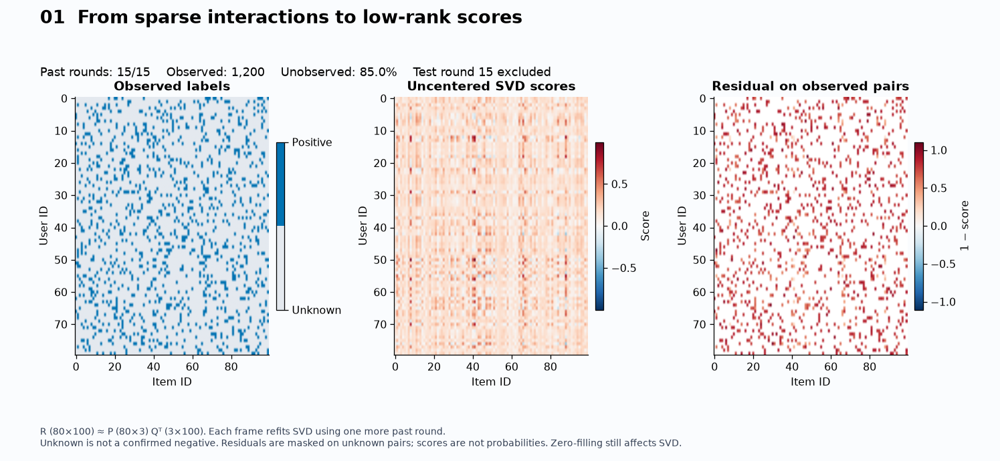
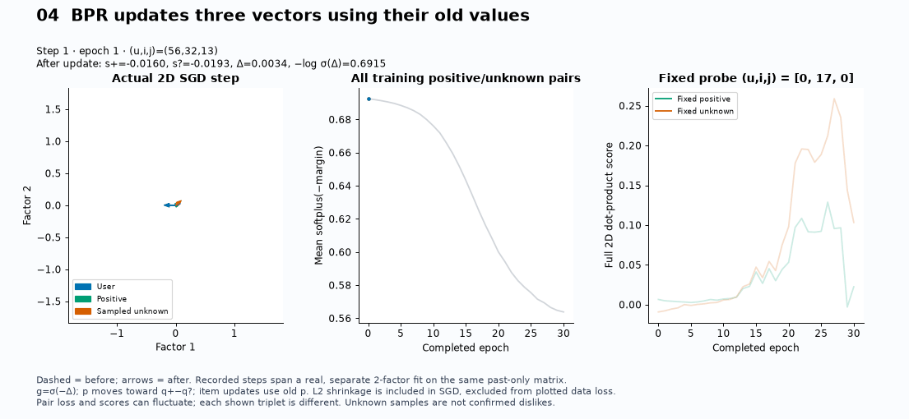
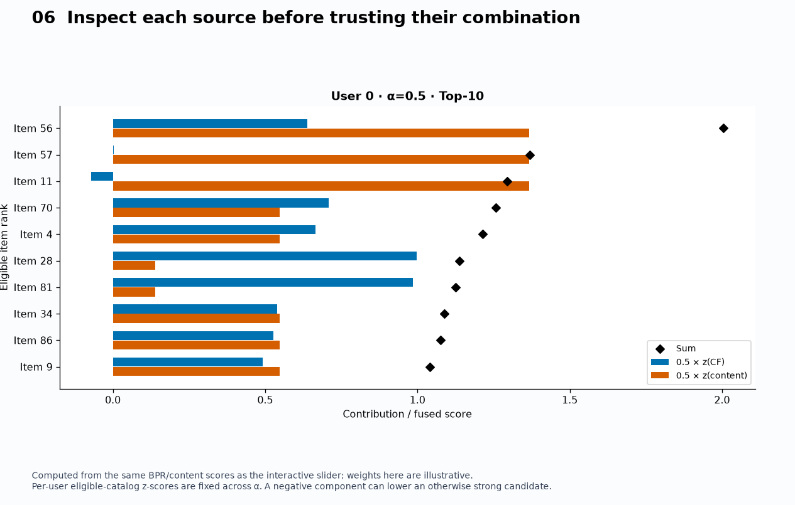

# Day 43 — Recommender Systems II

**When do learned embeddings help ranking, and what can a hybrid ranker recover
after retrieval has discarded items?**

[Day 42](../42-recommender-systems-i/) introduced explicit-rating neighbors and
cold-start fallbacks. This study moves to implicit interactions: low-rank SVD,
pairwise BPR matrix factorization, content profiles, validation-selected score
fusion and candidate unions. These building blocks connect recommendation
modeling to catalog discovery, media personalization and product retrieval.

The executable comparison uses **synthetic data only**, NumPy and scikit-learn.
It fits a pairwise ranking model, but does not implement a separate supervised
second-stage learning-to-rank model, implicit ALS, neural towers or ANN search.
The second-stage ordering is a normalized score-fusion policy. All candidate
searches score the catalog exhaustively; they teach retrieval boundaries rather
than demonstrate serving speed.

## Run and inspect

From the repository root, in a Python 3.11+ environment:

```bash
python -m pip install -e ".[dev]"
python 02-unsupervised-recommender-systems/43-recommender-systems-ii/example.py --save
python -m pytest -q 02-unsupervised-recommender-systems/43-recommender-systems-ii/tests/test_recommender_ii.py
```

Dependency ranges belong to [pyproject.toml](../../pyproject.toml); this topic
adds no packages or optional extras. The example prints configuration, versions,
validation scores, test metrics and interpretation status as JSON. `--save`
also creates a uniquely dated record under the script's ignored `outputs/`
directory, independent of the working directory. It preserves earlier records.
Omit `--save` for console output only. `--seed`, `--factors`, `--epochs` and `--k`
support explicitly labeled new experiments; defaults define the run below.

| File | What to inspect |
|---|---|
| [example.py](example.py) | Global round split, validation-only weight selection, refitting, baseline comparison and metadata-only item probe |
| [from_scratch.py](from_scratch.py) | Stable BPR triplet gradients, simultaneous SGD, bounded negative sampling, ranking/filtering and normalization |
| [notes.md](notes.md) | Objectives, embedding geometry, sampling assumptions, hybrid trade-offs and unrun extensions |
| [tests/test_recommender_ii.py](tests/test_recommender_ii.py) | Finite differences, exact SGD step, temporal isolation, deterministic output, candidate eligibility and metric arithmetic |
| [interview_questions.md](interview_questions.md) | Objective choice, retrieval bottlenecks, cold start and production decisions |
| [references.md](references.md) | Original BPR/implicit-factorization papers and the SVD API used here |

## Evaluation design

Generate 80 users, 100 items and eight one-hot genre attributes. Each user has
a hidden favorite genre; sampling weights are six for matching items and one
otherwise. Draw 16 distinct interactions per user without replacement. Position
$t$ in every user's sequence belongs to the **same global round** $t$.
Metadata is available from round zero; hidden favorites are never model inputs.

1. Train all models and user profiles on rounds 0–13 (1,120 interactions).
2. Use round 14 (80 targets) to choose the BPR weight from
   `{0, 0.25, 0.5, 0.75, 1}` by full-catalog NDCG@10. Ties favor the smaller weight.
   Other hyperparameters are fixed, without a search.
3. Refit on rounds 0–14 (1,200 interactions), then evaluate once on round 15
   (80 targets). Each user has 85 eligible items. Exclude all 15 consumed items.
4. Compare popularity, SVD, BPR, content and the selected fusion on that same
   catalog. Retrieve the union of the top five or top twenty eligible items
   from **each of BPR and content**, then rank it with the frozen fusion policy.

Per-user score normalization uses all eligible items before restricting
candidates. It uses no held-out labels and is unchanged across candidate budgets.
Tied scores use ascending item ID. Candidate recall and final metrics average
over **all** 80 users, including retrieval failures. With one positive per user,
Recall@10 equals hit rate; NDCG@10 rewards its position.
[Day 44](../44-ranking-metrics/) studies ranking metrics more broadly.

The cold-item probe is separate from these metrics. After fitting, append item
100 with no interactions and metadata matching user 0's strongest observed
profile dimension. Give its collaborative score an explicit zero fallback;
test whether content retrieval admits it. This constructed eligibility check
does not measure cold-item relevance or cold-start accuracy.

## Executed record — November 6, 2026

Executed by Codex at **11:53:21 UTC (08:53:21 America/Sao_Paulo)** using the
command above with the stable reference environment's Python. This is the first
topic run, not a replacement for any earlier topic's measurements.

**Hypothesis:** limiting candidates can remove held-out positives before
ranking; content may complement interaction embeddings.

**Configuration:** seed 43; data/splits above; 12 factors; randomized
TruncatedSVD with seven power iterations; BPR with 60 epochs, learning rate
0.05, regularization 0.01 and one uniform unseen draw per positive per epoch.
Training initialization is normal with standard deviation 0.1. Selection metric
is NDCG@10. Python 3.11.14, NumPy 2.4.6, scikit-learn 1.9.1; Windows x64.

Validation NDCG@10 for collaborative weights 0, 0.25, 0.5, 0.75 and 1 was
respectively **0.145761, 0.131133, 0.115366, 0.080131 and 0.053627**.
The selected weight was **0**, so the selected full-catalog fusion reduces to
the content-only ranking in this run. It provides no evidence of a fusion gain.

| Test policy | Recall@10 | NDCG@10 |
|---|---:|---:|
| Popularity | 0.062500 | 0.028825 |
| SVD reconstruction | 0.212500 | 0.085864 |
| BPR | 0.075000 | 0.050993 |
| Content | 0.325000 | 0.185011 |
| Selected fusion, full catalog | 0.325000 | 0.185011 |

| Retrieval budget per source | Mean union size | Candidate recall | Final Recall@10 | Final NDCG@10 |
|---:|---:|---:|---:|---:|
| 5 | 9.325 | 0.312500 | 0.312500 | 0.180559 |
| 20 | 33.550 | 0.550000 | 0.325000 | 0.185011 |

The metadata-only probe's content cosine score was **0.729325**; it entered
the content top twenty and therefore the candidate union. Its collaborative
fallback was zero. There is no fitted collaborative vector or relevance label
for that appended ID.

**Scoped technical review — November 13, 2026:** the AI assistant reviewed
the two interpretations below against the source and this historical record;
see [43-A/B](../../docs/CURATION.md). This is not a personal analysis or approval
by the author. Configurations and measured values are unchanged.

- **43-A — Selection:** validation chose collaborative weight zero. The
  selected full-catalog fusion is content-only, not evidence of a hybrid gain.
  Metadata defines this generator's preference signal, making content a strong
  comparator. Correct BPR gradients do not establish a ranking advantage.
- **43-B — Retrieval and admission:** the small budget lost one test hit
  relative to full-catalog ranking (25/80 versus 26/80); the larger budget
  matched its metrics in this run. Candidate recall limits achievable final
  recall on these same targets, but matching aggregate metrics does not prove
  identical rankings. The appended metadata-only item demonstrates admission
  under the declared fallback, not relevance or cold-start quality.

**Limitations:** one seed, one final event per user, homogeneous history lengths,
no impression or exposure policy, no drift or repeated consumption, and no
uncertainty intervals. All users have histories and all 100 evaluation items
have positive development interactions in this run. This is not an evaluated
new-user cohort. There is no online, latency or business-impact validation.
Metadata defines the synthetic preference signal, so model ordering cannot be
generalized to real recommendation tasks. The cold-item probe is constructed
to match the profile, not sampled from a real launch population.

The full JSON remains ignored and regenerable; its measured summary is recorded
here. This historical study run preceded the separate visual laboratory below.

## Interactive visual laboratory

The [visual guide](visualizations/README.md) maps ten executable scenes to
matrix reconstruction, shared 3D embeddings, dot products, actual BPR updates,
ranking losses, hybrid contributions, candidate budgets, metrics, cold start
and a declared exposure simulation. It links the
[generator](visualizations/visualizations.py),
[numerical states](visualizations/visual_core.py) and
[focused tests](visualizations/tests/test_visual_lab.py).

```powershell
python 02-unsupervised-recommender-systems/43-recommender-systems-ii/visualizations/visualizations.py --all --seed 43
```

Open the generated standalone HTMLs locally for user/epoch/K selection, 3D
rotation, dot-product inspection, hybrid weights and candidate budgets. Outputs
resolve beside the script. The visual default is three factors, 30 epochs and
fixed α=0.5; its metrics are a separate dated record from the 12-factor,
60-epoch, validation-selected historical run above. Visual interpretation
candidates also require author review.

Three inspected public previews illustrate the mechanisms; the remaining
exports, including all HTMLs, stay ignored and regenerate locally.







## What to carry forward

- A factorization architecture does not specify its objective: SVD, observed-only
  rating loss, confidence-weighted ALS and BPR treat missing feedback differently.
- Collaborative dot products express objective-dependent compatibility, not
  calibrated probability or guaranteed semantic similarity.
- A ranker can rearrange only retrieved items. Candidate recall bounds final
  recall on the same targets and eligible catalog.
- Hybrid selection must be allowed to choose a single source. Added complexity
  needs evidence beyond the fact that two signals can be combined.
- Content can admit new items when metadata is useful and the candidate union
  includes that source. It cannot create behavioral evidence or solve new-user
  preferences without history, context or onboarding.
