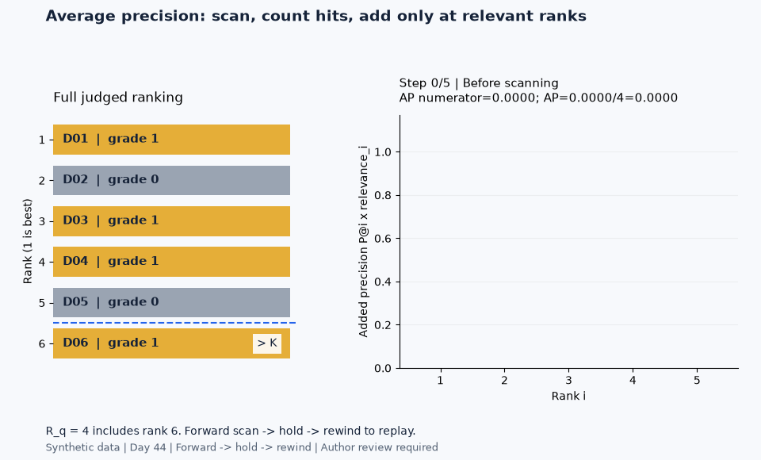
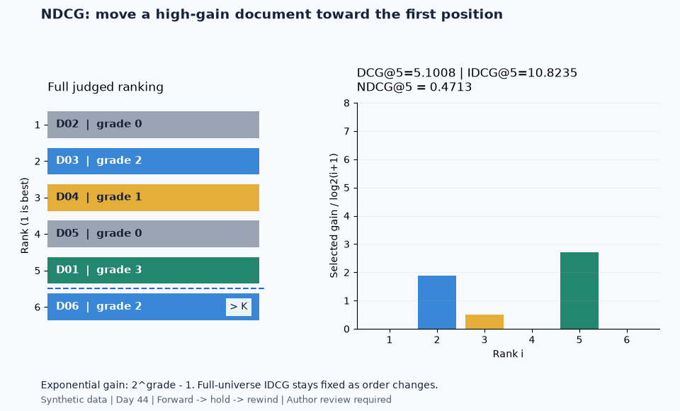

# Ranking metrics visual lab

Manipulate rankings, scan relevant hits, inspect discounted gain, rotate a
discrete quality landscape and separate candidate recovery from reranking.
This is the visual companion to [Day 44](../README.md), using **synthetic,
fully judged data** with fixed fixtures and a configurable seed (default 44).
It is a local educational application, not a trained search system or a
measurement of real-world recommendation or RAG performance.



## Run locally

Use Python 3.11+ in a virtual environment. From the repository root, activate
your environment, then enter this laboratory directory:

```powershell
cd 02-unsupervised-recommender-systems/44-ranking-metrics/ranking_metrics_visual_lab
pip install -r requirements.txt
streamlit run app.py
```

The app opens at `http://127.0.0.1:8501` by default. Stop it with Ctrl+C.
All interactions, charts, formulas and data are served locally. No credentials,
downloaded dataset, LLM API or cloud service is required. Initial dependency
installation can require a package index. The local theme uses system fonts
and disables usage telemetry.

`requirements.txt` delegates to the repository's canonical `.[dev]` extra in
[pyproject.toml](../../../pyproject.toml); dependency ranges are not duplicated.
Keep the surrounding repository: `metrics.py` reuses the original
[NumPy evaluator](../from_scratch.py) via its resolved file path. Copying this
subfolder alone omits that dependency.

From the **laboratory directory**, export all four GIFs and run focused tests:

```bash
python export_gifs.py
pytest -q
```

Alternatively, from the repository root:

```bash
python -m pip install -e ".[dev]"
python -m streamlit run 02-unsupervised-recommender-systems/44-ranking-metrics/ranking_metrics_visual_lab/app.py --browser.gatherUsageStats false --server.address 127.0.0.1
python 02-unsupervised-recommender-systems/44-ranking-metrics/ranking_metrics_visual_lab/export_gifs.py
python -m pytest -q 02-unsupervised-recommender-systems/44-ranking-metrics/ranking_metrics_visual_lab/tests
```

The lab-local theme config is discovered when launched from the laboratory
directory. Metric calculations and file paths do not depend on that theme.

## A guided tour

The sidebar selects a section, a query scenario, the shared cutoff K, NDCG
gain and random seed. Scenario/reset controls apply to the ten-document
playground and precision/recall views. The AP/NDCG examples contain six items
and cap K at six; the landscape contains eight and caps K at eight. RR uses
its dedicated five-position demonstration. Comparison scenarios offer their
own illustrative cutoff or the shared K. RAG combines shared K with its own
candidate pool and context budget. These scopes are labeled in the app.

| Section | Manipulation | What to inspect |
|---|---|---|
| Ranking playground | Swap positions, set an individual grade, choose ideal/poor/seeded orders | Five live metrics, neutral deltas and explanations of changed/unchanged summaries |
| Precision vs recall | Change K and switch early/scattered/late/few-positive scenarios | Selected points, highlighted cards, hit counts and the two denominators; equal-coverage rankings side by side |
| Average precision | Scrub the scan step or press Plotly Play | Cumulative hits, P@i, per-rank contributions and the numerator divided by four; reordered-list comparison |
| Reciprocal rank | Move the first hit from five to one; edit three query first-hit positions | RR curve, individual-query RR and macro MRR; one versus five hits with the same first hit |
| DCG and NDCG | Edit six grades, swap documents, toggle gain and change K | Gain/discount/contribution table, separate discount axis, observed versus ideal order, raw DCG and IDCG |
| 3D ranking landscape | Select distinct positions for grade-three and grade-two IDs; rotate the optional 3D chart | All 56 valid states, a masked-diagonal heatmap, highlighted best/worst states and their exact rankings |
| Metric comparison | Select five disagreement scenarios and change cutoff/gain | Per-metric preferences on the same judged universe; no universal system winner |
| RAG retrieval simulation | Change seed, candidate N, K and context budget | Excluded documents, before/after ranks and scores, pool recall and end-to-end metrics |

Plotly Play/Pause animates **annotations inside the chart**. External metric
cards show the selected Streamlit step or final cutoff, as labeled; animation
does not change Python widget state. Use the AP step slider to inspect a
specific scan state and its table. Hover charts for details. Standard Plotly
controls provide zoom, reset and local image download.

Color is consistent: **gray = 0**, **yellow = 1**, **blue = 2**, **green = 3**.
Every card also includes its ID and numerical grade so meaning does not depend
only on color. Faded tail cards still count in the judged universe.

## Mathematical contract

For binary relevance $r_i=\mathbf{1}[g_i>0]$ and full-universe relevant count
$R_q$, ranks start at one:

$$
P@K=\frac{\sum_{i=1}^{K}r_i}{K},\quad
Recall@K=\frac{\sum_{i=1}^{K}r_i}{R_q},\quad
AP@K=\frac{\sum_{i=1}^{K}P@i\,r_i}{R_q}.
$$

The lab always uses **R_q**, not min(K,R_q), for AP. RR@K is $1/h_q$ if the
first relevant position $h_q$ is within K and zero otherwise. MAP and MRR are
equal-query means of AP and RR; single-query scores are labeled AP and RR.

$$
DCG@K=\sum_{i=1}^{K}\frac{G(g_i)}{\log_2(i+1)},\qquad
NDCG@K=\frac{DCG@K}{IDCG@K}.
$$

Exponential $G(g)=2^g-1$ is default; linear $G(g)=g$ is selectable. IDCG sorts
all grades in the declared judged universe before truncating at K. Gain and
discount are multiplied, not stacked as if they were additive quantities.
The breakdown groups raw and discounted gain on one axis and places discount
on its own axis.

| Case | Policy |
|---|---|
| Invalid K/grades | Core raises for nonpositive/noninteger K or nonfinite/negative grades; UI grade controls offer integers 0–3 |
| Short or empty rankings | Missing positions contribute zero; precision still divides by K |
| No positive judgments / IDCG=0 | Core raises by default; dashboard explains undefined Recall/AP/NDCG instead of inventing values; P and RR are zero |
| Explicit zero-positive scoring | Core retains `no_relevant="zero"` for declared experiments; dashboard does not silently enable it |
| Duplicate IDs | Rejected, including duplicates below K |
| Tied synthetic scores | Descending score, then ascending document ID |
| Ties in an existing ranking | Supplied order is evaluated; no tie averaging |
| Unjudged returned ID | Rejected; real incomplete labels require a separate declared evaluation policy |

The evaluator cannot verify that a caller's declared universe is exhaustive.
Grade one counts as binary relevant here; that does not establish sufficient
evidence for an answer. Different evidence units, annotation rubrics and gain
functions can change results. [Day 44 notes](../notes.md) discuss these limits.
The original study's scikit-learn parity checks align gain and ties; the visual
lab's main calculations never call a black-box metric API. Classifier
`average_precision_score` is not presented as a grouped MAP@K replacement.

## Main experiments and the RAG connection

1. Swap selected IDs without changing top-K membership. P/R can remain fixed
   while AP or NDCG change. Changing a grade also changes the judgment universe's
   positive count and ideal gain, unlike a pure reorder.
2. Scan `[1,0,1,1,0,1]` through K=5. Relevant contributions are 1, 2/3 and 3/4,
   divided by **four**, yielding AP@5 = **0.604167**.
3. Move one relevant item from rank five to one: RR rises from **0.2 to 1**.
   The separate one-hit/five-hit comparison keeps five positives in a shared
   ten-document universe, so RR's blindness to later evidence is visible in recall.
4. Inspect `[3,0,2,1,0,2]`, K=5, exponential gain. DCG = **8.930677**, IDCG =
   **10.823466**, NDCG = **0.825122**. The GIF moves the grade-three ID from
   rank five back to one while preserving other IDs' relative order.
5. In the landscape, place two IDs at distinct ranks while preserving all
   other relative positions. Its 56 points are exact evaluated permutations;
   the impossible diagonal is masked and no continuous surface is interpolated.
6. In RAG, seed 44 generates a 20-document corpus with nine positive judgments.
   Retrieval scores are `0.25 × grade + Gaussian noise`; reranker scores are
   `0.7 × grade + Gaussian noise`. A low retrieval score is deliberately assigned
   to the grade-three D01. This is a declared synthetic mechanism, not a trained
   model or independent empirical relevance estimate.

RAG retrieves N IDs by synthetic score, then sorts exactly those IDs using
the second score. Excluded relevant IDs stay excluded. Recall@N, AP@K and
NDCG@K all retain the **complete 20-document universe**. The same effective K
is used before and after reranking. Context uses a hypothetical equal size of
180 tokens per document, with effective K = min(requested K, N, budget/180).
The displayed cutoff curve illustrates the coverage/utility trade-off as that
budget changes; it does not measure answer correctness.

Additional diagnostics executed on November 6, 2026 used seed 44, N=8, K=5,
900 hypothetical tokens and exponential gain. Candidate recall was **0.666667**;
end-to-end recall stayed **0.555556** before/after reranking while NDCG@5 changed
from **0.389354 to 0.525188**. Relevant D08, D10 and D01 were outside that pool.
For the separate 56-state landscape at K=5, best/worst valid NDCG values were
**0.995539 / 0.152696**. These are evaluated constructed cases, not model
benchmarks. Configuration/results are retained in a separate dated ignored
`visual_metrics_*.json` record. **Interpretation candidate — author review
required:** inspect the distinction between fixed-pool coverage and ordering,
and between the best allowed placement and a globally ideal ranking. This
single synthetic seed and restricted permutation family support no population
or downstream-answer claim.

## Exports and observed visual run — November 6, 2026

The four GIFs were generated at 2 fps, 960×580, with 9–11 decoded frames and
6–7 second loops, then decoded and visually inspected. The forward animation
holds at the end and explicitly rewinds to avoid a sudden reset. Rewind is a
replay convention, not an additional forward metric calculation.

| Generated file in assets/ | Size | Git policy |
|---|---:|---|
| `01_positions_precision_ap.gif` | 156,735 bytes | Regenerable, ignored |
| `02_ap_cumulative.gif` | 173,134 bytes | Selected public preview |
| `03_first_hit_rr.gif` | 158,834 bytes | Regenerable, ignored |
| `04_ndcg_gain.gif` | 180,605 bytes | Selected public preview |



**Hypothesis:** moving relevant IDs changes rank-sensitive summaries, and
rank-wise contributions explain AP and NDCG. **Configuration:** the fixed
fixtures above, K=5, exponential gain, total-relevant AP denominator, no random
draws in the GIFs. The dashboard's RAG/shuffle seed is independently configurable.
**Result:** reference P/R/AP/RR/NDCG = 0.6 / 0.75 / 0.604167 / 1 / 0.825122;
all four GIFs decoded successfully. **Interpretation candidate — author review
required:** inspect how contribution timing and gain weighting produce these
changes. **Limitation:** constructed rankings establish arithmetic behavior,
not a real application's gain from reranking.

This visual run used Python 3.11.14, NumPy 2.4.6, Matplotlib 3.11.2, Pillow
12.3.0, Plotly 6.9.0 and Streamlit 1.65.0 on Windows. It is separate from the
[earlier theoretical study record](../README.md). Export logs are unique dated
JSON files under ignored `outputs/`; old records are not overwritten. They
include configuration, versions, reference results, frame counts, durations,
file sizes, hashes and interpretation status. GIF names are intentionally
stable previews and are replaced when explicitly re-exported.

`python export_gifs.py --only ap --output-dir <directory> --dpi 100 --fps 2`
supports bounded exports elsewhere. Tests render only to temporary directories
and never regenerate the selected public previews. Browser screenshots and
inspection contact sheets remain ignored local review artifacts.

## Files and validation scope

- [app.py](app.py): eight selectively rendered Streamlit views, Plotly charts,
  interactive animations, native controls and scoped session state.
- [metrics.py](metrics.py): original NumPy core adapter, contribution traces,
  deterministic scores, comparison fixtures, discrete permutations and RAG pool logic.
- [export_gifs.py](export_gifs.py): Matplotlib/Pillow exports and dated run inventory.
- [tests/test_metrics.py](tests/test_metrics.py): hand arithmetic, DCG traces,
  valid states, monotonic recall/AP, fixed denominators, determinism and pool constraints.
- [tests/test_app.py](tests/test_app.py): AppTest navigation, edits, swaps,
  seeded shuffle, reset, K/gain changes, invalid all-zero edits and small RAG pools.
- [tests/test_exports.py](tests/test_exports.py): valid animation states and
  temporary GIF decoding/figure cleanup.

Headless AppTest checks Python-side UI interactions; it does not exercise
Plotly's browser-side animation or camera. Those require the separate local
browser check. Syntax/link checks do not certify browser appearance or scientific
interpretations. No full repository test suite or real retrieval benchmark is
implied by these focused checks.

On November 6, 2026, **51 lab tests passed** from this directory with no skips
or pytest warnings; the original topic's **53 tests also passed** separately.
The lab suite includes temporary GIF rendering and all eight AppTest sections.
AppTest emits an expected bare-mode ScriptRunContext log warning outside a
running server. Local Chrome verification covered all eight views, an actual
document swap, AP/NDCG Play completion and real 3D camera rotation, with **zero
browser errors and zero remote requests**. At 390px, document width remained
390px with no page-level horizontal overflow. Material-icon favicon loading
was removed after it was found to request an external resource; the app uses
the locally served default favicon.

These checks used the existing stable environment. Dependency consistency
passed; a clean-environment installation was not validated. The attempted
no-isolation packaging dry run lacked the reference environment's build backend
(`setuptools`), so it does not establish an installation failure in a normal
venv using the documented build-isolated pip command. Requirements were checked
to resolve to the canonical repository root and `dev` extra. Browser inspection
does not certify every browser, every possible user edit or GitHub rendering.

## Boundaries

Synthetic labels are complete and deterministic; real judgments can be sparse,
subjective, exposure-biased and semantically duplicated. A higher metric is not
evidence of causal product value. The RAG example does not generate answers,
test citations or grounding, estimate latency/cost, implement tokenization,
fit a model, evaluate fairness/diversity or measure statistical uncertainty.
The 3D landscape preserves other IDs' relative order and is not the set of all
8! permutations. Explanations and interpretation candidates require author review.
