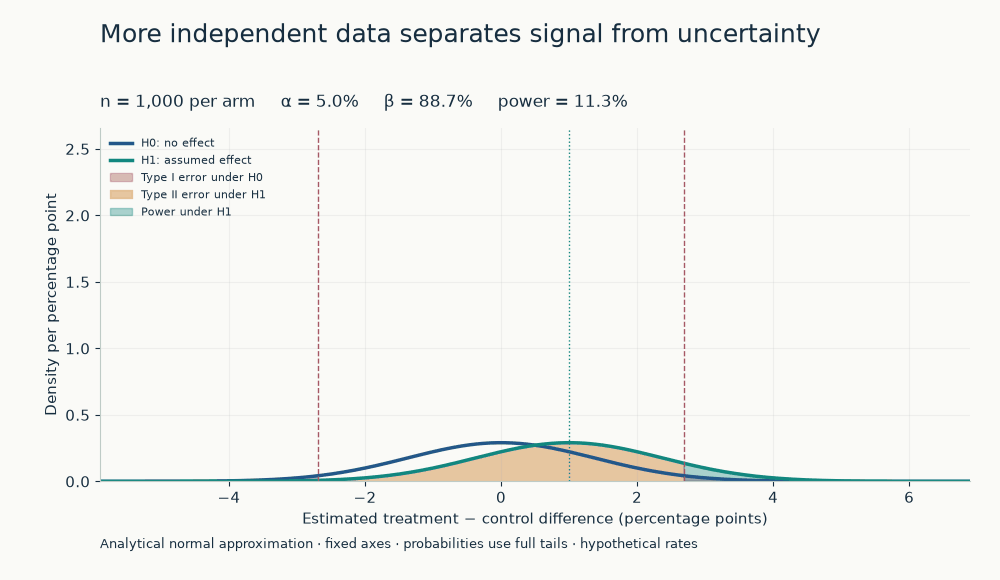

# Day 46 — Power Analysis and Sample Size

**Can the experiment detect a business-relevant improvement within the available
traffic, time and cost?** This study extends [Day 45's A/B test](../45-ab-testing/)
from inference after collection to sensitivity before collection.

Power is the probability of rejecting a null hypothesis **conditional on a
specified true effect and design**. It is neither the probability that the
treatment works nor a deployment criterion. Effect size, error tolerances,
allocation and independent sample units must be specified together.

## Planning case and implemented scope

All inputs are **hypothetical planning assumptions** for an AI assistant:
one binary resolution outcome per independently randomized user, measured over
a fixed window. The analytical scripts use no outcome sample; the visual lab
generates clearly labeled synthetic binomial experiments. No production or
public dataset is used.

| Input | Baseline plan |
|---|---|
| Control / treatment resolution probability | 0.10 / 0.11 |
| Absolute / relative effect | +1 percentage point / +10% |
| Null and alternative | Equal probabilities / two-sided difference |
| Significance / target power | 0.05 / 0.80 |
| Treatment-to-control sample ratio | 1:1 |
| Analysis schedule | Fixed horizon, one primary comparison |

The executed analytical calculation requires **14,751 users per arm**, 29,502
total, under the stated normal approximation. This is a prospective estimate,
not a measured treatment benefit or an exact finite-sample guarantee.

The executable example compares +0.5, +1 and +2 percentage points, stricter
significance, higher power and 2:1 treatment allocation. It also translates
sample requirements into calendar time and evaluates power under a deadline.
At 2,500 new users/day and 40% eligibility, with two days for final outcomes,
the baseline plan needs approximately 32 calendar days. A 14-day deadline leaves
6,000 users/arm and approximately 43.13% power at the assumed +1-point effect.
See the [dated calculation record](notes.md#executed-analytical-study--2026-11-11)
for configuration, outputs, interpretation candidates and limitations.

## Files and execution

| File | Purpose |
|---|---|
| [from_scratch.py](from_scratch.py) | Standard-library balanced sample-size formula; ignores the remote rejection tail |
| [example.py](example.py) | SciPy normal tails and numerical sizing, unequal allocation, time and illustrative cost |
| [notes.md](notes.md) | Derivation, MDE versus business threshold, design pitfalls, run record and interview prompts |
| [tests/test_power_analysis.py](tests/test_power_analysis.py) | Two-tail integration, null calibration, rounding boundaries, sensitivity and input validation |
| [app.py](app.py) and [VISUAL_LAB.md](VISUAL_LAB.md) | Eight interactive learning modules and their interpretation guide |
| [power_math.py](power_math.py) and [simulation.py](simulation.py) | Statsmodels-validated planning, positive MDE, effective information, traffic maturity and seeded experiments |
| [visual_charts.py](visual_charts.py) and [generate_visuals.py](generate_visuals.py) | Shared Plotly figures and bounded offline GIF/PNG/HTML export |
| [Visual math tests](tests/test_visual_math.py), [simulation tests](tests/test_simulation.py), [app tests](tests/test_visual_app.py), [export tests](tests/test_visual_exports.py) | Numerical agreement, Monte Carlo uncertainty, all eight views, reset and temporary-file exports |

From the repository root, use stable Python 3.11+ and the canonical dependencies:

```powershell
python -m pip install -e ".[dev]"
python 03-statistics-experimentation/46-power-analysis/from_scratch.py
python 03-statistics-experimentation/46-power-analysis/example.py
python -m pytest -q 03-statistics-experimentation/46-power-analysis/tests/test_power_analysis.py
```

The two original scripts print text and create no figures or result files.
They are deterministic and need no random seed. The separate visual laboratory
uses seed 46 by default and the canonical `experimentation` extra for statsmodels.
The [validation contract](../../docs/validation.md) explains broader checks.

### Run the interactive laboratory on Windows

From the repository root, activate your environment, then:

```powershell
Set-Location 03-statistics-experimentation/46-power-analysis
python -m pip install -r requirements.txt
python -m streamlit run app.py
python generate_visuals.py
python -m pytest -q tests
```

The topic's `requirements.txt` delegates to the root `.[dev,experimentation]`
dependency contract. Launching from this directory applies its local theme,
loopback binding and telemetry setting. The app defaults to
`http://127.0.0.1:8501`; use `--server.port=8506` if that port is occupied.

Navigate eight modules using **Learning module**. Sidebar parameters update
the current analytical view. The Monte Carlo form runs only on **Run simulation**;
it retains the previous run's configuration if other inputs change. Reset
restores the population assumptions, sample size, seed and first module.
Every module includes a visual reading, parameter intuition, mathematical
interpretation and AI/product implication.

The [visual guide](VISUAL_LAB.md) documents all eight views, formulas, limitations,
manual experiments and the separately dated Monte Carlo record. The generator
uses Matplotlib's noninteractive Agg backend and writes three GIFs, a PNG,
`power_surface_3d.html` and a unique JSON run record to ignored `outputs/`.
The HTML embeds Plotly and stays interactive without a CDN or internet access.
Frame count and simulation repetitions are bounded and configurable.

### Selected visual previews

These inspected, intentionally unignored files reproduce the default export
configuration; they do not change with dashboard sliders.



| Preview | Learning question |
|---|---|
| [Power growth](assets/power_growth.gif) | How quickly does detection approach the target as n grows? |
| [Effective sample size](assets/effective_sample_size.gif) | How can 10,000 conversations contain far less independent information? |
| [Effect versus required sample](assets/effect_size_sample_size.png) | Why are small improvements so expensive to detect? |

The hypothesis-distribution GIF and effect-size PNG are the strongest compact
entry points. Other exports and local browser screenshots remain ignored.

## What to carry into an experiment review

- Specify a smallest effect of business interest before fitting a sample plan.
  A design's minimum detectable effect (MDE) can be larger than that threshold.
- Count independent randomization units. Repeated conversations from one user
  do not automatically increase the independent sample size.
- Halving the effect costs roughly four times the sample at fixed variance;
  Bernoulli variance also changes with the assumed probabilities.
- Evaluate power at the original effect when a deadline limits enrollment.
  Changing the assumed effect changes the question the design can answer.
- Report estimates and intervals after the test. Nonsignificance does not
  demonstrate equivalence, and observed-effect post-hoc power adds little.

## Limits and review status

The code is educational. It models independent Bernoulli outcomes with a
two-sided pooled-null Z threshold and separate alternative variances, without
continuity correction. It does not validate sparse-event approximations or
implement clustered, paired, sequential, multiplicity-adjusted or
noninferiority designs. The dashboard exposes only two-sided inference, avoiding
an implicit change in sidedness. Intermediate numerical roots may use fractional sample
sizes; returned plans use integer counts and recheck approximate power.

Calendar estimates use constant expected traffic and allocation; actual arm
counts fluctuate. Eligibility is applied before enrollment, with complete
outcomes for everyone enrolled. Missing outcomes, recurrent users, traffic
ramps, interference and seasonality require another planning model. The cost
input is invented for illustration; it establishes no ROI or budget approval.

**Implementation and local verification are separate from interpretation
approval. Author review required** for the business effect, baseline, unit,
error tolerances, cost and interpretation candidates in the notes. No production
decision is supported by these calculations alone.

Primary method references: [statsmodels two-proportion power](https://www.statsmodels.org/stable/generated/statsmodels.stats.proportion.power_proportions_2indep.html),
[dominant-tail sizing approximation](https://www.statsmodels.org/stable/generated/statsmodels.stats.proportion.samplesize_proportions_2indep_onetail.html)
and [SciPy bracketed root finding](https://docs.scipy.org/doc/scipy/reference/generated/scipy.optimize.brentq.html).
The visual lab's tests compare sizing and power with statsmodels and the original
implementation. Matching numerical outputs does not establish exact binomial
calibration or author approval of the interpretation.
