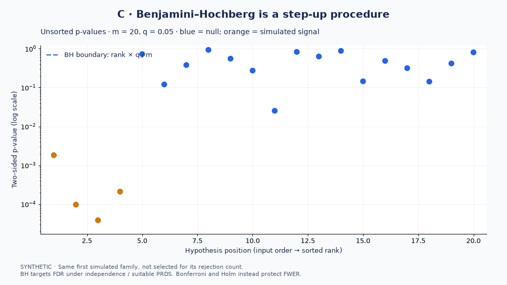
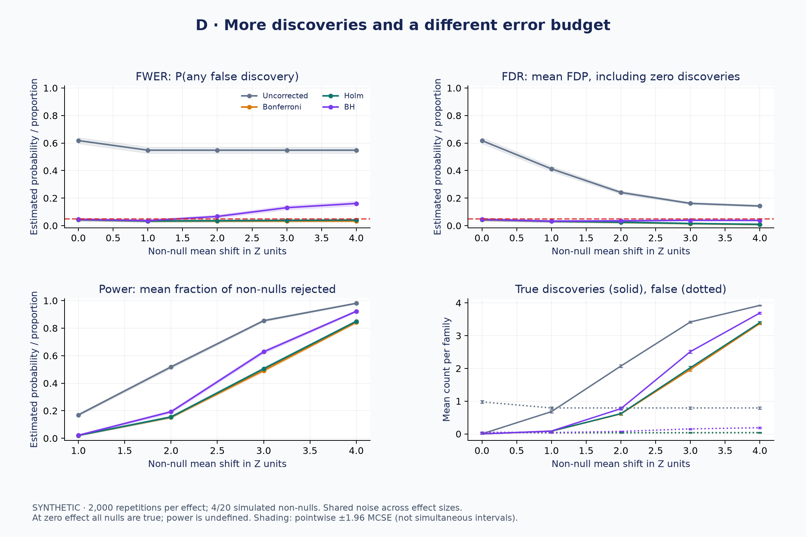
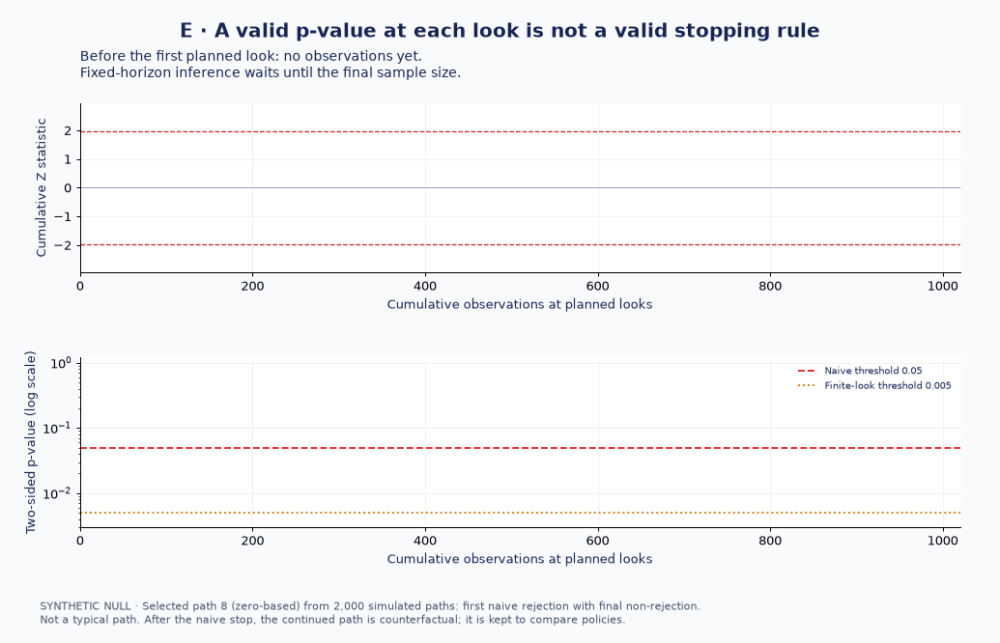

# Day 48 — Multiple Testing and False Positives

If a RAG evaluation checks twenty metrics and stops when any result looks
favorable, what does a nominal 5% threshold actually protect? The answer
depends on the hypothesis family, the error criterion and the stopping rule.

This study separates **family-wise error rate (FWER)**, **false discovery rate
(FDR)** and **repeated looks at accumulating data**. All data and illustrative
p-values are synthetic; no external dataset, service or production outcome is used.

## What the executable study compares

1. Twenty independent true nulls: uncorrected testing, Bonferroni, Holm and
   Benjamini–Hochberg (BH). The analytical uncorrected FWER is
   $1-0.95^{20}\approx0.6415$; under the global null, FDR equals FWER.
2. Twenty independent hypotheses with four shifted normal statistics:
   repeated-family FWER, mean FDP (estimated FDR), average non-null rejection
   fraction and discovery counts. A single family's FDP is not its FDR.
3. One null experiment with ten **nested**, prespecified looks: fixed-horizon
   testing, stopping at the first ordinary $p\leq0.05$, and a conservative
   $0.05/10$ threshold at each look. All policies use the same trajectories.

Every reported mean includes a Monte Carlo standard error. These simulations
illustrate assumptions; they do not prove error-control theorems or establish
business benefit. [Notes](notes.md) contain the mathematical argument, design,
dated measurements and limitations. **Author review of interpretation candidates
is pending.**

## Files and execution

| File | Purpose |
|---|---|
| [from_scratch.py](from_scratch.py) | Educational adjusted p-values, original-order restoration and rejection rules |
| [example.py](example.py) | Seeded repeated-family and finite-look simulations; optional JSON report |
| [tests/test_multiple_testing.py](tests/test_multiple_testing.py) | Hand calculations, statsmodels/SciPy agreement, input checks and policy contracts |
| [notes.md](notes.md) | Theory, decision boundaries, executed study and proposed extensions |
| [interview_questions.md](interview_questions.md) | Senior-level questions about discovery, monitoring and AI evaluation |

From the repository root, use a stable Python 3.11+ environment and the
canonical dependency definitions in [pyproject.toml](../../pyproject.toml):

```powershell
python -m pip install -e ".[dev,experimentation]"
python 03-statistics-experimentation/48-multiple-testing/from_scratch.py
python 03-statistics-experimentation/48-multiple-testing/example.py --trials 10000 --seed 48 --output 03-statistics-experimentation/48-multiple-testing/outputs/study.json
python -m pytest -q 03-statistics-experimentation/48-multiple-testing/tests/test_multiple_testing.py
python scripts/validate_repo.py syntax
python scripts/validate_repo.py links
```

The `experimentation` extra supplies statsmodels for independent test oracles;
the example itself uses NumPy and SciPy. `--output` is optional; without it the
example prints JSON only. Reusing an output path overwrites that local report;
use a new filename when retaining a historical run. Numerical results repeat
with the same configuration/environment; execution timestamps change.
Generated JSON stays in ignored `outputs/`. The separate visual phase below
adds new runs without replacing the historical baseline measurements.

## Interactive visual laboratory

The [visual guide](VISUAL_LAB.md) documents six experiments, their generators,
assumptions, justified interpretations, overinterpretation risks and validation:

| Experiment | Mechanism revealed | Reproduce with |
|---|---|---|
| A: null false positives | Uniform null p-values and fluctuating rejection proportions | `--experiment null` |
| B: FWER growth | Exact independence formula over family size and threshold; interactive 3D sliders | `--experiment fwer` |
| C: correction rules | Bonferroni/Holm rejection sets and BH's largest passing rank | `--experiment corrections` |
| D: discovery trade-offs | Realized FDP versus mean FDP, power and true/false counts across effects | `--experiment tradeoffs` |
| E: peeking | Selected early-crossing path versus whole-pool Type I error; shared monitoring paths | `--experiment peeking` |
| F: dependence | PSD equicorrelated normal families; Bonferroni/Holm/BH/BY with MC uncertainty | `--experiment dependence` |

```powershell
python 03-statistics-experimentation/48-multiple-testing/visualize_day48.py --mode quick
python 03-statistics-experimentation/48-multiple-testing/visualize_day48.py --mode full
python 03-statistics-experimentation/48-multiple-testing/visualize_day48.py --experiment peeking --output-dir 03-statistics-experimentation/48-multiple-testing/outputs/peeking-review
python -m pytest -q 03-statistics-experimentation/48-multiple-testing/tests
```

Use the same canonical installation above. Quick defaults: seed 48, 2,000
repetitions per condition, 20 hypotheses and 24 animation frames. Full defaults:
20,000 repetitions and 48 frames. Parameters and output directory are configurable;
existing output directories require explicit `--overwrite`. The generator uses
Agg/Pillow and runs on Windows without FFmpeg or a server. The generated
`outputs/quick/index.html` displays the figures and links to the standalone
interactive surface. Open it locally; no internet is required.

The [numerical core](day48_visual_core.py), [export CLI](visualize_day48.py)
and [visual tests](tests/test_visual_lab.py) keep simulation and rendering
separate. Two-sided normal statistics are synthetic; the effect-zero sweep
point is global null and has undefined non-null power. Peeking trajectory
selection is disclosed. Dependence sweeps do not establish general BH validity.
**All visual interpretation candidates remain author review required.**

Selected, inspected previews from the quick run:



BH's step-up mechanism on the first synthetic family. This family's correction
methods happen to reject the same four signals; a single family does not
establish comparative power.



Repeated-family estimates with pointwise Monte Carlo uncertainty. FDR averages
FDP, including zero-discovery runs; power is undefined at zero effect.



Disclosed selected example: naive rejection at an early look, followed by a
final-horizon non-rejection. The gray continuation is counterfactual after the
naive stop; the whole-pool error-rate comparison is documented in the guide.

[Open/download the standalone interactive FWER surface](assets/02_fwer_surface.html).
Download the raw HTML and open it locally to use both sliders, hover, rotation
and zoom. The approximately 5 MB file deliberately bundles Plotly for offline
use. It is linked as HTML rather than embedded as an image. All other exports,
run manifests and inspection intermediates remain ignored. These selected
assets do not imply publication or approval of interpretations.

## Choosing an error criterion

| Decision | Candidate approach | Required qualification |
|---|---|---|
| Any false positive in a declared confirmatory family is costly | Bonferroni or Holm | Valid individual null p-values; Holm weakly dominates Bonferroni in rejection power |
| Screen a family for promising findings | BH | Independence or suitable positive regression dependence (PRDS); FDR is an expectation |
| FDR control with arbitrary dependence | Benjamini–Yekutieli (BY), included in visual experiment F | More conservative; absent from the original baseline example |
| Stop or act on accumulating significance evidence | Prespecified sequential design or anytime-valid inference | Correcting across metrics alone does not account for repeated looks |

Define the family before examining results: candidate variants, metrics,
segments and inferential claims can all introduce multiplicity. Pairing and
clustering in an actual query-level RAG evaluation must be handled by the
individual tests first. Adjusting invalid p-values cannot repair leakage,
confounding or reuse of a benchmark for adaptive model selection.

Key takeaways: choose FWER or FDR from the decision's consequences; preserve the
complete family; report effect sizes and uncertainty; and specify when a test
may stop. A favorable corrected p-value supplies neither practical significance
nor safety non-inferiority or deployment authorization.

## References

- [SciPy: false_discovery_control](https://docs.scipy.org/doc/scipy/reference/generated/scipy.stats.false_discovery_control.html): adjusted p-values, BH/BY and dependence assumptions.
- [statsmodels: multipletests](https://www.statsmodels.org/stable/generated/statsmodels.stats.multitest.multipletests.html): library implementation used as an independent numerical reference in tests.
- [Benjamini and Hochberg (1995)](https://doi.org/10.1111/j.2517-6161.1995.tb02031.x): original FDR procedure.
- [Holm (1979), A Simple Sequentially Rejective Multiple Test Procedure](https://www.jstor.org/stable/4615733): strong FWER control by step-down testing.
- [Johari, Pekelis and Walsh, Peeking at A/B Tests (KDD 2017)](https://www.kdd.org/kdd2017/papers/view/peeking-at-ab-tests-why-it-matters-and-what-to-do-about-it): why fixed-sample inference and continuous monitoring need different procedures.

[Module index](../README.md) · [Previous: metrics and guardrails](../47-product-metrics-guardrails/)
