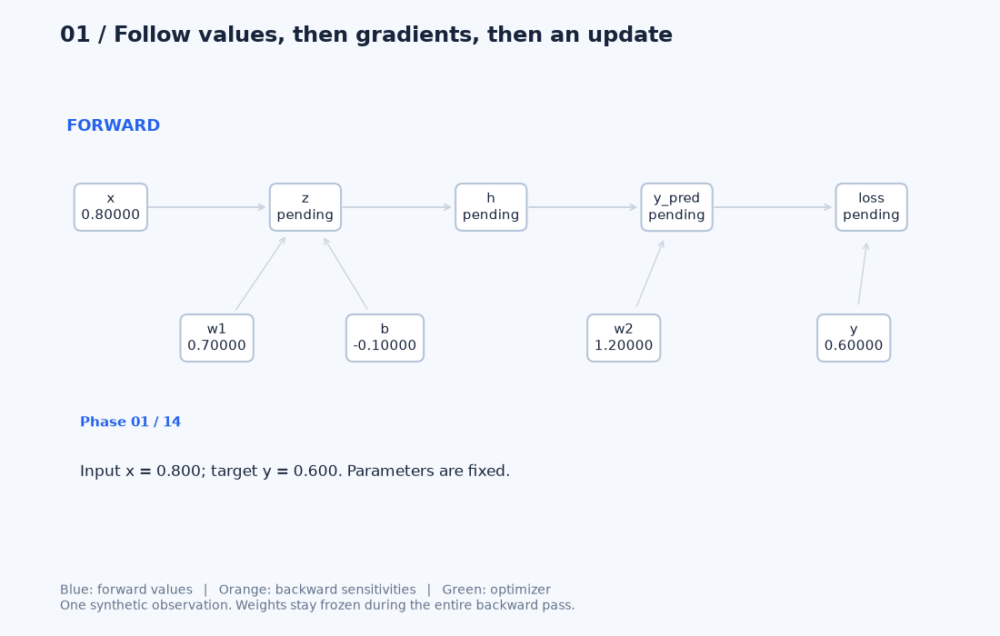
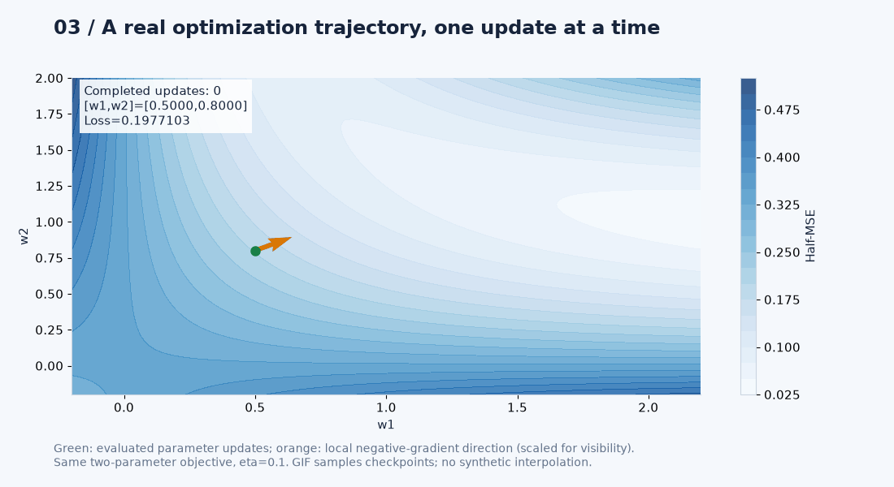
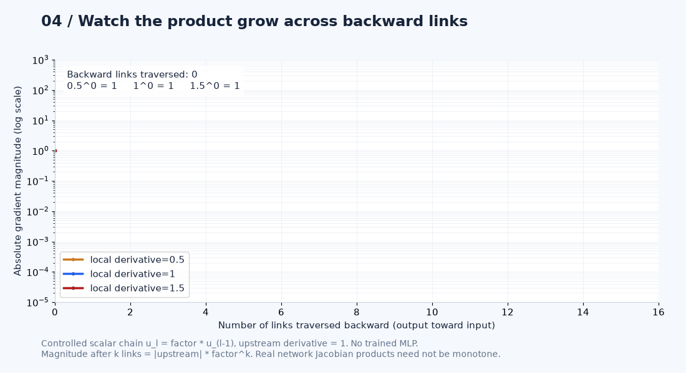

# Day 54 — Backpropagation

[Deep Learning module](../README.md) · [Roadmap](../../ROADMAP.md)

**How does a loss at the output produce a gradient for an earlier weight?**
Backpropagation applies the chain rule in reverse dependency order, reusing
intermediate sensitivities and adding contributions from every downstream
path. An optimizer then uses these gradients to update parameters.

This study follows a scalar graph with a shared node, then derives and tests
the backward pass of a `1 → 8 → 1` tanh regressor. It connects computational
graphs, matrix shapes, bias broadcasting, loss reduction and parameter updates.
These details matter when debugging a custom layer, diagnosing a missing
learning signal or accumulating gradients across smaller batches.

## Inspect and run

| File | Purpose |
|---|---|
| [from_scratch.py](from_scratch.py) | Explicit scalar and matrix backward passes, central differences and simultaneous gradient descent updates |
| [example.py](example.py) | Synthetic full-batch regression, gradient norms and weighted unequal-microbatch comparison |
| [notes.md](notes.md) | Derivations, assumptions, pitfalls, interview questions, primary references and dated execution record |
| [tests/test_backpropagation.py](tests/test_backpropagation.py) | Every-parameter gradient checks, graph branching, loss scaling, update semantics and invalid-input checks |
| [visual_lab.py](visual_lab.py) | Eight-module visual CLI exporting GIF, PNG and standalone offline 3D HTML |
| [visual_math.py](visual_math.py) / [visual_render.py](visual_render.py) | Tested visual-model mathematics separated from headless rendering |
| [VISUAL_LAB.md](VISUAL_LAB.md) | Visual questions, mathematical contracts, commands, dated observations and preview policy |
| [visual tests](tests/test_visual_lab.py) | Manual-gradient checks, actual trajectory identities, clipping, accumulation and temporary-directory exports |

Run from the repository root with stable Python 3.11+ in an isolated environment.
Dependency ranges come from [pyproject.toml](../../pyproject.toml).

```powershell
python -m pip install -e ".[dev]"
python 04-deep-learning/54-backpropagation/from_scratch.py
python 04-deep-learning/54-backpropagation/example.py
python scripts/validate_repo.py tests --scope 04-deep-learning/54-backpropagation
python scripts/validate_repo.py syntax
python scripts/validate_repo.py links
```

Only NumPy is needed for the two analytical examples; pytest is supplied by `dev`. The
backward pass is written for this specific architecture, with no generic
autodiff engine. PyTorch training-loop practice remains planned for Day 62.
Both analytical scripts print JSON to standard output and write no artifacts.

## What is being differentiated?

For $X\in\mathbb{R}^{n\times d}$ and one real-valued target per row:

$$
H=\tanh(XW_1+b_1),\qquad \hat Y=HW_2+b_2,
\qquad L=\frac{1}{2n}\sum_{i=1}^{n}(\hat y_i-y_i)^2.
$$

The output adjoint is $(\hat Y-Y)/n$. Multiplying by the output weights and
the local tanh derivative propagates it into the hidden layer. Matrix
multiplication aggregates weight gradients; summing rows reverses bias
broadcasting. All derivatives use the same parameter state before any update.
The [notes](notes.md#matrix-backward-pass) derive each expression.

The scalar example uses $z=wx+b$ and $\hat y=\tanh(z)+z$. Its two paths make
gradient accumulation visible without introducing a graph library.

## Executed evidence and boundaries

In the **2026-11-18 local run**, central differences checked all **25**
parameters of the NumPy regressor, with maximum absolute disagreement
$5.12\times10^{-12}$. The separate 128-point synthetic training exercise
reduced half-MSE from 0.294871 to 0.004222 after 2,000 full-batch updates.
The [dated record](notes.md#executed-study--2026-11-18) gives configuration,
versions, checkpoint gradient norms and interpretation candidates.

**Author review required.** This is a fitting and gradient-validation exercise
on $y=\sin(3x)+0.2x$, with no independent holdout or external dataset. Passing
gradient checks does not establish generalization, global convergence or
production readiness. The implementation is educational and is not a
replacement for a numerical or deep-learning library.

## Explore the visual lab

```powershell
python 04-deep-learning/54-backpropagation/visual_lab.py --list
python 04-deep-learning/54-backpropagation/visual_lab.py --all
python 04-deep-learning/54-backpropagation/visual_lab.py --only loss_landscape
```

Watch values move forward, gradients move backward and the optimizer act
only after all parameter derivatives are available:



Follow evaluated gradient descent checkpoints on the actual loss contours:



Compare exact scalar derivative products across backward depth:



Open the [offline interactive 3D landscape](visuals/loss_landscape_3d.html)
locally to rotate, zoom and inspect all four learning-rate trajectories.
GitHub shows HTML source; download the file for interaction. The
[visual guide](VISUAL_LAB.md) also covers chain-rule multiplication, local
perturbations, activation derivatives, finite differences, clipping and
unequal-microbatch accumulation. It documents `--quick`, custom output paths
and the distinct two-parameter visual model without a bias.

In the separate visual run, all four rates decreased training loss over 180
updates; none diverged in that configuration. **Author review required.**
The visual study does not replace the analytical record above or establish
generalization. Three inspected GIFs and the offline HTML are deliberately
unignored; other exports and dated generation manifests remain ignored.

## Takeaways

- Backpropagation computes gradients; gradient descent changes parameters.
- Shared graph nodes receive the sum of all downstream contributions.
- A mean loss fixes gradient scale; unequal microbatches need sample-count
  weights to reproduce the full-batch gradient at frozen parameters.
- Correct gradients can still yield a harmful update at a large learning rate.
- Near-zero gradients need context: symmetry, saturation and disconnected
  computation are different explanations.
