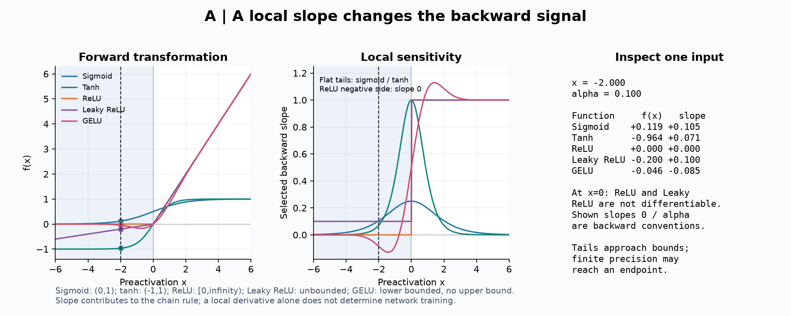
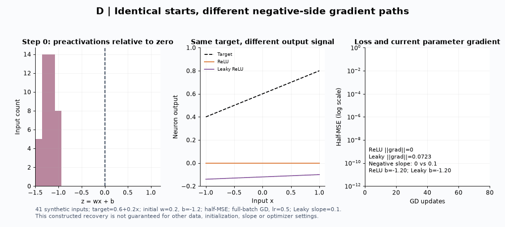
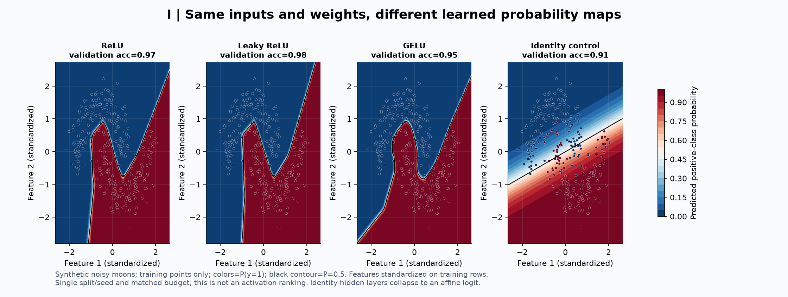

# Day 55 — Activation Functions

[Deep Learning module](../README.md) · [Roadmap](../../ROADMAP.md)

**How does an activation change both the signal and the gradient?** Stacked
affine layers collapse into one affine map. Nonlinear hidden activations
change the representable functions; their local derivatives also change the
learning signal. Output transformations answer a separate question: whether
labels coexist or compete for probability mass.

This study implements sigmoid, tanh, ReLU, Leaky ReLU and exact-form GELU,
then treats softmax as a coupled vector transformation. Fixed synthetic inputs
make saturation, negative-side gradients, temperature and stable categorical
loss easy to inspect without training a model or downloading data.

## Inspect and run

| File | Purpose |
|---|---|
| [from_scratch.py](from_scratch.py) | Elementwise values and derivatives, axis-aware softmax, dense Jacobian, logit loss and central differences |
| [example.py](example.py) | Synthetic diagnostics, SciPy agreement, temperature sweep and mean-loss gradient checks |
| [notes.md](notes.md) | Formulas, numerical assumptions, applications, pitfalls, interview questions, references and dated execution evidence |
| [tests/test_activation_functions.py](tests/test_activation_functions.py) | Derivative checks, kink conventions, tensor axes, mean reduction, extreme logits and invalid inputs |
| [visual_lab.py](visual_lab.py) | Quick PNGs, full GIF/3D generation and two native Matplotlib explorers |
| [visual_math.py](visual_math.py) / [visual_render.py](visual_render.py) | Controlled mechanisms and matched CPU training separated from rendering |
| [interactive_3d.py](interactive_3d.py) | Standalone probability-simplex and MLP surface HTML generation |
| [VISUAL_LAB.md](VISUAL_LAB.md) | Ten visual questions, controls, configurations, execution records and limits |
| [tests/test_visual_lab.py](tests/test_visual_lab.py) | Real PyTorch agreement, deterministic training, sliders and temporary PNG/GIF/HTML exports |

Run from the repository root with stable Python 3.11+. Dependencies are
centralized in [pyproject.toml](../../pyproject.toml): NumPy/SciPy supply the
numerics and the canonical `dev` extra supplies pytest.

```powershell
python -m pip install -e ".[dev]"
python 04-deep-learning/55-activation-functions/from_scratch.py
python 04-deep-learning/55-activation-functions/example.py
python scripts/validate_repo.py tests --scope 04-deep-learning/55-activation-functions/tests/test_activation_functions.py
python scripts/validate_repo.py syntax
python scripts/validate_repo.py links
```

The two analytical scripts print JSON and write no files. No autograd framework
is needed for those explicit derivatives. GELU uses SciPy's standard-normal
CDF, not a custom CDF solver. The separate visual lab uses PyTorch CPU for
autograd and small matched MLPs; a fuller training-loop study remains planned
for Day 62.

## Explore the visual learning lab

Install CPU PyTorch first, then the canonical extra (no GPU required):

```powershell
python -m pip install "torch>=2.6,<3" --index-url https://download.pytorch.org/whl/cpu
python -m pip install -e ".[dev,deep-learning]"
python 04-deep-learning/55-activation-functions/visual_lab.py --mode quick
python 04-deep-learning/55-activation-functions/visual_lab.py --mode full
python 04-deep-learning/55-activation-functions/visual_lab.py --mode interactive --explorer activations
python 04-deep-learning/55-activation-functions/visual_lab.py --mode interactive --explorer softmax
python 04-deep-learning/55-activation-functions/interactive_3d.py
python scripts/validate_repo.py tests --scope 04-deep-learning/55-activation-functions
```

`quick` produces seven PNGs and verifies derivatives with autograd. `full`
adds four GIFs, a 2D boundary comparison and three standalone HTMLs, including
real MLP checkpoints and distinct raw-logit surfaces. `interactive` opens one
window with Matplotlib sliders; close it before starting another. All generated
files go to ignored `outputs/` by default. See the [visual guide](VISUAL_LAB.md)
for lighter settings, artifact names and interpretation boundaries.

Compare local transformations and sensitivities:



Follow actual matched updates from an initially inactive neuron:



Inspect nonlinear decision boundaries alongside an affine-logit control:



These three inspected previews are intentionally unignored. Other PNG/GIF
exports, HTMLs and dated JSON manifests remain regenerable local artifacts.
The [visual execution record](VISUAL_LAB.md#executed-visual-study--2026-11-18)
reports actual configuration-specific observations; **author review required**.

## Two different derivative contracts

For elementwise $a=f(z)$, backpropagation uses
$\nabla_z L=\nabla_a L\odot f'(z)$. Softmax instead couples all classes:

$$
p_i=\frac{\exp((z_i-m)/T)}{\sum_j\exp((z_j-m)/T)},\qquad
J=\frac{\operatorname{diag}(p)-pp^\top}{T},\qquad T>0.
$$

Here $m=\max_j z_j$ along the chosen axis. For a batch of $n$ fixed target
distributions whose rows sum to one, mean categorical cross-entropy has gradient
$(P-Y)/(nT)$. The code computes log probabilities directly rather than taking
the logarithm of probabilities that may have rounded to zero.

The [notes](notes.md) distinguish mathematical ranges from float64 rounding,
ordinary derivatives from selected slopes at kinks, and normalization from
calibration. The educational API accepts finite real inputs only, with an
integer softmax axis. It does not implement masked attention.

## Evidence and takeaways

The [2026-11-18 execution record](notes.md#executed-study--2026-11-18) records
the synthetic inputs, environment and measured errors. The numerical checks
cover local activation derivatives, the full softmax Jacobian and every logit
of a two-row categorical loss at three temperatures.

- Sigmoid and tanh saturate; ReLU blocks negative-side gradients. Neither
  positive ReLU slopes nor a Leaky ReLU slope guarantee stable network gradients.
- Exact GELU is smooth but can have negative slopes and slopes above one.
- Sigmoid outputs can represent coexisting labels. Softmax normalizes mutually
  exclusive alternatives along an explicitly chosen axis.
- Temperature changes concentration while preserving the mathematical logit
  ranking for $T>0$; calibration still needs labeled validation data.
- Use raw logits with a library loss that expects logits. Normalized scores
  alone establish neither calibrated confidence nor factual correctness.

**Author review required:** execution and passing assertions support the
specified numerical identities, not a ranking of activations, training quality,
generalization or production readiness. These first-principles routines are
educational, not numerical-library replacements. Suggested model comparisons
with multiple seeds remain unexecuted in the [notes](notes.md#suggested-follow-ups-not-executed).
