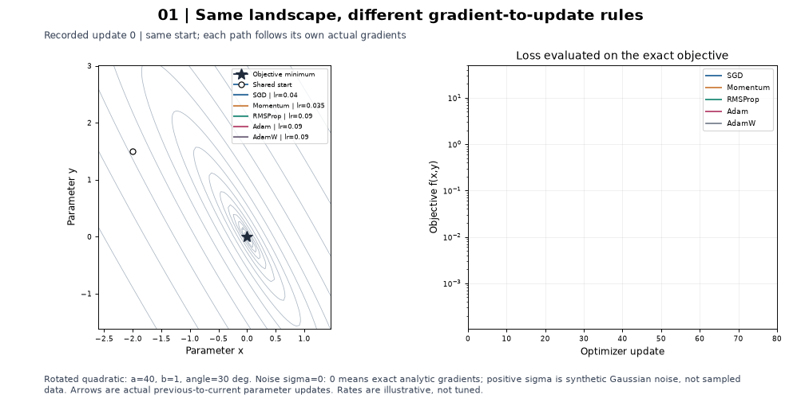
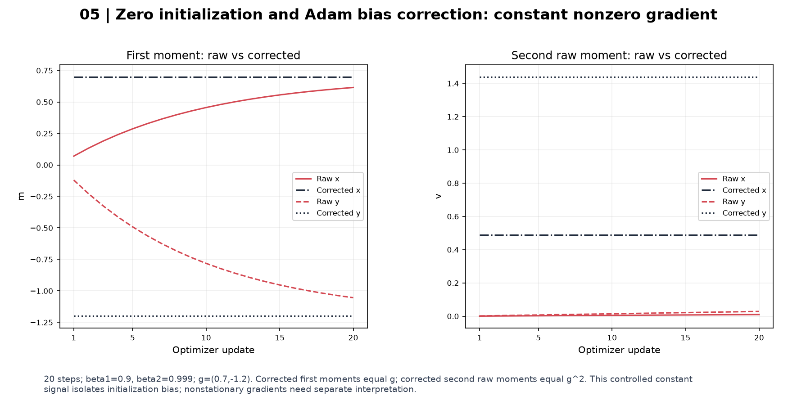

# Day 56 — Optimizers

[Deep Learning module](../README.md) · [Roadmap](../../ROADMAP.md)

**How does the same gradient become a different parameter update?**
Backpropagation computes derivatives; the optimizer combines them with its
state and learning rate. SGD follows the current gradient, Momentum retains
directions, RMSProp rescales coordinates, and Adam combines two moment
estimates with bias correction. AdamW applies weight decay outside those
moments. These choices affect training dynamics, tuning and state memory.

The study connects explicit update equations to a small CPU training exercise.
It uses a deterministic synthetic quadratic and synthetic noisy concentric
rings, with no dataset downloads. It does not select an optimizer for a real
application or establish a generalization ranking.

## Inspect and execute

| File | Technical purpose |
|---|---|
| [from_scratch.py](from_scratch.py) | Dense NumPy updates, optimizer-owned state, quadratic and Adam/AdamW controls |
| [example.py](example.py) | Matched PyTorch MLP configurations, epoch metrics, norms, timing and run metadata |
| [notes.md](notes.md) | Equations, conventions, trade-offs, interview answers, primary references and dated evidence |
| [tests/test_optimizers.py](tests/test_optimizers.py) | Hand calculations, PyTorch agreement, finite differences, input contracts and repeatable training |
| [visualizations.py](visualizations.py) | Eight-scene CLI for real trajectories, internal states, GIFs and offline 3D |
| [visual_math.py](visual_math.py) / [visual_render.py](visual_render.py) | Analytic objectives and histories separated from rendering; shared optimizer updates |
| [VISUAL_LAB.md](VISUAL_LAB.md) | Visual questions, controls, export names, dated evidence and preview selection |
| [tests/test_visual_lab.py](tests/test_visual_lab.py) | Visual-only mathematics, frame alignment and real temporary PNG/GIF/HTML exports |

From the repository root with stable Python 3.11+, use the canonical
[dependency configuration](../../pyproject.toml). NumPy is sufficient for the
first-principles script. The example and integration tests require the
`deep-learning` extra; `dev` supplies pytest. No GPU is required.

```powershell
python -m pip install "torch>=2.6,<3" --index-url https://download.pytorch.org/whl/cpu
python -m pip install -e ".[dev,deep-learning]"
python 04-deep-learning/56-optimizers/from_scratch.py
python 04-deep-learning/56-optimizers/example.py
python scripts/validate_repo.py tests --scope 04-deep-learning/56-optimizers
python scripts/validate_repo.py syntax
python scripts/validate_repo.py links
```

Both scripts print JSON and write no files. A shorter exploratory run is:

```powershell
python 04-deep-learning/56-optimizers/example.py --epochs 5 --samples 200 --batch-size 32 --seed 56
```

Changing these options creates a new configuration; it does not reproduce the
dated default run. Generated reports redirected to `outputs/` remain ignored.

## Explore the optimizer laboratory

The visual workflow needs the shared dependencies and `.[dev]` for tests;
PyTorch is only needed for the separate neural-network example and its tests.
Generate all eight scenes, then inspect the 3D experiment offline:

```powershell
python -m pip install -e ".[dev]"
python 04-deep-learning/56-optimizers/visualizations.py --all
python 04-deep-learning/56-optimizers/visualizations.py --scene surface3d --show
python scripts/validate_repo.py tests --scope 04-deep-learning/56-optimizers/tests/test_visual_lab.py
```

The output `02_interactive_loss_surface.html` opens directly in a browser.
Its selector, step slider, Play/Pause and camera controls inspect actual
recorded updates on the same mathematical surface. Plotly is bundled into
the HTML; no server, GPU, JavaScript build or runtime internet is required.
CLI controls recompute geometry, rates, momentum, moment coefficients,
decay and synthetic noise. See the [visual guide](VISUAL_LAB.md) for examples,
the optional Rosenbrock surface and lower-cost quality settings.

Compare actual steps from identical initial parameters:



Isolate zero-initialization bias with a constant gradient:



Inspect [coupled Adam versus AdamW's separate decay components](assets/06_weight_decay_comparison.png),
including their zero-decay control. These three inspected previews are
intentionally unignored. The other PNGs/GIFs, HTMLs, manifests and inspection
sheets remain regenerable ignored outputs. The
[dated visual record](VISUAL_LAB.md#executed-visual-study--2026-11-18) retains
measured checks and limitations; **author interpretation review remains pending**.

The eight scenes connect the common landscape to Momentum's vector sum,
RMSProp's coordinate scaling, Adam's moments and bias correction, AdamW's
decay decomposition, rate sensitivity and synthetic gradient noise. No
literal mini-batch experiment or generalization benefit is inferred from
the artificial Gaussian perturbations.

## What is held constant?

The NumPy demo takes 50 full-gradient steps from $(2,-1)$ on
$f(w)=\frac12(10w_1^2+2w_2^2)$. Its condition number is only 5. This is a
mechanism demonstration, with different illustrative learning rates rather
than a tuned comparison. A separate pair changes Adam/AdamW decay from 0 to 0.1.

The PyTorch example uses a 2–16–16–2 tanh MLP, fixed initial weights and
identical shuffled mini-batches for all configurations. The default run has
1,000 samples, an 800/200 train/validation split, 60 epochs and batch size 64:
780 optimizer steps per configuration, including each epoch's partial batch.

| Group | Configurations | Decay policy |
|---|---|---|
| No decay | SGD, Momentum, RMSProp, Adam, AdamW | Explicitly zero for all five |
| Decay pair | Adam and AdamW at the same learning rate | 0.01 on every parameter, including biases |

Learning rates differ across optimizer families and are listed in the
[notes](notes.md#training-controls-and-comparison-limits) and JSON output.
There is no scheduler, clipping, early stopping, hyperparameter search or
test-set evaluation. Final-epoch validation metrics are descriptive; no
validation-selected winner is returned. Reported losses exclude decay penalties.

## Evidence and takeaways

The [dated execution record](notes.md#executed-study--2026-11-18) separates
measured outcomes from interpretation candidates. **Author review required.**
Passing tests support specific equations and controls, not author endorsement
or production readiness.

- Momentum's accumulator and learning rate interact; conventions matter.
- Squared-gradient averages are neither Hessians nor automatically variances.
- Adam's step counter advances per optimizer update, not per epoch.
- Coupled L2 enters Adam's moments; AdamW's decay bypasses them. At zero decay,
  their stated rules coincide.
- Lower training loss, smaller parameter norms and faster local execution
  each answer different questions. None alone establishes held-out quality.

The educational NumPy implementation supports one dense real float64 parameter
array. It excludes parameter groups, sparse gradients, Nesterov, centered
RMSProp, AMSGrad, checkpoint serialization, mixed precision and distributed
training. Use maintained framework optimizers for practical training.
