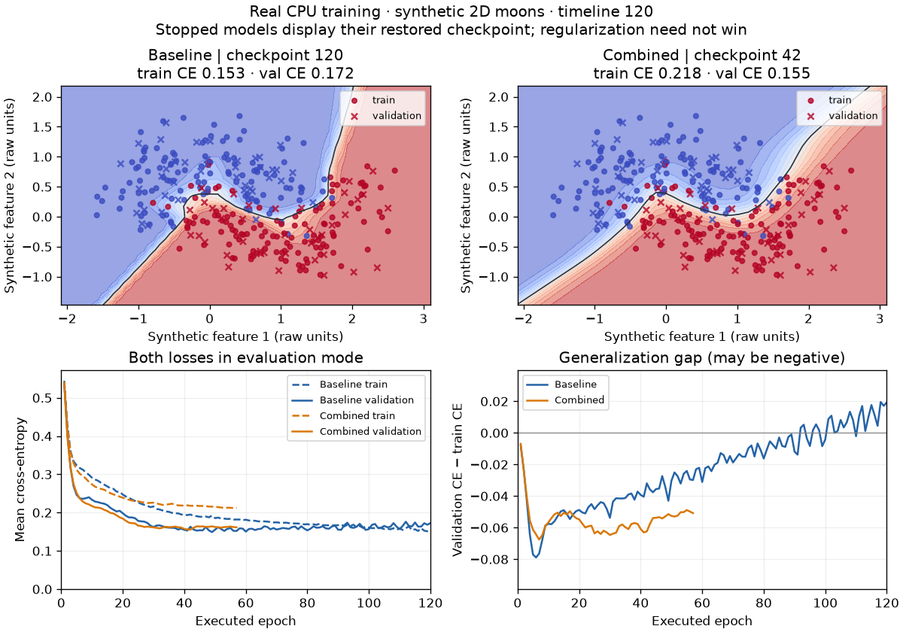

# Day 57 — Regularization in Deep Learning

When does changing the training procedure help a network generalize? This study
separates four mechanisms often grouped under regularization and implements a
small, controlled comparison. Lower training loss alone does not answer that
question, and enabling every technique is not a guarantee of improvement.

| Mechanism | What changes | Evaluation concern |
|---|---|---|
| Dropout | Random activation masks with inverted scaling | Disabled during ordinary inference; noise can also cause underfitting |
| AdamW weight decay | Shrinkage outside adaptive gradient moments | Strength interacts with learning rate and number of updates |
| Batch normalization | Feature normalization using batch statistics and learned affine parameters | Primarily affects optimization; running statistics matter at inference |
| Early stopping | Training duration and retained validation checkpoint | Patience is a selection hyperparameter; the test set must stay outside selection |

These distinctions matter when training document classifiers, embedding models
or neural rerankers. They do not replace representative data, leakage-safe splits
or evaluation of the actual application. Calling an LLM API with a different
temperature does not apply weight decay to that model.

## Explore and execute

- [example.py](example.py): six PyTorch CPU configurations, validation selection,
  one final selected-model test evaluation and a JSON report with per-epoch metrics.
- [from_scratch.py](from_scratch.py): NumPy inverted dropout, BatchNorm training
  forward and the vanilla SGD/L2 equivalence. No autodiff or running-statistics engine.
- [notes.md](notes.md): formulas, protocol, trade-offs, interview questions,
  dated execution evidence and proposed follow-up experiments.
- [tests/test_regularization.py](tests/test_regularization.py): framework agreement,
  checkpoint restoration including buffers, mode behavior and evaluation boundaries.
- [app.py](app.py) and [VISUAL_LAB.md](VISUAL_LAB.md): six interactive learning pages,
  real 2D CPU training, mathematical simulations and reproduction guidance.
- [visualizations.py](visualizations.py): bounded PNG/GIF and offline HTML exports;
  [visual_math.py](visual_math.py), [experiments.py](experiments.py) and
  [visual_render.py](visual_render.py) separate simulations, training and rendering.
- [tests/test_visual_lab.py](tests/test_visual_lab.py): numerical oracles, real
  checkpoint checks, temporary-directory exports and dashboard interaction tests.

From the repository root, with stable Python 3.11+ and an isolated environment:

```powershell
python -m pip install -e ".[dev,deep-learning]"
python 04-deep-learning/57-regularization/from_scratch.py
python 04-deep-learning/57-regularization/example.py
python scripts/validate_repo.py tests --scope 04-deep-learning/57-regularization
```

For a CPU-only PyTorch installation, follow the shared
[dependency guidance](../../docs/validation.md). Dependency ranges live in the
root `pyproject.toml`; this topic adds no separate requirements file.

The full example defaults to 120 epochs, batch size 64, 1,000 synthetic examples
and seed 57. A smaller execution check is:

```powershell
python 04-deep-learning/57-regularization/example.py --epochs 4 --n 100
```

Each invocation evaluates its selected model on the test set once. Use validation
results for further development; repeated changes informed by test results turn
that split into development data. Small test runs are execution checks, not
additional comparative scientific results.

## What the comparison measures

Synthetic noisy moons supply two signal features; 18 independent Gaussian
features provide irrelevant inputs. Stratified partitions contain 60% training,
20% validation and 20% test data. Standardization is fitted on training only.
There is no external dataset or download.

The baseline, dropout-only, decay-only, BatchNorm-only, early-stopping-only and
combined configurations share initial linear weights and precomputed batch
orders. The network is a `20-64-64-2` ReLU MLP, trained with AdamW at `lr=0.001`.
Dropout uses `p=0.3`; nonzero decay is `0.01`, applied only to linear weight
matrices. BatchNorm introduces 256 additional affine parameters.

Configurations without early stopping retain the last epoch. Configurations
with early stopping restore the absolute best validation checkpoint, including
BatchNorm buffers; patience is 15 and `min_delta=0.0001` controls patience resets.
Validation selects among the retained checkpoints. This deliberately combines
checkpoint policy and unequal training effort: it is not a compute-matched
ranking of regularization techniques.

Both reported training and validation metrics use `eval()` and exclude the
decay penalty. Training-mode stochastic losses would not be directly comparable
to these metrics. JSON records include configurations, seeds, versions, split
and order fingerprints, steps, selected epochs, histories and limitations.
Only the winning configuration receives test metrics.

## Evidence and takeaways

The [dated execution record](notes.md#executed-study--2026-11-18) reports actual
measurements and their scope. **Interpretation candidates require author
review.** Automated checks establish specific behavior; they do not approve
conclusions about generalization.

Inverted dropout preserves a conditional activation mean, not an entire
nonlinear prediction. AdamW decay differs from a coupled Adam/L2 penalty.
BatchNorm's training and evaluation paths differ, so a checkpoint includes
more than trainable weights. Early stopping selects among checkpoints already
seen; its minimum validation loss is itself subject to selection bias.

This is one synthetic seed/split with illustrative hyperparameters. It does not
establish effects on real documents, transformers, calibration, robustness or
production performance. Multi-seed and budget-controlled comparisons remain
proposals for the historical analytical configuration. The separate visual lab
uses a genuine 2D MLP and a distinct protocol; its results must not be pooled
with the 20-feature study above. Numeric reports and full visual exports remain
under ignored `outputs/`; preview selection is documented in the visual guide.

## Interactive learning lab

```powershell
python -m streamlit run 04-deep-learning/57-regularization/app.py --server.address 127.0.0.1 --browser.gatherUsageStats false
python 04-deep-learning/57-regularization/visualizations.py --export
```

Explore overfitting, masked forward passes, rotatable 3D decay surfaces,
BatchNorm distributions/running estimates, early-stopping replay and six real
training configurations. Training requires a button press, with bounded CPU
budgets and cached completed runs. The dashboard does not query the test split.
The export command generates five GIFs, six PNGs and three self-contained HTMLs;
its optional `--evaluate-test` flag requests a final selected-model evaluation.
See the [visual guide](VISUAL_LAB.md) for controls, seeds, output purposes,
mathematical cautions and the distinction between simulations and actual training.

### Selected visual previews



Seed 157: the baseline retains epoch 120; the combined model restores epoch 42
after stopping at 57. Blue denotes class 0 and red class 1; circles are training
observations and crosses validation. This is an observed comparison with
different checkpoint policies and budgets, not a general ranking.

- [Dropout activation distribution and conditional moments](assets/dropout_activation_distribution.png):
  a fixed untrained network, actual masks and training/inference distinctions.
- [Optimization trajectory animation](assets/optimizer_trajectories.gif):
  SGD, SGD/L2, Adam/L2 and AdamW on the declared shifted quadratic. J is only
  a reference surface for AdamW.

These three inspected previews total 985,553 bytes. Other exports remain
ignored and can be regenerated with the commands above.

[Deep Learning index](../README.md) · [Day 56: optimizer mechanics](../56-optimizers/)
