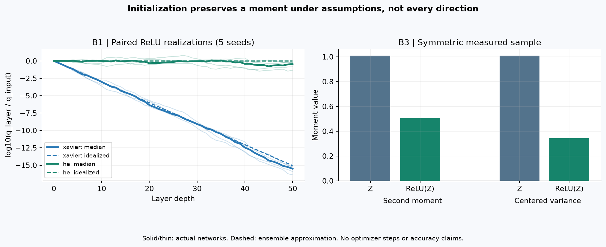

# Day 58 — Weight Initialization and Training Stability

Why can the same deep network start with useful signals, nearly zero signals,
or enormous signals before its first optimizer step? This study connects
Xavier and He scales to forward second moments and backward sensitivities.
Normalization changes both the representations and their derivatives.

The analytical examples use **synthetic standard Gaussian inputs**, constant-width ReLU
layers and CPU float64 arithmetic. They perform no supervised training and
make no accuracy, convergence or generalization comparison.
The separate [visual laboratory](VISUAL_LAB.md) adds an offline dashboard,
measured animations, normalization mechanisms, multi-seed supervised experiments
and optional Jacobian spectra, with its own protocol and evidence boundaries.

## What to inspect

- [from_scratch.py](from_scratch.py): NumPy initialization scales, including
  rectangular fan-in/fan-out, and a paired forward-propagation demonstration.
- [example.py](example.py): official PyTorch initializers, five matched
  configurations, layerwise activation statistics and two backward diagnostics.
- [notes.md](notes.md): assumptions, derivations, normalization trade-offs,
  interview questions, primary references and dated execution evidence.
- [tests/test_initialization.py](tests/test_initialization.py): hand oracles,
  paired scales, framework agreement, finite-difference gradients, normalization
  axes, reproducibility and invalid-input checks.
- [main.py](main.py), [experiments.py](experiments.py),
  [visualizations.py](visualizations.py) and [dashboard.js](dashboard.js):
  executable offline visual lab, cached CPU measurements and interactive controls.
- [VISUAL_LAB.md](VISUAL_LAB.md) and [tests/test_visual_lab.py](tests/test_visual_lab.py):
  figure-by-figure interpretation guide, reproduction protocol and real export tests.

From the repository root, in an isolated stable Python 3.11+ environment:

```powershell
python -m pip install -e ".[dev,deep-learning]"
python 04-deep-learning/58-weight-initialization/from_scratch.py
python 04-deep-learning/58-weight-initialization/example.py
python scripts/validate_repo.py tests --scope 04-deep-learning/58-weight-initialization
```

Dependency bounds remain in the root `pyproject.toml`; see the shared
[CPU PyTorch guidance](../../docs/validation.md). No dataset download, GPU,
credentials or new dependencies are needed.

Optional machine-readable output, using a fresh filename for each run:

```powershell
python 04-deep-learning/58-weight-initialization/example.py --output outputs/day58/my-run.json
```

The JSON includes all layer measurements, configuration, versions, timestamp
and limitations. Existing records are never silently overwritten. Reports stay
under ignored `outputs/`. Visual exports have separate commands and run records.
A small execution check can use `--width 16 --depth 3 --batch 8`.

## A comparison with two backward questions

The default PyTorch run uses seed 58, 128 examples, width 128 and 20 bias-free
`Linear → [LayerNorm] → ReLU` blocks. It compares normal weights with standard
deviation 0.06, Xavier normal with gain 1, He normal with ReLU/fan-in, the same
He weights with LayerNorm, and normal weights with standard deviation 0.18.
LayerNorm is before ReLU, with epsilon $10^{-5}$, scale 1 and shift 0.

Identical underlying Gaussian weight draws, inputs and output probes are shared
across PyTorch configurations. NumPy uses its own random-number generator and
separately paired matrices; the two scripts are distinct realizations.

| Diagnostic | What it answers | Important boundary |
|---|---|---|
| Activation second moment $q_l=\operatorname{mean}(a_l^2)$ | Does forward magnitude shrink or grow? | ReLU activations have nonzero mean; this is not centered variance |
| RMS of $\partial L/\partial a_l$, for $L=\operatorname{mean}(a_D^2)$ | How does this particular scalar objective backpropagate? | Its output gradient already depends on the initializer's output scale |
| RMS of $J_{D:l}^{\top}u$, with output RMS of $u$ fixed at 1 | How does a common output adjoint propagate? | One direction does not determine the Jacobian spectrum |
| RMS of $\partial L/\partial W_l$ | What scale do linear-weight gradients have? | Separate from activation gradients; not an optimizer update |

JSON layer 0 denotes the input; layers 1–20 denote post-ReLU activations.
The report also keeps centered variance, mean and zero fraction. The terminal
prints endpoint summaries; the full depth profile is in JSON.

## Evidence and useful conclusions to review

The [2026-11-18 execution record](notes.md#executed-study--2026-11-18) contains
actual measurements. In that realization, small/Xavier scales attenuated the
forward signal and fixed-adjoint sensitivity, while the large scale amplified
both. He did not keep every layer's moment exactly constant. LayerNorm kept
the final forward moment controlled while changing backward behavior.
**These interpretation candidates require author review.**

The underlying lessons are that fan sizes, activation, gain and normalization
placement all matter. Average magnitude preservation is weaker than preserving
every input direction. Neither normalization nor a finite diagnostic proves
that an optimizer will converge. The notes preserve the analytical phase's
proposed extensions; the separately dated visual phase executes multi-seed
propagation, depth/scale sweeps and an explicitly distinct supervised experiment.

## Run the interactive visual lab

```powershell
python 04-deep-learning/58-weight-initialization/main.py --mode quick --no-display
python 04-deep-learning/58-weight-initialization/main.py --mode full --no-display
python 04-deep-learning/58-weight-initialization/main.py --mode interactive --open
```

The quick mode exports five measured GIFs, five PNGs, a standalone dashboard
and a standalone rotatable 3D surface. Full mode adds measured small-network
Jacobian spectra and more seeds/updates. Interactive mode reuses quick measurements
when cached and exports HTML only. There is no running server or external runtime.
Use `--seed`, `--depth`, `--width` and `--output-dir` for a new bounded experiment.

The dashboard selects a documented grid of actual measurements, including
ReLU/tanh and no/BatchNorm/LayerNorm normalization. It separates forward moments,
fixed-probe activation gradients, loss-based weight gradients and actual training.
The 3D surface represents signal statistics rather than an optimization loss.
Zeros/non-finite measurements are explicit; no positive plotting floor hides them.
The [visual guide](VISUAL_LAB.md) maps every artifact's axes, empirical/theoretical
parts, useful patterns and unsupported conclusions. Generated collections remain
ignored; a small inspected preview selection is documented separately.

### Selected previews



The PNG above uses five seeds and depth 50 from the full visual experiment.
Thin/solid curves are measured networks; dashed curves are analytical
approximations. The right panel separates second moment and centered variance.

- [Paired Xavier/He propagation GIF](assets/xavier_vs_he.gif): seed 58, depth 30,
  matched weights and one fixed color scale across 31 actual layer states.
- [Normalization axes and batch-companion mechanisms](assets/normalization_axes.png):
  measured synthetic batches, shared heatmap scale and 80 repeated batch estimates.

These inspected previews total 1,493,694 bytes. The GIF and PNGs have distinct
configurations as labeled; their measurements are not pooled. Full exports,
standalone HTMLs and measurement records remain ignored and regenerable.

These diagnostics can help inspect a new embedding-model head or a custom MLP.
Pretrained parameters and architecture-specific residual or attention scaling
require their own conventions. This educational code is not a production
initialization library or evidence about Transformers, CNNs or mixed precision.

[Deep Learning index](../README.md) · [Activation functions](../55-activation-functions/)
· [Regularization and BatchNorm](../57-regularization/)
