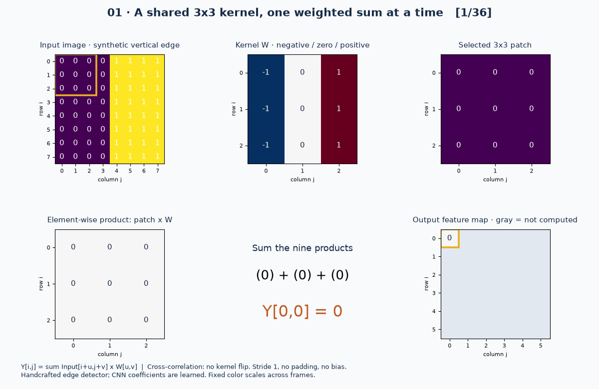
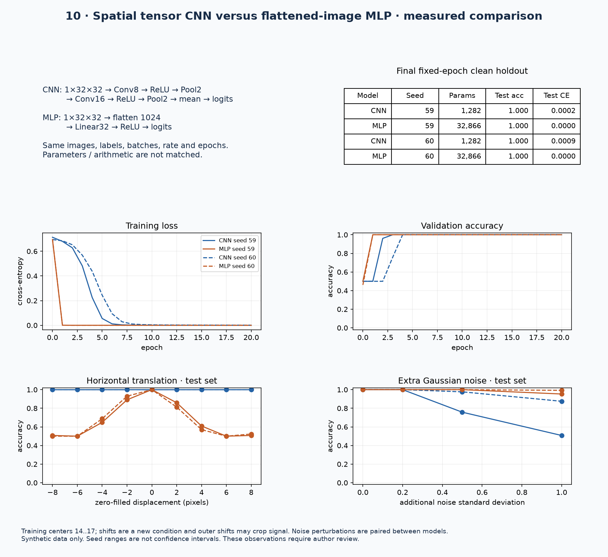

# Day 59 — Convolutional Neural Networks

How do local, shared filters turn pixels into useful features, and what does
spatial downsampling discard? This study connects cross-correlation, channels,
stride, padding, dilation, receptive fields and pooling to a small trainable
image classifier. CNNs are useful building blocks for image classification,
OCR feature extraction, detection and segmentation; those tasks require their
own architectures and representative evaluation.

## From a local operator to a classifier

A convolutional layer applies the same learned local transformation at many
positions. Each output channel combines all input channels in a standard
`groups=1` convolution. ReLU introduces a nonlinearity, max pooling reduces
resolution, and spatial averaging gives the classification head eight features.

| Stage | Shape for a batch of size $N$ | Trainable parameters |
|---|---|---:|
| Synthetic grayscale input | $(N,1,16,16)$ | 0 |
| Conv2d, 8 filters, $3\times3$, stride 1, zero padding 1; ReLU | $(N,8,16,16)$ | 80 |
| MaxPool2d, $2\times2$, stride 2 | $(N,8,8,8)$ | 0 |
| Global spatial mean | $(N,8)$ | 0 |
| Linear classifier | $(N,2)$ raw logits | 18 |

The 98 parameters are shared across spatial positions. Parameter count does
not measure inference cost: every filter is still applied across the image.
`CrossEntropyLoss` receives raw logits and integer class labels.

## Files and execution

- [from_scratch.py](from_scratch.py): single-channel NumPy cross-correlation,
  max/average pooling, output-size and receptive-field calculations.
- [example.py](example.py): deterministic CPU training on synthetic bars and
  an independent same-generator test set; writes a new dated JSON record.
- [notes.md](notes.md): equations, assumptions, applications, interview prompts,
  primary references and the dated execution record.
- [tests/test_cnns.py](tests/test_cnns.py): hand-computed oracles, PyTorch
  agreement, spatial geometry, invalid inputs and a small training check.

From the repository root with stable Python 3.11+:

```powershell
python -m pip install -e ".[dev,deep-learning]"
python 04-deep-learning/59-cnns/from_scratch.py
python 04-deep-learning/59-cnns/example.py
python scripts/validate_repo.py tests --scope 04-deep-learning/59-cnns
```

The canonical dependencies are in [pyproject.toml](../../pyproject.toml).
For CPU wheel installation guidance, see the [validation contract](../../docs/validation.md).
The scripts use no external datasets, downloads, pretrained weights or GPU.
The default classifier run uses 256 training and 128 test images, 30 epochs,
batch size 32 and Adam at learning rate 0.01. Use `--seed` or `--epochs` for
a separately configured run. New JSON files go under the ignored topic
`outputs/` directory; `--output` accepts a new path and refuses overwrites.
That analytical command produces no plots. The separate visual phase below
uses its own 32×32 data, models and measurement protocol.

## Interactive visual learning lab

See filters move, inspect the products inside each weighted sum, choose a
neuron and trace its input support, rotate channel/tensor stacks, and compare
actual trained CNN/MLP predictions. The local Streamlit app has eleven focused
sections; training is explicit and cached rather than repeated on navigation.

```powershell
python 04-deep-learning/59-cnns/example.py --generate-visuals
python -m streamlit run 04-deep-learning/59-cnns/app.py --server.address=127.0.0.1 --browser.gatherUsageStats=false
```

Generation runs the matched two-seed CPU experiment and creates **six GIFs,
five PNGs and three standalone offline HTMLs**, plus measurement records and
an artifact manifest, under a fresh ignored `outputs/visual-lab/run-*` folder.
Use `--visual-report PATH/TO/experiment.json` with `--generate-visuals` to
refresh presentation from saved measurements without training again.
The app can read the latest exported run or run an explicit new comparison
from its sidebar. Nothing is downloaded or trained at app startup.

| Question | Visual / control |
|---|---|
| Which nine products create this output pixel? | Sliding-kernel GIF and output-position slider |
| How do filters change the same image? | Six numeric kernels and a Plotly filter selector |
| How does an RGB kernel sum across channels? | Rotatable discrete channel planes, output-filter and pixel selectors |
| How do stride and padding change the grid? | N/K/S/P controls, sampled centers and the output-size formula |
| What does pooling discard? | Synchronized 8×8 → 4×4 max/mean animation |
| Which original pixels can influence a neuron? | Layer/position selector and structural support clipped at boundaries |
| Does shifting features preserve predictions? | Interior-aligned operator control, per-image probabilities and stress sweeps |
| Where do spatial dimensions and channels change? | Rotatable nine-stage CNN architecture with actual parameter counts |
| What changed during optimization? | Real epoch 0/1/2/5/10/20 kernels, shared-scale activations and validation curves |
| How do CNN and MLP behaviors differ? | Paired learning/evaluation curves and an actual failure gallery |

[VISUAL_LAB.md](VISUAL_LAB.md) explains every artifact's operation, controls,
observations, relevance and limitations, as well as installation, execution,
the dated results and output policy. Implementation is separated into
[spatial mechanisms](visual_core.py), [experiments](experiments.py),
[renderers](visualizations.py), [dashboard](app.py) and
[focused tests](tests/test_visual_lab.py). The renderers reuse the existing
NumPy operators rather than duplicating them.

### Selected previews



This GIF retains all 36 valid window positions and fixed numerical scales.
The gray cells are not computed yet. The handcrafted detector explains the
operation; learned filters are inspected separately.



The comparison uses 1,282-parameter CNNs and 32,866-parameter MLPs, two seeds,
identical splits and a fixed 20-epoch Adam budget. Both architectures reached
1.0 clean test accuracy. The chosen CNNs retained that accuracy at the measured
horizontal shifts; the MLPs were more resistant to the strongest added noise.
These are **interpretation candidates requiring author review**, not an
architecture ranking or a proof of invariance.

- [Receptive-field growth GIF](assets/06_receptive_field_growth.gif): nominal
  spans 1→3→4→8→12 with exact structural support on the real input.
- [Actual filter-learning GIF](assets/09_filter_learning.gif): six observed
  checkpoints, one fixed weight scale, no interpolated weights.

Four inspected previews total 2,761,634 bytes. The 1,933,508-byte convolution
GIF is an intentional size exception preserving its readable arithmetic and
36 exact states; the [selection record](VISUAL_LAB.md#selected-previews-and-output-policy)
documents the lossless check. Other generated GIFs, PNGs, HTMLs and JSONs remain
ignored and reproducible. Preview selection is distinct from author review.

## Executed evidence and its boundary

The [2026-11-18 record](notes.md#executed-study--2026-11-18) reports the actual
CPU run: training cross-entropy fell from 0.714487 to 0.046861; all 128 synthetic
test images were classified correctly, against a 0.5 majority-class baseline.
Both test classes had 64 samples. These measurements describe one fixed
configuration and one same-generator holdout, with no hyperparameter search.

**Interpretation candidate — author review required:** the compact network
learned information useful for this bar-orientation task. The result does not
identify the meaning of individual filters or establish robustness to shifts,
rotations, new noise levels, real images or source changes. A perfect score on
this simple generator is not a realistic computer-vision benchmark.

## Key takeaways

- Deep learning “convolution” usually computes cross-correlation without
  flipping the kernel; training learns the filter coefficients.
- Output resolution, receptive-field span and parameter count answer
  different questions. A pooled activation here has a $4\times4$ theoretical
  receptive field; the global mean subsequently aggregates the whole map.
- Shared local filters provide a useful spatial inductive bias. This small
  one-convolution model demonstrates a mechanism rather than a deep hierarchy.
- Stride-1 convolution has translation-equivariance under appropriate boundary
  assumptions. Pooling and global averaging do not guarantee that this finite
  classifier is invariant to arbitrary translations.
- Downsampling trades spatial detail for a smaller representation. That trade
  matters especially for small defects, fine text and dense prediction.

[Deep Learning index](../README.md) · [Weight initialization](../58-weight-initialization/)
