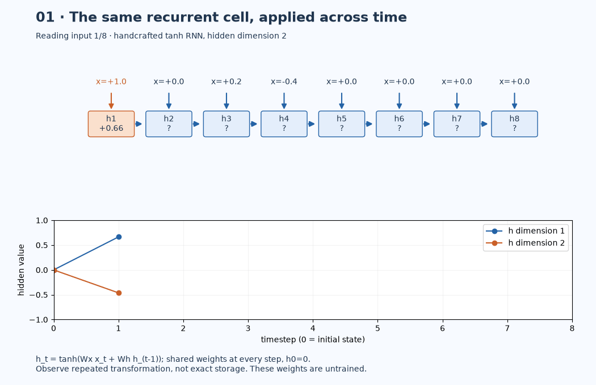
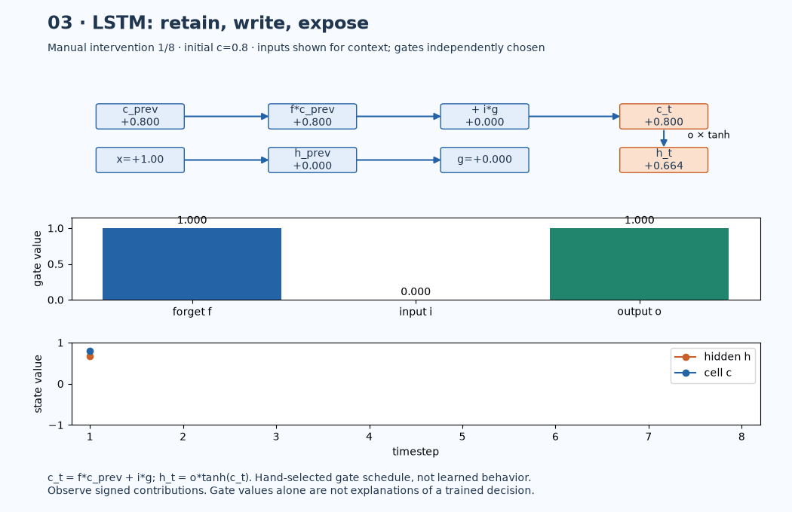

# Day 60 — RNNs, LSTMs and GRUs

[Deep Learning index](../README.md) · [Roadmap](../../ROADMAP.md)

How can a model retain an early observation while processing later noise?
Recurrent networks update a shared hidden state at each position. LSTMs add
gated cell memory; GRUs gate a single hidden state. These mechanisms improve
possible information paths without guaranteeing that training discovers them.

This study connects recurrent equations, Backpropagation Through Time (BPTT),
state boundaries and the limitations that motivated attention. It uses only
**synthetic delayed-bit sequences**, with no downloaded dataset or service.
Compact recurrent state can be useful for streaming telemetry or sequence
classification; this exercise does not validate either application.

## Read and run

| File | Purpose |
|---|---|
| [notes.md](notes.md) | Equations, BPTT, GRU conventions, forecasting pitfalls, interview questions, references and dated execution evidence |
| [example.py](example.py) | CPU PyTorch comparison with validation-selected checkpoints, held-out BCE/accuracy and simple controls |
| [from_scratch.py](from_scratch.py) | NumPy LSTM forward steps exposing gates; no training or BPTT implementation |
| [tests/test_recurrent.py](tests/test_recurrent.py) | Hand oracles, NumPy/PyTorch agreement, chunked states, validation selection and deterministic small training |

From the repository root, with stable Python 3.11+ and an isolated environment:

```bash
python -m pip install -e ".[dev,deep-learning]"
python 04-deep-learning/60-rnn-lstm-gru/from_scratch.py
python 04-deep-learning/60-rnn-lstm-gru/example.py
python scripts/validate_repo.py tests --scope 04-deep-learning/60-rnn-lstm-gru
```

The default comparison runs all three cells at lengths 10 and 50, with hidden
size 16, 20 epochs, Adam at 0.005, gradient-norm clipping at 1 and one CPU
thread. Dependencies remain in [pyproject.toml](../../pyproject.toml).
For a smaller **new experiment**, choose one cell or length:

```bash
python 04-deep-learning/60-rnn-lstm-gru/example.py --cell gru --lengths 20 --epochs 10
```

Each run creates a new timestamped JSON under ignored `outputs/`, including
configuration, environment, epoch history, metrics, hypothesis, interpretation
candidate and limitations. `--output` accepts a new path and refuses to replace
an existing record. Analytical JSON records remain ignored; the selected visual
previews below have a separate generation path and evidence record.

## What the task establishes

For each independent sequence, a fair random bit is encoded as -1 or +1 in
feature 0 at the first step. Later values are independent standard-normal
distractors; feature 1 marks the first step. The final hidden state must predict
the bit, so sequence length $T$ introduces $T-1$ recurrent transitions after
the signal. A direct first-step sign rule solves this generator exactly. It is
a task-solvability control and a reminder that recurrence is unnecessary if the
first observation is already explicitly accessible at decision time.

Train, validation and test use separate seeds. Every cell receives the same
samples and minibatch orders at a given length. Each model trains for the full
budget; its earliest minimum-validation-BCE epoch is restored before test
evaluation. All predefined configurations are reported, without selecting an
architecture using test results. No hidden state carries across independent
sequences or minibatches.

The [dated execution record](notes.md#executed-study--2026-11-19) distinguishes
observed values from interpretation candidates. **Author review required.**
Equal hidden sizes imply unequal parameter budgets. One seed, one optimizer
configuration and same-generator holdouts cannot establish a general ranking,
real forecasting performance, long-context robustness or production readiness.

## Key takeaways

- BPTT accumulates contributions to shared parameters across time; recurrent
  Jacobian products can suppress or amplify early learning signals.
- LSTM additive cell updates and GRU interpolation provide gated paths.
  Clipping large gradients cannot reconstruct vanished gradients.
- Carrying state across chunks can preserve inference computation. Detaching
  state preserves values while truncating the training graph; resetting state
  changes the forward computation.
- Attention changes access to context. Standard full attention has quadratic
  attention work in sequence length; recurrence has a sequential bottleneck.
  Parallel training does not make autoregressive generation parallel.

## Interactive Visualizations — Understanding Recurrent Memory

The [visual lab guide](VISUAL_LAB.md) maps each visual to its mathematical
question, controls, measured protocol and limitations. It uses the same
canonical installation command above, without additional dependencies.

```bash
python 04-deep-learning/60-rnn-lstm-gru/visualizations.py --quick
python 04-deep-learning/60-rnn-lstm-gru/visualizations.py --full
python 04-deep-learning/60-rnn-lstm-gru/visualizations.py --only lstm
python 04-deep-learning/60-rnn-lstm-gru/visualizations.py --only gradients
python 04-deep-learning/60-rnn-lstm-gru/visualizations.py --only hidden3d
```

The generator prints a new ignored output directory. Open its HTML files
directly in a browser: each includes its runtime and data, so no server or
internet is needed. Quick mode trains nine small CPU models; full mode uses
three seeds and 27 fits. Cached numerical results/checkpoints avoid training
again when regenerating plots. `--matched-budget --only comparison` adds an
approximately equal-parameter protocol. Existing exports are not overwritten.

| Visual | Learn by interacting |
|---|---|
| RNN unrolling | Edit inputs and recurrent strength; inspect both actual hidden coordinates and shared transitions |
| Gradient propagation | Compare adjustable analytical $|a|^k$ with real PyTorch input-loss gradients; these are distinct quantities |
| LSTM gates | Independently manipulate retention, writing and exposure, or switch to gates computed from fixed NumPy weights |
| GRU gates | Adjust update/reset gates and compare PyTorch's candidate with a reset-before variant |
| Architecture comparison | Explore measured accuracy by length, validation curves, actual gradients, parameters and fit time |
| Hidden states in 3D | Rotate actual trained trajectories projected with NumPy SVD; inspect timesteps, classes and explained variance |
| Recurrence vs attention | Inspect illustrative causal attention weights and weighted values alongside sequential state propagation |





[Scalar vanishing/exploding-gradient animation](assets/02_gradient_vanishing_exploding.gif)
· [Download/open the standalone LSTM gate explorer](assets/03_lstm_gates_interactive.html)

The mechanism GIFs and attention example are analytical or explicitly
untrained/manual demonstrations. Empirical gradient, comparison and 3D HTMLs
use actual trained PyTorch checkpoints. In the executed full comparison,
length-50 recall varied greatly across three seeds; no general architecture
ranking follows. Quick/full visual measurements are documented separately from
the analytical run. **Interpretation candidates require author review.**

Implementation: [visualizations.py](visualizations.py) orchestrates exports;
[visual_core.py](visual_core.py) contains mechanisms and diagnostics;
[experiments.py](experiments.py) reuses the existing training loop with measured
probes and cache validation; [lab_controls.js](lab_controls.js) supplies embedded
offline controls. [Visual tests](tests/test_visual_lab.py) check numerical logic,
checkpoint reuse and real temporary exports. Remaining HTMLs, PNG/CSV/JSON,
checkpoints and intermediate assets stay ignored and are generated on demand.
