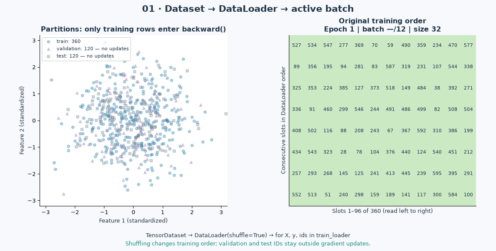
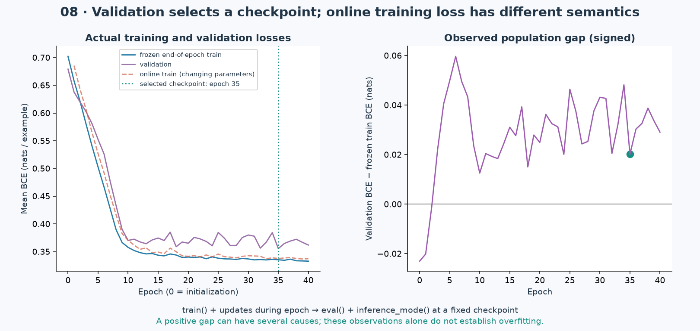

# Day 62 — PyTorch Training Loop

[Deep Learning index](../README.md) · [Roadmap](../../ROADMAP.md)

What must happen between loading a batch and reporting a held-out score?
This study follows the complete path: `Dataset`, `DataLoader`, model, logits,
loss, backward pass, optimizer update, validation selection and final evaluation.
The loop is explicit so that each operation and its statistical role can be
inspected. That control matters when debugging custom losses, fine-tuning
classifiers or building specialized batches for retrieval models.

## The executable question

The PyTorch example uses **entirely synthetic data** with two Gaussian features,
a nonlinear interaction and noisy binary labels. A linear classifier and a
2 → 16 → 1 ReLU MLP receive the same partitions, training order and fixed Adam
budget. Preprocessing is fitted on training data only. Each candidate retains
the epoch with lowest validation BCE; validation also selects the architecture.
Only that restored model receives a final test evaluation, with a fixed zero
logit threshold. No downloads, credentials, plotting or accelerator are required.

The NumPy example isolates analytical logistic-loss gradients and mini-batch
SGD on a **different synthetic linear task**. Its training scores and the
PyTorch holdout scores answer different questions and must not be compared.
This is an educational implementation, not a replacement for library trainers.

| File | What to inspect |
|---|---|
| [example.py](example.py) | Train-only scaling, TensorDataset/DataLoader, explicit updates, weighted losses and restored-model selection |
| [from_scratch.py](from_scratch.py) | Stable logistic BCE, analytical gradients and simultaneous SGD updates |
| [notes.md](notes.md) | Reduction formulas, evaluation semantics, assumptions, pitfalls, interview questions and dated results |
| [tests/test_training_loop.py](tests/test_training_loop.py) | Finite differences/autograd, update boundaries, uneven batches, snapshots and test isolation |
| [references.md](references.md) | Official API and reproducibility references |

## Run from the repository root

Use stable Python 3.11+ and the canonical
[deep-learning and dev extras](../../pyproject.toml):

```bash
python -m pip install -e ".[dev,deep-learning]"
python 04-deep-learning/62-pytorch-training-loop/from_scratch.py
python 04-deep-learning/62-pytorch-training-loop/example.py
python scripts/validate_repo.py tests --scope 04-deep-learning/62-pytorch-training-loop
```

The PyTorch CLI defaults to CPU float32, one numerical thread, deterministic
algorithms, seed 42, 60 epochs, batch size 64 and learning rate 0.001. It prints
JSON with configuration, versions, per-epoch scalar history, selected epoch,
validation metrics and the selected model's test metrics. Use a fresh filename
for an optional local record:

```bash
python 04-deep-learning/62-pytorch-training-loop/example.py --output 04-deep-learning/62-pytorch-training-loop/outputs/my-run.json
```

Existing files are rejected. Analytical `outputs/` records remain ignored.
Importing the analytical module does not start training
or change global thread settings. The CLI controls deterministic settings;
the imported helpers use the caller's settings. Fixed seeds do not guarantee
identical results across PyTorch releases, platforms or devices.

## Interactive visual learning lab

The separate [visual guide](VISUAL_GUIDE.md) connects ten demonstrations:
actual DataLoader batches, forward tensors, logit BCE, backward gradients,
a faithful two-parameter loss surface, controlled SGD/Adam/rate/batch-size
comparisons, evolving decision boundaries, checkpoint selection, Dropout modes
and an interactive dashboard synchronized to actual training updates.

```bash
python 04-deep-learning/62-pytorch-training-loop/visualize_training_loop.py --quick
python 04-deep-learning/62-pytorch-training-loop/visualize_training_loop.py --all
python 04-deep-learning/62-pytorch-training-loop/visualize_training_loop.py --interactive
```

The [entry point](visualize_training_loop.py), [event recorder](visual_core.py),
[renderers](visual_figures.py) and [visual tests](tests/test_visual_lab.py) are
independent of notebooks. Open the generated Plotly HTMLs locally to rotate,
zoom, play/pause and scrub measured updates. The optimizer menu selects eight
prerecorded configurations; CLI controls rerun training with other settings.
Everything runs on CPU with the same canonical installation above.





The historical preview's right panel says “Observed population gap”. Its
plotted quantity is the **empirical validation–frozen-training BCE difference**,
not a known population-risk gap. The generator uses that more precise label;
the original preview and measurements are preserved.

The [selected-model boundary comparison](assets/07_final_comparison.png) is a
third curated preview. These previews come from the distinct 600-row,
2→8→1 visual protocol. They must not be combined with the historical
1,800-row, 2→16→1 analytical results below. The
[dated visual evidence](VISUAL_GUIDE.md#execution-evidence--2026-11-19) keeps
configurations, observations and limitations separate. Full galleries,
HTMLs and numerical records remain in ignored timestamped run directories.

## Evidence and boundaries

The [2026-11-19 execution record](notes.md#executed-study--2026-11-19) documents
the hypothesis, complete protocol, versions, measurements and limitations.
The MLP was selected by validation BCE (0.314760 versus 0.647401 for linear).
Its final test BCE was 0.412863 and accuracy was 77.33% on 300 synthetic cases.
These are observations from one fixed run, not a general architecture ranking
or evidence of production usefulness. **Author review required** for all
interpretation candidates.

## Takeaways

- `backward()` accumulates gradients; `step()` changes parameters. Clear stale
  gradients before each independent update.
- Pass raw logits to `BCEWithLogitsLoss`; use matching `(N, 1)` float targets.
- `eval()` changes mode-dependent layers; `inference_mode()` controls autograd.
  The evaluation helper leaves the model in eval mode; training sets train mode.
- Weight batch means by the number of examples actually processed. Training
  online loss spans changing parameters; frozen-checkpoint loss has a different meaning.
- A copied model state is sufficient for this inference selection. Exact
  training continuation also needs optimizer, RNG and data-order state.
- Validation selects; test measures the selected model. Repeated development
  against that test score would consume its holdout status.
