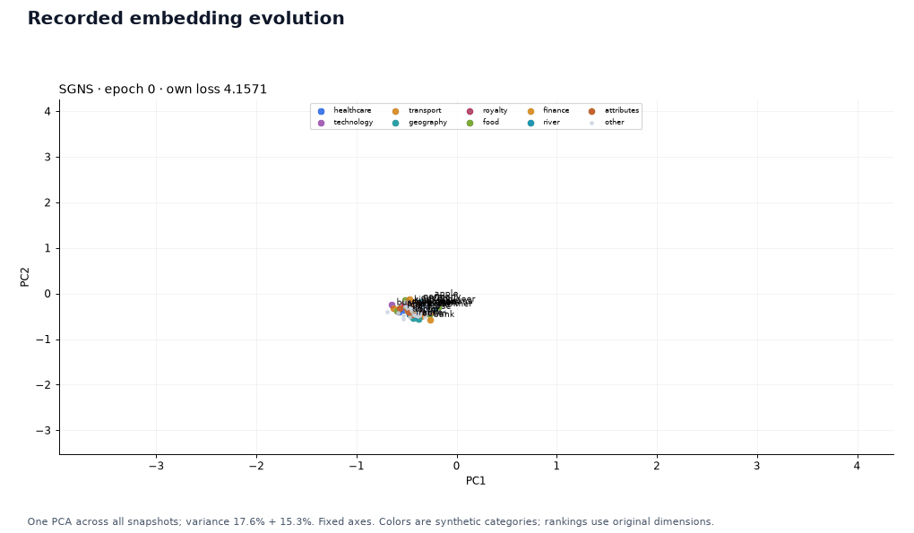
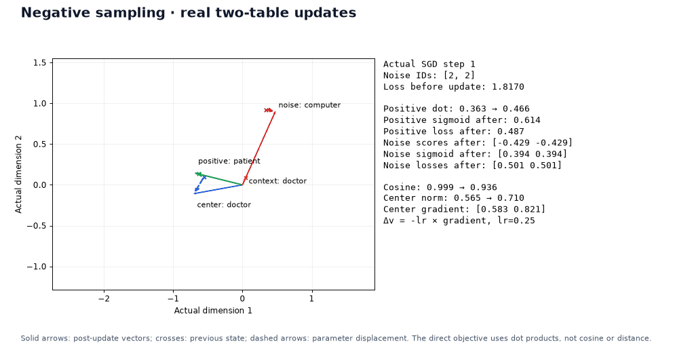
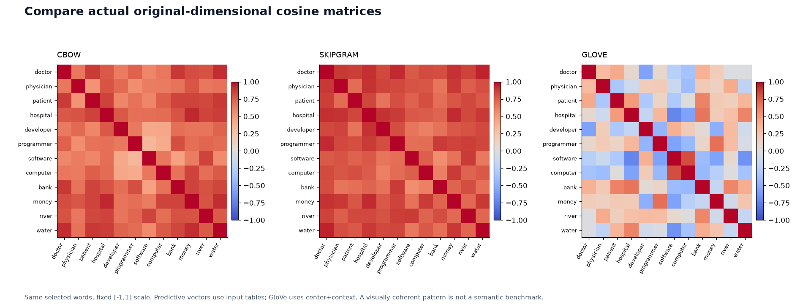

# Day 65 — Word2Vec, GloVe and Static Embeddings

Can shared contexts produce useful word geometry, and does fitting a training
objective guarantee good neighbors or analogies? This study learns static word
vectors through CBOW, Skip-gram and GloVe, then inspects cosine rankings in the
original eight-dimensional space.

## From context to vectors

The distributional hypothesis connects similar usage with related meaning.
CBOW predicts a center word from averaged context embeddings; Skip-gram predicts
each context word from a center embedding. GloVe reconstructs aggregated,
weighted log co-occurrences. All three learn one vector per vocabulary entry:
the financial and geographical uses of `bank` share a single representation.

These mechanisms explain useful word-level features and inexpensive terminology
exploration baselines. Their geometry also illustrates why cosine alone cannot
validate semantic equivalence, query expansion or document retrieval.

The analytical comparison uses **32 synthetic three-token sentences**, defined
in code. Several word pairs intentionally share contexts. No external corpus,
pretrained model, download, credentials or service is required.

## Files and execution

- [example.py](example.py): common synthetic corpus, three trained models,
  similarity margins, nearest neighbors, analogy rankings and a JSON report.
- [from_scratch.py](from_scratch.py): educational NumPy objectives, analytical
  gradients, batch optimization, co-occurrences, cosine and vector search.
- [tests/test_embeddings.py](tests/test_embeddings.py): hand counts, finite
  differences for every parameter group, simultaneous updates, repeatability,
  ranking policies and invalid-input checks.
- [notes.md](notes.md): derivations, simplifications, limitations and the dated
  execution record, including unsuccessful analogy results.
- [interview_questions.md](interview_questions.md): objective, geometry,
  evaluation and deployment trade-offs.
- [references.md](references.md): primary papers and data provenance.
- [visualize_embeddings.py](visualize_embeddings.py): visual CLI for independent
  demonstrations and complete CPU-only generation.
- [embedding_lab.py](embedding_lab.py) and [embedding_html.py](embedding_html.py):
  synthetic template corpus, SGNS, snapshot/evaluation logic and offline HTML.
- [VISUAL_LAB.md](VISUAL_LAB.md): visual questions, output catalog, controls,
  experimental protocols and execution evidence.
- [tests/test_visual_core.py](tests/test_visual_core.py) and
  [tests/test_visual_exports.py](tests/test_visual_exports.py): numerical checks
  and real temporary-directory exports for the visual phase.

From the repository root, with Python 3.11+:

```powershell
python -m pip install -e ".[dev]"
python 05-transformers-llms/65-static-embeddings/example.py
python 05-transformers-llms/65-static-embeddings/from_scratch.py
python scripts/validate_repo.py tests --scope 05-transformers-llms/65-static-embeddings
```

Dependencies are declared centrally in [pyproject.toml](../../pyproject.toml).
The analytical scripts use only NumPy and the standard library at runtime. Both
print JSON and write no files. `from_scratch.py` also provides a separate,
smaller GloVe smoke example; it does not rerun the 32-sentence comparison.

The Word2Vec architectures here use **full softmax**, with dense features and
full-batch gradient descent. This makes the math inspectable for 31 words.
These analytical scripts do not implement negative sampling. The separate
visual laboratory adds a real SGNS implementation and records its own runs.
The GloVe learner uses the weighted reconstruction objective with batch gradient
descent instead of the original AdaGrad optimizer. These are educational
implementations, not replacements for scalable embedding libraries.

## What the run establishes

In the [November 24 execution](notes.md#execution-record--2026-11-24), all three
objectives decreased and the selected shared-context cosine margins were
positive. The analogy `man:king::woman:?` returned `prince`, `queen` and `bank`
respectively for CBOW, Skip-gram and GloVe. GloVe's nearest neighbor to `doctor`
was `vehicle` despite its small reconstruction residual.

These are observations on engineered training data. The loss scales differ,
the representation policies differ, and no held-out semantic benchmark was
run. The results do not rank the methods. Interpretation candidates remain
**author review required**.

## Takeaways and limits

- Context prediction and co-occurrence reconstruction provide different
  training signals. Neither directly labels synonymy or factual equivalence.
- Low training loss does not certify useful nearest neighbors or analogies.
- Cosine is an angular score, not a calibrated probability. Zero vectors raise
  an error; unknown words raise an explicit OOV error.
- Analogy search uses the raw offset $v_b-v_a+v_c$, cosine ranking, source-word
  exclusion and lexical order for exact ties. A constructed unit test verifies
  the arithmetic; successful learned analogies are not assumed.
- Word order, negation, polysemy, corpus bias and unknown vocabulary need
  separate consideration. Averaging static vectors does not automatically
  produce a retrieval-trained sentence encoder.
- Dense $|V|\times|V|$ counts and event feature matrices are deliberately tiny.
  There is no throughput, memory scalability or production validation.

## Execute the visual laboratory

```powershell
python 05-transformers-llms/65-static-embeddings/visualize_embeddings.py --demo all --no-show
python 05-transformers-llms/65-static-embeddings/visualize_embeddings.py --demo negative_sampling --quick --no-show
python 05-transformers-llms/65-static-embeddings/visualize_embeddings.py --demo analogies --seed 42 --no-show
```

The [visual guide](VISUAL_LAB.md) separates the larger synthetic corpus from the
historical analytical run. It covers actual two-table SGNS updates, fixed-PCA
training evolution, GloVe reconstruction, original-space analogies, polysemy,
hyperparameter diagnostics and manually judged synthetic retrieval. Static
plots, Pillow GIFs, standalone offline HTML and numerical records are generated
under timestamped ignored outputs. No external model download or server is
required. A conceptual contextual-encoder diagram is explicitly illustrative.
The historical notes retain the experiments and suggestions from the analytical
phase; the visual guide identifies what was subsequently implemented and run.

The visual phase uses NumPy, pandas, Matplotlib, Pillow, Plotly and scikit-learn
from the root dependencies. No additional framework is required. Interpretations
and preview curation have separate evidence requirements from passing tests.

### Selected visual previews

These six locally inspected Git candidates total **1,492,620 bytes**. Dated
HTML/CSV/JSON/NPZ runs and other exports stay ignored. Preview selection is not
author approval of the interpretation.

Actual SGNS training, with one fixed PCA and constant axes:



Actual positive/noise updates: the first update increases the positive dot
product while decreasing its cosine. The direct objective is the dot product.



The same selected words and cosine scale across the three original learners:



Additional selected views:

- [Observed-cell GloVe reconstruction](outputs/previews/17_glove_matrix_reconstruction.gif).
- [A learned analogy failure](outputs/previews/27_learned_vector_analogy.gif).
- [Changing bank-sense frequencies](outputs/previews/30_polysemy_frequency_experiment.gif).

In the executed visual configuration, SGNS recovered both predefined analogy
answers; full-softmax CBOW/Skip-gram and GloVe recovered neither. SGNS performed
many more minibatch updates per epoch, so this is not a fair-budget architecture
ranking. On six manually judged synthetic queries, TF-IDF MRR was 0.833333,
mean Skip-gram 0.588889 and mean GloVe 0.638889, including OOV abstention.
The [dated visual record](VISUAL_LAB.md#executed-default-visual-run--2026-11-24)
contains configurations, unsuccessful cases and **author review required**
interpretation candidates. No contextual model or production workload was tested.

[Module index](../README.md) · [Previous: BoW and TF-IDF](../64-bow-tfidf-text-similarity/)
