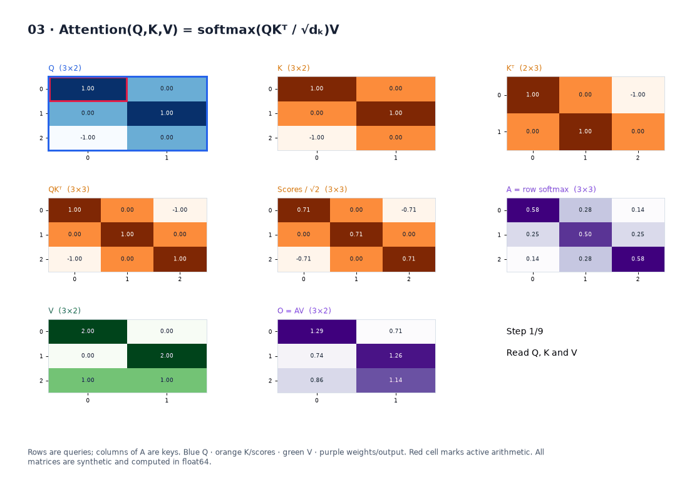
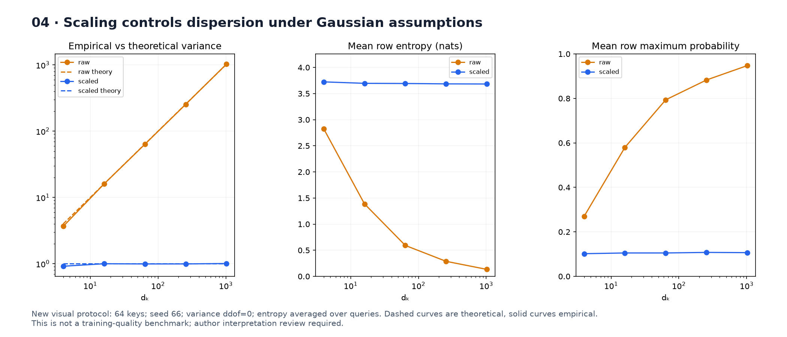

# Day 66 — Attention Mechanism

How do query–key scores become a contextual representation, and what does a
causal mask actually prevent? This study follows one single-head operation
from Q, K and V through scaled scores, row-wise softmax and a weighted sum.
It connects [static embeddings](../65-static-embeddings/) to the attention
blocks used in Transformers, without implementing a full Transformer.

For $Q\in\mathbb{R}^{n\times d_k}$, $K\in\mathbb{R}^{m\times d_k}$ and
$V\in\mathbb{R}^{m\times d_v}$:

$$
A=\operatorname{softmax}_{\text{keys}}\left(\frac{QK^T}{\sqrt{d_k}}+M\right),
\qquad O=AV.
$$

Queries request information, keys determine compatibility and values carry
the information mixed into the output. Every permitted row sums to one;
the output shape is $n\times d_v$. Self-attention uses the same source sequence
for all three projections; cross-attention can have different query/key lengths.
See [the original formulation and framework references](references.md).

## Inspect and run

- [from_scratch.py](from_scratch.py): NumPy float64 attention with explicit
  shape, finite-value and boolean-mask checks; `True` permits an interaction.
- [example.py](example.py): hand-specified vectors, value-only and future-token
  controls, a seeded scaling experiment and optional CPU PyTorch equivalence.
- [notes.md](notes.md): projections, scaling assumptions, masks, complexity,
  practical boundaries and a dated execution record.
- [tests/test_attention.py](tests/test_attention.py): numerical invariants,
  error cases and real PyTorch SDPA comparisons, including cross-attention.
- [interview_questions.md](interview_questions.md): explanations and engineering
  trade-offs tied to the mechanism.

From the repository root, in a Python 3.11+ environment:

```sh
python -m pip install -e ".[dev]"
python 05-transformers-llms/66-attention-mechanism/from_scratch.py
python 05-transformers-llms/66-attention-mechanism/example.py
```

The optional framework comparison and the complete topic tests require the
canonical `deep-learning` extra. No NLP extra, dataset download or GPU is needed.

```sh
python -m pip install -e ".[dev,deep-learning]"
python 05-transformers-llms/66-attention-mechanism/example.py --torch
python scripts/validate_repo.py tests --scope 05-transformers-llms/66-attention-mechanism
python scripts/validate_repo.py syntax
python scripts/validate_repo.py links
```

## What this establishes

The controlled vectors expose how changing V can change O without changing A,
and how causal masking blocks future K/V changes when earlier Q/K/V remain fixed.
The scaling experiment measures score dispersion and entropy for independent
Gaussian vectors. Its [dated results](notes.md#execution-record--2026-11-24)
keep observations separate from interpretation candidates. **Author review
required** for those interpretations.

Attention matters for context construction, sequence modeling and inference
costs. External retrieval selects evidence to supply to a model; internal
attention mixes the representations already available. A large attention
weight is neither calibrated confidence nor proof of causal importance.

All inputs are synthetic. There are no trained projections, semantic accuracy
claims or performance benchmarks. The reference is unbatched, materializes
scores/weights, has no gradients or dropout, and rejects fully masked rows.
It is educational code, not a production library replacement. The analytical
scripts print results only. The separate visual laboratory below generates
dated local exports and keeps its execution protocol distinct.

## Interactive visual laboratory

The [visual guide](VISUAL_LAB.md) connects matrix arithmetic, geometric matching,
probability, value mixing and sequence visibility in twelve experiments. Five
standalone HTML explorers recalculate numerical values as controls change;
GIFs expose actual computation stages and PNGs retain detailed comparisons.
Everything runs locally on Windows/CPU without credentials, services or a server.
All vector representations and projections are synthetic or deliberately designed.

Use the same canonical installation above; rendering needs only the base
dependencies, while the complete topic tests require `.[dev,deep-learning]`.
From the repository root:

```sh
python 05-transformers-llms/66-attention-mechanism/visualize_attention.py --list
python 05-transformers-llms/66-attention-mechanism/visualize_attention.py --quick
python 05-transformers-llms/66-attention-mechanism/visualize_attention.py --all
python 05-transformers-llms/66-attention-mechanism/visualize_attention.py --experiment geometry
python 05-transformers-llms/66-attention-mechanism/visualize_attention.py --experiment scaling
python 05-transformers-llms/66-attention-mechanism/visualize_attention.py --experiment softmax
python 05-transformers-llms/66-attention-mechanism/visualize_attention.py --experiment masking
```

Each run creates `outputs/runs/<UTC timestamp>/index.html`, a numerical
`run.json` and the selected artifacts. Open the gallery or any HTML directly;
Plotly is bundled, with no CDN or MathJax request. `--open` optionally opens
the gallery through the OS. Exports are ignored; previews are a separate,
intentional selection. See [the guide](VISUAL_LAB.md) for exact filenames.

| Experiment | What can be inspected or changed? | Formats |
|---|---|---|
| `projections` | Input rows × independent projection columns, partial products and Q/K/V dimensions | GIF |
| `geometry` | Query azimuth, elevation and magnitude; key magnitudes; angles, dot products, weights; real 3D camera | HTML, GIF |
| `pipeline` | Transpose, scores, scaling, row softmax, weighted sum and final output | GIF, PNG |
| `scaling` | Five Gaussian key dimensions: distributions, empirical/theoretical variance, entropy, maxima and softmax Jacobian | GIF, PNG |
| `softmax` | Individual logits, temperature, concentration presets, stabilized exponentials and reset | HTML, GIF |
| `values` | Normalized masses, weighted vectors, convex hull; fixed Q/K with changing V | HTML, two GIFs |
| `context` | Engineered river/finance features, bank input/output, token connections and attention matrices | HTML, GIF |
| `masking` | Full/causal/padding visibility, masked scores, row reveal, outputs and future-token intervention | Two GIFs, PNG |
| `cross` | Source/target origins and projections; square self-attention versus rectangular cross-attention | GIF, PNG |
| `heads` | Three intentionally different projection spaces, head outputs, concatenation and output projection | GIF |
| `complexity` | Pair counts, FP16/FP32 byte estimates, bounded CPU timing and theory-only memory control | HTML, GIF, PNG |
| `inference` | External cosine retrieval versus internal attention; prefill and prefix-validated KV cache reuse | Two GIFs |

The visual source is organized into [numerics](attention_lab.py),
[standalone explorers](attention_html.py), [matrix/vector renderers](attention_figures.py),
[sequence/inference renderers](attention_sequences.py) and the
[entry point](visualize_attention.py). The [visual numerical tests](tests/test_visual_core.py)
and [export tests](tests/test_visual_exports.py) complement the analytical suite.

The [visual execution record](VISUAL_LAB.md#visual-execution-and-preview-record)
documents actual runs and pending interpretation candidates. Gaussian scaling
assumptions, softmax derivative coordinates, fully masked-row policy, padding
query handling and timing scope are explicit there. Context features do not
demonstrate language understanding; heads have no learned specialization; the
RAG/KV diagrams contain calculated synthetic attention but no text-generating LLM.

## Selected previews

Follow the complete operation from Q/K/V to the contextual output:



Compare empirical score variance, entropy and concentration with dimensional
scaling under the stated Gaussian assumptions:



| Additional preview | Question |
|---|---|
| [Query–key alignment](outputs/previews/02_query_key_alignment.gif) | What changes across a complete query rotation with unit versus unequal key norms? |
| [Weighted value aggregation](outputs/previews/06_weighted_value_aggregation.gif) | How does a changing normalized mixture move inside a convex hull? |
| [Full versus causal attention](outputs/previews/08_full_vs_causal_attention.png) | How does visibility change weights and contextual outputs? |
| [Complexity and measured CPU time](outputs/previews/11_attention_complexity.png) | Which growth is theoretical, and which latency was actually measured? |

Only these six inspected assets are public candidates (2.32 MiB total).
The complete interactive laboratory is regenerated locally; the
[guide](VISUAL_LAB.md#visual-execution-and-preview-record) records run provenance,
preview selection, actual browser checks and remaining review boundaries.
