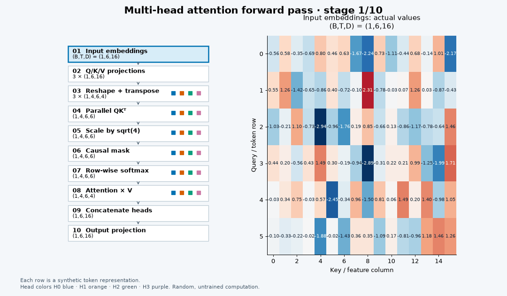

# Day 68 — Transformer Architecture II: Multi-Head Attention

Why use several attention distributions instead of one wider distribution?
Each head routes information using its own learned Q/K/V projections. The
outputs are concatenated and mixed by an output projection. Heads can retrieve
different combinations of values for the same query; they are not assigned
linguistic roles or guaranteed to learn complementary features.

This study isolates the mechanism introduced inside the
[Day 67 encoder-decoder](../67-transformer-architecture-i/), building on
[Day 66 scaled dot-product attention](../66-attention-mechanism/).
It connects head dimensions, projection storage, causal masking and explicit
attention-map memory to practical implementation decisions.

## Implementation and evidence

- [from_scratch.py](from_scratch.py): vectorized NumPy float64 forward pass with
  persistent weights, equal-width heads, stable softmax and boolean masks.
- [example.py](example.py): CPU PyTorch parity with identical projections,
  causal perturbation control and a fixed-width head/scaling sweep.
- [tests/test_multi_head_attention.py](tests/test_multi_head_attention.py):
  independent head-loop oracle, hand-computed routing/output mixing, framework
  agreement, padding, causality, numerical stability and invalid inputs.
- [notes.md](notes.md): equations, tensor shapes, computational trade-offs,
  MHA/GQA/MQA, KV cache estimates and dated execution evidence.
- [interview_questions.md](interview_questions.md) and [references.md](references.md):
  targeted questions and primary sources.

## Interactive visual learning lab

```powershell
python 05-transformers-llms/68-transformer-architecture-ii/visualize.py --all --show
python 05-transformers-llms/68-transformer-architecture-ii/visualize.py --quick --show
python 05-transformers-llms/68-transformer-architecture-ii/visualize.py --experiment subspaces
python 05-transformers-llms/68-transformer-architecture-ii/visualize.py --experiment scaling
python 05-transformers-llms/68-transformer-architecture-ii/visualize.py --experiment kv-cache
```

[visualize.py](visualize.py) creates an offline HTML gallery organized into ten
learning modules, covering all fifteen visual questions plus numerical checks.
Standalone Plotly documents provide 2D/3D controls; GIFs show computed stages
with PNG frame selectors for pausing and inspection. No Streamlit server,
network connection, model download or GPU is required.

The [visual guide](VISUAL_LAB.md) maps every artifact, control, equation and
limitation. [visual_core.py](visual_core.py) computes fixtures and controlled
experiments while reusing this study's forward pass;
[visual_figures.py](visual_figures.py), [visual_html.py](visual_html.py) and
[visual_controls.js](visual_controls.js) handle rendering and offline controls.
[Numerical visual tests](tests/test_visual_core.py) and
[real export tests](tests/test_visual_exports.py) complement the original suite.

Visual experiments use seed 168 and retain a separate dated record. Random
projection spaces, constructed retrieval examples, exact full-space geometry,
PCA approximations and theoretical serving calculations carry different evidence
labels. Full exports and reports stay ignored; selected previews are documented
in the guide. Interpretation review remains pending.



Selected companion previews: [projection subspaces](assets/02_representation_subspaces.gif),
[individual/average maps](assets/05_attention_heads.png) and
[head concatenation/output mixing](assets/11_head_concatenation.gif).
These previews are deliberately unignored; full interactive galleries regenerate locally.

Analytical inputs are **synthetic standard-normal vectors**; visual controls
also include explicitly constructed vectors and routing distributions. Weights
are randomly initialized and never trained. There are no pretrained models,
external datasets or API calls. Numerical agreement validates the tested
forward calculation; it does not measure language understanding or model quality.
Interpretation candidates in the execution record require **author review**.

## Run from the repository root

Use a stable Python 3.11+ environment with the canonical extras, if needed:

```powershell
python -m pip install -e ".[dev,deep-learning]"
python 05-transformers-llms/68-transformer-architecture-ii/from_scratch.py
python 05-transformers-llms/68-transformer-architecture-ii/example.py
python scripts/validate_repo.py tests --scope 05-transformers-llms/68-transformer-architecture-ii
```

The PyTorch example uses CPU float64 and one PyTorch thread. The default seed
is 68; `--seed` changes the controlled example. Each execution writes a new
UTC-stamped JSON file under ignored `outputs/`, including versions, configuration,
hypotheses, results, interpretation candidates and limitations. `--output PATH`
selects a new destination; an existing file is never overwritten. Results can
differ at floating-point precision across environments. See the
[dated execution record](notes.md#execution-record--2026-11-25) for the run actually inspected.

## Contracts worth checking

Inputs and outputs have shape `(B,T,D)`; maps retain `(B,H,T,T)`.
`D` must be divisible by `H`. Every projection sees all input dimensions before
reshape exposes the heads. Softmax normalizes keys independently for each query/head.
Concatenation preserves head outputs before the learned output mixing.

Both scripts use boolean **`True = blocked`**, matching
[`torch.nn.MultiheadAttention`](https://docs.pytorch.org/docs/2.15/generated/torch.nn.MultiheadAttention.html).
This differs from functional SDPA's boolean mask and Day 66's visibility mask.
The NumPy layer accepts a shared `(T,T)` or exact `(B,H,T,T)` blocked mask,
plus `(B,T)` key padding. Fully blocked rows raise an error. Padding masks
exclude keys; padded query outputs still need exclusion from downstream losses.

At fixed standard width, the four bias-free projections contain $4D^2$
parameters regardless of head count. Explicit maps grow as $BHT^2$ while
per-head width shrinks to $D/H$. More heads do not guarantee better quality.
Attention weights describe routing, not confidence or causal explanations.

This educational forward implementation is not a production library replacement.
It omits backpropagation, bias, dropout, cross-attention, mixed precision,
KV caching and optimized kernels. GQA/MQA and memory estimates are theory only.
No performance benchmark or trained-head specialization is claimed. The visual
lab includes untrained zero-head interventions; these are not evidence for
pruning a trained model. Trained-model follow-ups remain unexecuted.
