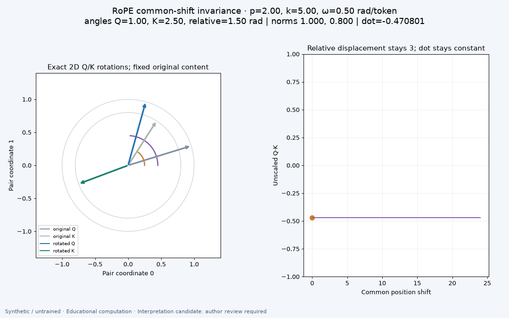

# Day 69 — Positional Encoding

[Module index](../README.md) · [Roadmap](../../ROADMAP.md)

**How does a Transformer distinguish token order when content-only self-attention
is permutation equivariant?** This study connects that symmetry to additive
sinusoidal vectors, learned absolute position tables, rotary query/key geometry
and distance biases in attention logits.

Position information matters for sequence modeling, cache offsets and evaluating
where evidence appears in a long prompt. A computable position index is not
evidence of reliable long-context reasoning.

## What is implemented

| File | Purpose |
|---|---|
| [from_scratch.py](from_scratch.py) | NumPy sinusoidal encoding, supplied absolute-table lookup, adjacent-pair RoPE and rectangular causal ALiBi bias; executable numerical checks |
| [example.py](example.py) | PyTorch untrained attention permutation controls; NumPy full-versus-cached RoPE attention with correct and deliberately reset position IDs |
| [notes.md](notes.md) | Derivations, conventions, trade-offs, dated measured results and proposed follow-ups |
| [tests/test_positional_encoding.py](tests/test_positional_encoding.py) | Scalar/block-matrix oracles, numerical identities, mask/offset controls, input errors and CLI execution |
| [interview_questions.md](interview_questions.md) | Questions about symmetry, relative geometry, extrapolation and inference |
| [references.md](references.md) | Original papers and the PyTorch API used here |

All inputs are **synthetic vectors**. No public dataset, tokenizer, model download,
training, service or credential is required. The absolute-table helper reads a
supplied array; it does not train positional embeddings. ALiBi slopes are explicit
teaching choices rather than the paper's automatic head-slope schedule.

## Run from the repository root

Python 3.11+. Dependency bounds belong to [pyproject.toml](../../pyproject.toml).
Use an isolated environment; NumPy alone supports the first command's script.
The complete example and tests also require the canonical PyTorch and test extras:

```powershell
python -m pip install -e ".[dev,deep-learning]"
python 05-transformers-llms/69-positional-encoding/from_scratch.py
python 05-transformers-llms/69-positional-encoding/example.py
python scripts/validate_repo.py tests --scope 05-transformers-llms/69-positional-encoding
python scripts/validate_repo.py syntax
python scripts/validate_repo.py links
```

Both scripts print JSON. To retain a new local run, pass a **new** output filename:

```powershell
python 05-transformers-llms/69-positional-encoding/example.py --output 05-transformers-llms/69-positional-encoding/outputs/2026-11-25-analytical.json
```

`outputs/` stays ignored; no generated asset is needed to read this study.
The CLI refuses to overwrite an existing record; use a different filename for subsequent runs.
See the [validation contract](../../docs/validation.md) for check boundaries.

## Interactive visual learning lab

The [visual guide](VISUAL_LAB.md) connects thirteen questions to offline
controls and scientific GIF/PNG exports: permutation symmetry, sinusoidal
frequencies/construction, exact and PCA geometry, vector addition, relative
similarity, absolute versus relative positions, RoPE planes, ALiBi, matched
attention mechanisms and numerical extrapolation. An optional RAG page shows
prompt construction and proposed evaluation metrics without invoking an LLM.

```powershell
python 05-transformers-llms/69-positional-encoding/visualizations.py --list
python 05-transformers-llms/69-positional-encoding/visualizations.py --quick
python 05-transformers-llms/69-positional-encoding/visualizations.py --demo rope --show
python 05-transformers-llms/69-positional-encoding/visualizations.py --all
```

Each execution writes a new ignored run folder with `index.html`, a numerical
report and local Plotly/JavaScript resources. Keep that folder together for
offline use. Default invocation only lists demonstrations; `--show` opens one
gallery. See the guide for controls, outputs and mathematical limitations.

The generator [visualizations.py](visualizations.py),
[numerical tests](tests/test_visual_core.py) and
[real-export tests](tests/test_visual_exports.py) are separate from the original
analytical scripts and their dated observations.

With original Q/K content fixed, a common shift rotates both absolute vectors
while preserving their rotary interaction:



Selected complementary previews: [sinusoidal widths on one scale](assets/positional_encoding_heatmap.png)
and [six mechanisms with matched projections/masking](assets/attention_mechanisms_comparison.png).
Full galleries and exploratory exports remain ignored; these three previews
are deliberately selected public candidates, subject to author review.

## Evidence and takeaways

The [2026-11-25 execution record](notes.md#execution-record--2026-11-25) reports
the actual configuration and observations. The content-only permutation error
was about $1.67\times10^{-16}$; assigning positions to fixed slots produced a
maximum difference of about $0.216$ after permuting content. Permuting content
and coordinates together restored equivariance to numerical tolerance.

- Unmasked attention is **equivariant**, not invariant. A fixed causal mask
  also changes the symmetry; it is not interchangeable with a distance encoding.
- Sinusoidal vectors have paired frequencies and useful offset identities.
  Adding them before learned projections does not make all attention scores
  functions of distance alone.
- RoPE rotates queries and keys. With their content held fixed, its interaction
  depends on relative displacement and preserves norms; individual scores need
  not decay monotonically with distance.
- Causal ALiBi adds a head-specific distance penalty **after** content-logit
  scaling. Future tokens still need masking.
- Correct position offsets matter when combining new queries with cached keys.
  The included cache check covers one synthetic attention layer only.

**Author review required:** interpretations remain candidates for manual review.
These are educational implementations and architectural controls, not replacements
for model libraries, trained-model benchmarks or production inference validation.
RAG evidence-position evaluation and context-extension training remain suggested
follow-ups, not executed experiments.
