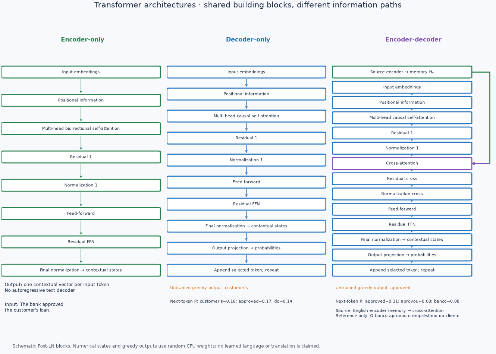
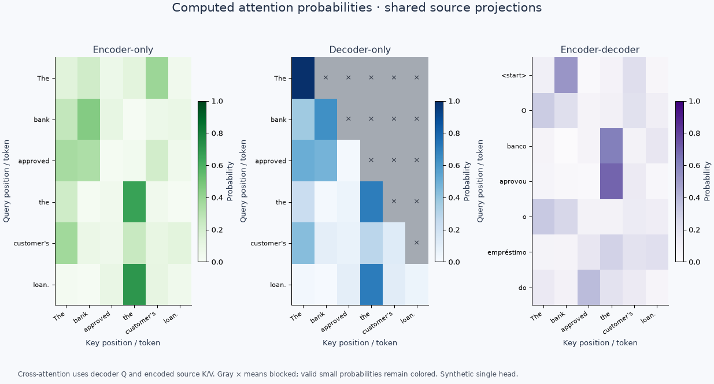
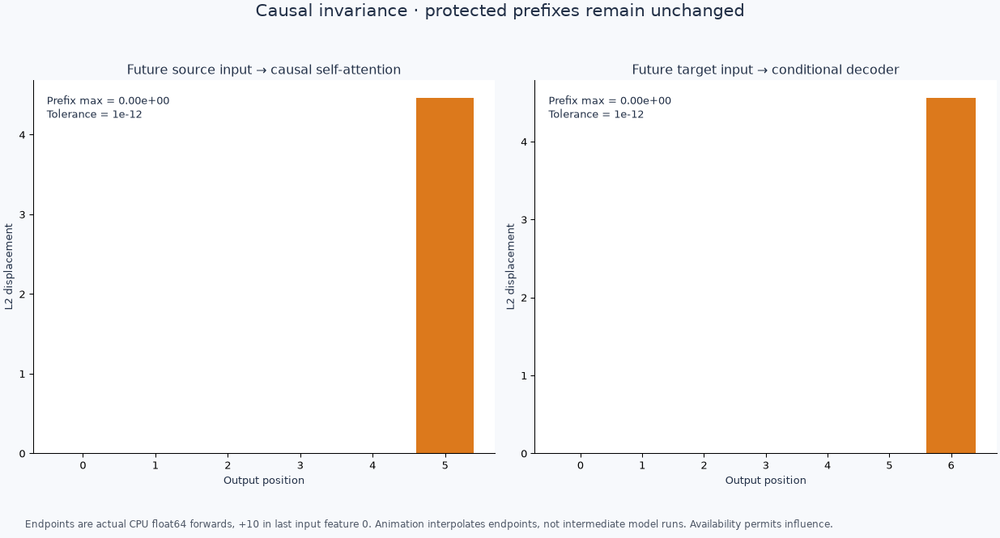
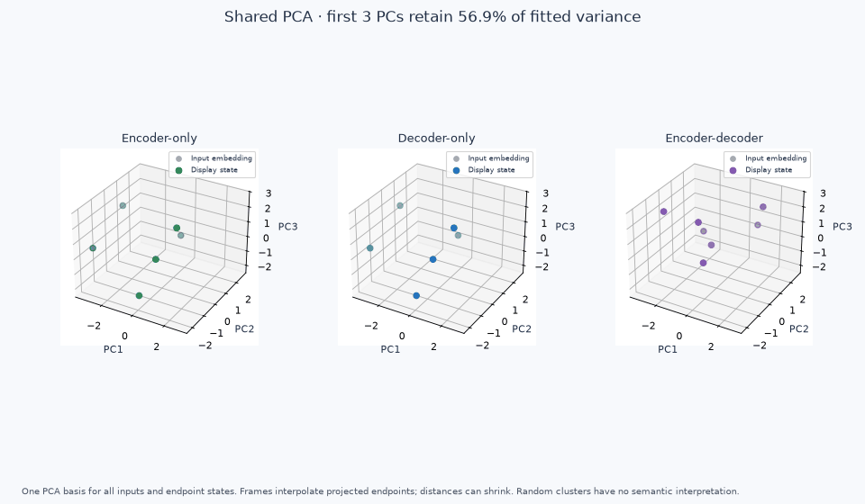

# Day 71 — Encoder-only, Decoder-only and Encoder-Decoder Models

[Module index](../README.md) · [Roadmap](../../ROADMAP.md)

Which tokens may influence a representation, and what is the model trained
to predict? These questions separate architecture, attention visibility and
learning objective when discussing BERT, GPT and T5-style systems.

| Family | Information flow | Representative pretraining | Candidate uses |
|---|---|---|---|
| Encoder-only, BERT-style | Bidirectional self-attention over valid input | Masked-token reconstruction; original BERT also used next-sentence prediction | Classification, entity labeling, retrieval after suitable embedding training, pair scoring |
| Decoder-only, GPT-style | Causal self-attention; no separate source encoder | Next-token prediction | Continuation, dialogue, code, prompted conditional generation |
| Encoder-decoder, T5-style | Bidirectional source, causal target, target-to-source cross-attention | Span corruption expressed as a target sequence | Translation, summarization, text-to-text classification |

These are starting points for evaluation, not quality rankings or exclusive
task assignments. A cross-encoder reranker usually uses joint self-attention
over a query-document pair; its name does not imply encoder-decoder cross-attention.

## Executable scope

- [from_scratch.py](from_scratch.py): NumPy visibility masks, single-head
  attention with rectangular source/target lengths, and shifted decoder inputs.
- [example.py](example.py): paired bidirectional/causal PyTorch blocks and an
  encoder-decoder information-flow experiment, including source padding.
- [tests/test_architectures.py](tests/test_architectures.py): prefix invariance,
  positive perturbation controls, padding isolation, NumPy/SDPA agreement,
  label alignment and invalid-input checks.
- [notes.md](notes.md): objectives, equations, engineering trade-offs,
  limitations and the dated execution record.
- [interview_questions.md](interview_questions.md) and [references.md](references.md):
  focused explanations and primary sources.

From the repository root, with dependencies from the canonical
[pyproject.toml](../../pyproject.toml):

```sh
python -m pip install -e ".[dev,deep-learning]"
python 05-transformers-llms/71-encoder-decoder-models/from_scratch.py
python 05-transformers-llms/71-encoder-decoder-models/example.py
python scripts/validate_repo.py tests --scope 05-transformers-llms/71-encoder-decoder-models
```

The scripts use synthetic vectors/IDs, run locally on CPU and print JSON.
The PyTorch example defaults to seed 71, float64 and one thread. It downloads
no weights or dataset. To retain a distinct new local record:

```sh
python 05-transformers-llms/71-encoder-decoder-models/example.py --seed 72 --output 05-transformers-llms/71-encoder-decoder-models/outputs/my_seed72_run.json
```

Existing output files are rejected. Generated records under `outputs/` remain
ignored. The separate visual laboratory below has a small curated preview set.

## Interactive visual laboratory

The [visual guide](VISUAL_LAB.md) maps nine groups to their mathematical
questions, operations, controls and limitations. It covers component flow,
computed attention/masks, bilingual cross-attention mechanics, token
interventions, shared-PCA geometry, pretraining objectives, toy autoregressive
generation, exact KV reuse, theoretical complexity and a synthetic RAG pipeline.
The same canonical installation command above supplies its dependencies.

```sh
python 05-transformers-llms/71-encoder-decoder-models/visualizations.py --quick
python 05-transformers-llms/71-encoder-decoder-models/visualizations.py --section attention
python 05-transformers-llms/71-encoder-decoder-models/visualizations.py --section geometry --no-gif --show
```

Open the generated `index.html` or an individual Plotly HTML directly in a
browser. HTML files embed Plotly and require no Python server or internet.
The default command generates all 31 visual artifacts in a new ignored dated
directory; `--section`, `--quick`, `--no-gif`, `--show` and `--output-dir` allow
bounded runs. Existing nonempty output directories are rejected.

The generator [visualizations.py](visualizations.py) shares computations from
[visual_experiments.py](visual_experiments.py), using
[visual_figures.py](visual_figures.py) for PNG/GIF and
[visual_html.py](visual_html.py) for interactive controls. The additional
[visual tests](tests/test_visual_lab.py) check invariants, computed plot data
and real temporary exports. Numerical fixtures and a manifest with library
versions are retained locally with each generated gallery.

To interpret the views, inspect visibility before weight magnitude. Gray
blocked cells differ from valid low-probability cells. Hover reports computed
scores and full-space displacements; the PCA view can shrink distances and
does not establish semantic clusters. Memory/complexity views are theoretical
counts, and RAG generation/response checking are conceptual. Toy probabilities
are not pretrained-model outputs. See the guide for the dated execution and
browser validation scope. **Author interpretation review remains pending.**

The 2026-11-25 quick run generated **12 PNGs, 11 multi-frame GIFs and 8 HTMLs**.
All 15 generator assertions passed. The focused topic suite passed **67 tests**
without skips or warnings. An eight-page Chrome 158 desktop audit exercised
152 scenarios without JavaScript errors or external requests; three Canvas2D
performance warnings were observed. This was loopback browser validation,
not GitHub rendering, cross-browser coverage or author approval.

### Selected visual previews

These four inspected exports are intentional Git candidates. Complete
galleries and numerical records remain ignored. This selection does not
approve scientific interpretations on the author's behalf.



The diagram distinguishes contextual encoder output from untrained greedy
continuations and gives the conditional decoder a separate source-memory path.



All probability scales span zero to one. Gray × cells are blocked; colored
cells remain valid even when their weights are small.



Both protected prefixes had exactly zero measured L2 change in the declared
synthetic run; positive effects elsewhere remain initialization-specific.



One shared PCA basis retains 56.92% of the fitted variance. Animated movement
interpolates computed endpoints; it does not show learning or semantic clusters.

## What the executed controls establish

In the [2026-11-25 record](notes.md#execution-record--2026-11-25), changing the
last source vector changed earlier bidirectional representations, while the
four earlier causal outputs had zero measured difference. All three target
outputs changed when the valid source changed. Changing the final target
input preserved earlier target outputs. Changing a source position designated
as padding preserved valid encoder outputs and all decoder outputs.

The decoder-only demonstration uses an encoder-layer primitive with a causal
mask: self-attention plus FFN, without cross-attention. These randomly
initialized blocks are **not implementations of pretrained BERT, GPT or T5**.
They omit tokenization, positional encoding, language-model heads, training,
generation and KV caching. No language quality, latency or model benchmark was
measured. **Interpretation candidates require author review.**

The useful distinction is between information that is forbidden and information
that is merely available: a permitted connection need not have a large learned
effect. Causal masking and shifted targets jointly protect autoregressive
training; source availability is a separate condition. Task-specific quality
and serving measurements are still needed to select an actual model.
