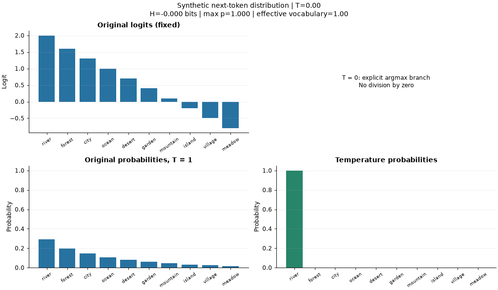
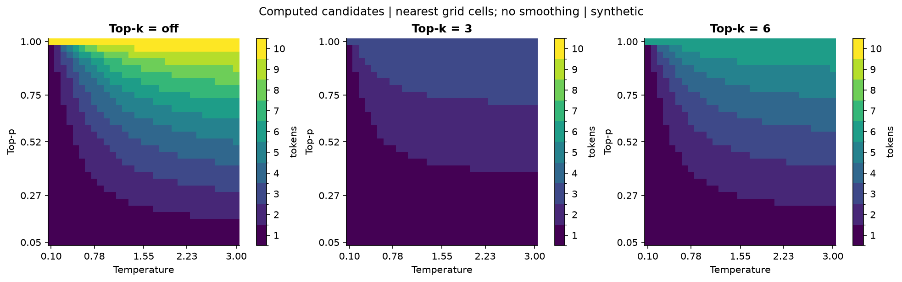
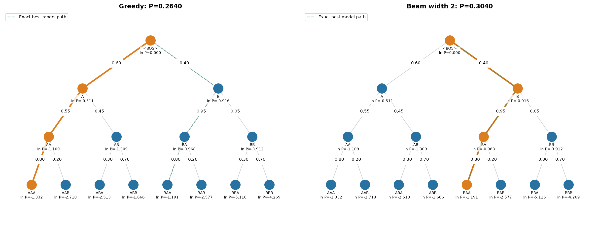

# Day 75 — LLM Inference and Decoding

How do next-token scores become an output sequence, and which parts of that
process can be controlled deterministically? This study separates the model's
conditional predictions, the decoding policy and the stopping conditions.
These distinctions matter when configuring extraction, RAG and conversational
systems: consistent token selection alone cannot establish factual correctness
or valid structured output.

The implementation uses **synthetic logits and handwritten transition models**.
It runs locally with NumPy, without pretrained weights, a GPU, credentials or
an external dataset. It is an educational reference, not a serving library.

## What is implemented

- Numerically stable temperature scaling, greedy selection, top-k and top-p.
- Explicit ordering: temperature → top-k → renormalize → inclusive top-p → sample.
- Stable index-based tie breaking and an explicit zero-temperature branch.
- A context-dependent generation loop with EOS, cross-fragment text stops and
  an output-token budget; returned token IDs distinguish work done from text shown.
- Seeded single-step sampling, filter interactions and controlled reproducibility.

| File | Purpose |
|---|---|
| [from_scratch.py](from_scratch.py) | Reusable NumPy decoder, generation contract and three-case demo |
| [example.py](example.py) | Four synthetic experiments with dated JSON provenance |
| [notes.md](notes.md) | Mathematics, stopping semantics, trade-offs and execution evidence |
| [tests/test_decoding.py](tests/test_decoding.py) | Numerical identities, boundaries, invalid inputs and context/stopping checks |
| [interview_questions.md](interview_questions.md) | Questions connecting mechanics to evaluation decisions |
| [references.md](references.md) | Original nucleus-sampling paper and official documentation |
| [VISUAL_LAB.md](VISUAL_LAB.md) | Nine-group visual lab, assumptions, provenance and review record |
| [visualizations.py](visualizations.py) | Single batch entry point for static figures, GIFs and offline Plotly surfaces |
| [visual_core.py](visual_core.py) / [visual_render.py](visual_render.py) | Shared experiments and headless exports |
| [interactive_demo.py](interactive_demo.py) | Python-backed playground, sequence search, stopping and cache exploration |
| [tests/test_visual_core.py](tests/test_visual_core.py), [tests/test_visual_rendering.py](tests/test_visual_rendering.py), [tests/test_interactive_demo.py](tests/test_interactive_demo.py) | Numerical protocols, temporary real exports and application controls |

## Run from the repository root

Python 3.11+; dependencies remain in the root [pyproject.toml](../../pyproject.toml).
The runtime needs NumPy; tests additionally use the `dev` extra.

```sh
python -m pip install -e ".[dev]"
python 05-transformers-llms/75-llm-inference-decoding/from_scratch.py
python 05-transformers-llms/75-llm-inference-decoding/example.py --seed 42 --samples 10000
python scripts/validate_repo.py tests --scope 05-transformers-llms/75-llm-inference-decoding
```

`example.py` creates a new UTC-stamped JSON under the topic's ignored `outputs/`.
It records versions, seeds, configurations, results, interpretation candidates
and limitations. Repeated runs preserve previous records. See the
[dated analytical record](notes.md#execution-record--2026-11-26) for observed
results and review boundaries; the visual experiment protocol is separate.

## Interactive visual laboratory

```sh
python 05-transformers-llms/75-llm-inference-decoding/visualizations.py --all
python 05-transformers-llms/75-llm-inference-decoding/visualizations.py --temperature --sampling
python -m streamlit run 05-transformers-llms/75-llm-inference-decoding/interactive_demo.py --server.address 127.0.0.1
```

The live controls expose logits, scaled logits, softmax, retained raw mass,
normalization, categorical draws and empirical frequencies. Other sections
explore computed parameter grids, exhaustive versus beam search, structured
output truncation, RNG state, convergence and cache accounting.

Nine export groups generate synchronized probability animations, unsmoothed
heatmaps, flat-tile 3D HTML surfaces, conditional generation trees and cache
diagrams. Each full run receives a new ignored directory with source/measurement
hashes and a gallery; HTMLs work offline without a CDN. The
[visual guide](VISUAL_LAB.md) gives individual commands, mathematical assumptions
and actual execution evidence. A few inspected previews are selected separately;
full exports and experiment JSONs remain ignored.

Production implications are bounded: output caps can truncate a structured
response, filter order changes retained mass, and RNG replay differs from shared
state. The cache plots use explicit theoretical work/storage assumptions plus
a one-layer numerical check; they do not measure serving latency. No real-model
or optional pretrained-model experiment is claimed. Interpretations and final
publication require human review; root README evidence updates remain pending.

### Selected previews

Temperature changes concentration while the original logits stay fixed. The
animation includes an explicit greedy frame and reports entropy, maximum
probability and effective vocabulary from the calculated distribution.



Candidate counts change discretely with temperature and top-p; preceding top-k
changes the mass used by the nucleus filter. Every displayed cell is calculated.



On the fixed depth-3 tree, greedy chooses AAA with model probability 0.264;
beam width 2 finds BAA with probability 0.304, matching exhaustive enumeration.
Node labels show cumulative natural-log probabilities. This constructed example
does not rank factual accuracy or human preference.



These three byte-preserved previews total 1,087,974 bytes. Other exports remain
local. Source runs, measured sampling errors, RNG comparisons and review limits
are recorded in the [visual execution record](VISUAL_LAB.md#execution-and-review-record).

## Reading the behavior correctly

Temperature changes concentration, not the ranking of finite logits at positive
temperature in exact arithmetic. Top-k limits candidate count; top-p retains
enough cumulative mass, including the threshold-crossing token. Applying top-p
after top-k means its threshold refers to the already filtered distribution.

A token budget is an upper bound. In this loop, EOS and stop-triggering tokens
consume budget even when their text is hidden. A stop may span multiple synthetic
fragments, and can cut inside one fragment. This is a non-streaming string
contract, not a real tokenizer's decoding or a schema constraint.

Greedy selection and repeated seeded sampling are reproducible within the
controlled local fixtures. They do not establish cross-platform or hosted-model
determinism. Synthetic entropy, frequency agreement and candidate counts do not
measure hallucination, reasoning, language quality, latency or cost.
**Interpretation candidates require author review.**

[Module index](../README.md) · [Previous: fine-tuning and alignment](../74-fine-tuning-alignment/)
