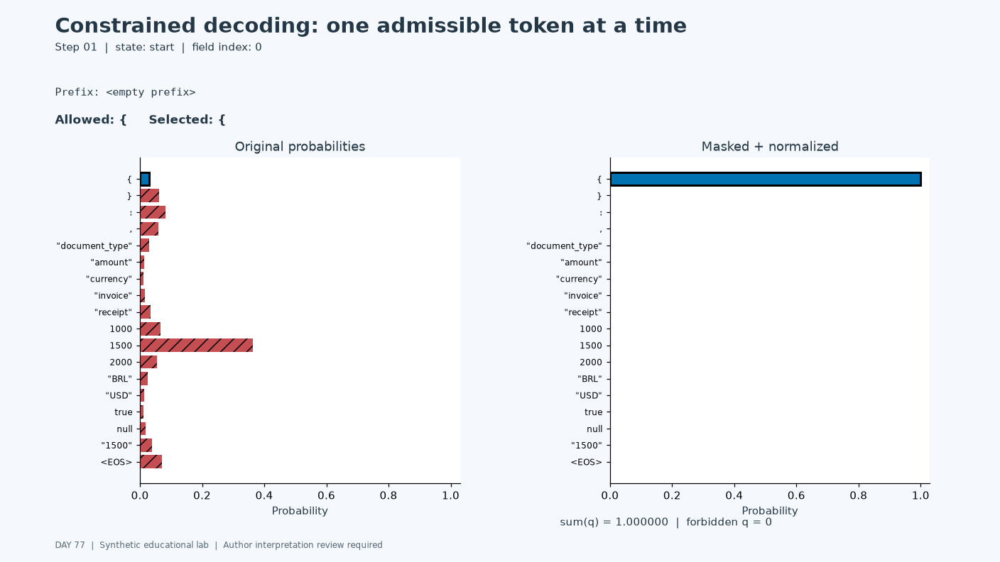
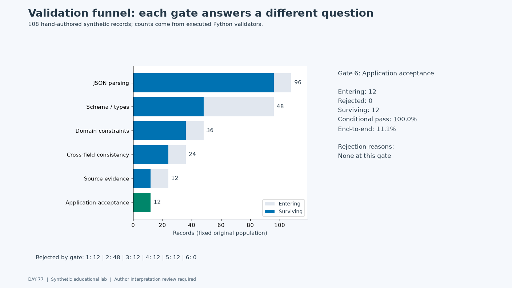

# Day 77 — Structured Outputs

When can an application consume an LLM response? Valid JSON provides a readable
representation. A schema adds a contract; business rules and source checks add
different evidence. None grants permission to execute an action.

This study builds an **offline synthetic invoice pipeline** with strict Pydantic
v2 validation, explicit failure stages and a bounded retry controller. A separate
NumPy example shows how an admissibility mask changes next-token probabilities.
No model, external dataset, API key or network connection is used at runtime.

## What is implemented

| File | Technical question |
|---|---|
| [example.py](example.py) | How do strict parsing, a versioned contract, arithmetic and a synthetic reference gate acceptance? |
| [from_scratch.py](from_scratch.py) | How are forbidden tokens removed and remaining probabilities normalized? |
| [visualizations.py](visualizations.py) / [VISUAL_LAB.md](VISUAL_LAB.md) | Thirteen demonstrations: toy grammar, token masking, actual validation gates, strictness, retry mathematics/simulation and execution guardrails. Six GIFs, four PNGs and eight offline HTMLs. |
| [visual_core.py](visual_core.py), [visual_render.py](visual_render.py), [visual_html.py](visual_html.py), [visual_controls.js](visual_controls.js) | Separate calculations, static export and standalone interactive controls. |
| [notes.md](notes.md) | What do schemas, local token masks, retries and guardrails establish or leave unresolved? Includes the dated execution record. |
| [tests/test_structured_outputs.py](tests/test_structured_outputs.py) | Do invalid inputs fail, terminal conditions stop and budgets hold? Are masking invariants preserved? |
| [tests/test_visual_core.py](tests/test_visual_core.py), [tests/test_visual_rendering.py](tests/test_visual_rendering.py) | Do grammar states, simulation/formula agreement and real temporary exports satisfy their contracts? |
| [interview_questions.md](interview_questions.md) | How would these decisions be explained and extended in an engineering interview? |
| [references.md](references.md) | Which primary sources support the contract and parsing choices? |

The invoice uses integer cents and an explicit currency. Its required
`purchase_order` field accepts `null` to represent an unavailable order reference;
omitting that field is a contract failure. Money fields require known values;
incomplete financial records must be routed for review rather than filled with
zeros. This intentionally narrow schema does not model every invoice.

## Run from the repository root

Use Python 3.11+ and the canonical `nlp` extra, which includes Pydantic:

```bash
python -m pip install -e ".[dev,nlp]"
python 05-transformers-llms/77-structured-outputs/example.py
python 05-transformers-llms/77-structured-outputs/from_scratch.py
python scripts/validate_repo.py tests --scope 05-transformers-llms/77-structured-outputs
python scripts/validate_repo.py syntax
python scripts/validate_repo.py links
```

The example prints its generated JSON Schema, configuration and attempt history.
Use `example.py --save` to write a uniquely dated JSON under the topic's ignored
`outputs/` directory. Scripts resolve output paths from their own location and
also run outside the repository working directory.

## Acceptance and recovery

1. Reject refusals and incomplete response envelopes before inspecting content.
2. Parse a complete JSON value; reject duplicate keys, non-finite numbers,
   Markdown fences and trailing prose. Enforce a 16,384-character response limit.
3. Validate required fields, strict types, bounds, literals and extra fields.
4. Check `subtotal_cents + tax_cents == total_cents` in deterministic code.
5. Compare every field with a known synthetic reference.

Only parsing, schema and arithmetic failures can trigger another attempt.
Feedback contains a fixed stage/error code. Reference mismatch, response-size
failure, refusal and incomplete output terminate; unexpected callback exceptions
propagate. The budget counts **total calls**, including the first one.

In the executed demonstration, the scripted repair sequence was accepted on
call four; a fabricated but arithmetically consistent record was rejected on
call one. Repeated schema failures consumed exactly four calls. Refusal and
incomplete envelopes each stopped after one. These are controller checks on
hand-authored fixtures, not measured LLM recovery rates. Full configuration,
results and interpretation candidates appear in the
[execution record](notes.md#execution-record--2026-11-26).

## Takeaways and limits

- Separate syntax, contract compliance, internal consistency and source fidelity.
- A generated JSON Schema does not encode the arithmetic or reference checks.
- Strict application types can be narrower than JSON Schema numeric semantics.
- The analytical constrained softmax teaches probability redistribution, without building
  a tokenizer, JSON grammar, prefix-state machine or complete constrained decoder.
  The separate visual lab adds a restricted finite-state toy grammar; it is not
  a general nested JSON decoder or a commercial model implementation.
- A reference oracle exists here because the data are synthetic. It is neither
  an OCR pipeline nor a general grounding verifier available during inference.
- Retries require a failure policy and finite budgets. Real transport recovery,
  deadlines, cost limits, authorization, idempotency and monitoring need separate
  implementation and evaluation.

**Author review required:** the interpretation candidates remain pending.
Passing software tests does not establish real extraction accuracy, provider
compatibility, injection resistance, production readiness or author approval.

[Module index](../README.md) · [Previous: prompt engineering](../76-prompt-engineering/)

## Explore the visual companion

```powershell
python 05-transformers-llms/77-structured-outputs/visualizations.py --all
python 05-transformers-llms/77-structured-outputs/visualizations.py --demo masking --preview --show
```

Open the generated local `index.html` to explore the complete lab. Each HTML
embeds Plotly and runs without a server. The guide explains
[the controls, assumptions and dated results](VISUAL_LAB.md). The original
five-sequence analytical run and the 108-record visual experiment are separate
configurations. The Monte Carlo uses seed 777 and 100,000 synthetic requests
per model; it does not estimate real LLM performance.

The four inspected public previews answer distinct questions:

| Preview | What it establishes visually |
|---|---|
| [Constrained decoding](assets/constrained_decoding.gif) | A prefix changes the grammar state, the permitted tokens and the sampled continuation. |
| [Validation funnel](assets/validation_funnel.png) | Actual gate counts distinguish parsing, types, domain, arithmetic and reference evidence. |
| [Retry reliability surface](assets/retry_reliability_surface.png) | Theoretical reliability depends jointly on per-attempt success and integer total-call budget. Generate its standalone HTML to rotate and inspect contours. |
| [Guardrails pipeline](assets/production_guardrails_pipeline.gif) | A structurally valid tool proposal can still fail evidence or authorization; recoverable failures and exhausted budgets take different routes. |





The larger guardrails animation is linked instead of embedded. Full galleries,
interactive HTMLs and experimental records remain ignored. See the guide's
[curation and verification record](VISUAL_LAB.md#selected-previews-and-final-verification)
for sizes, assumptions and the scope of browser checks.
